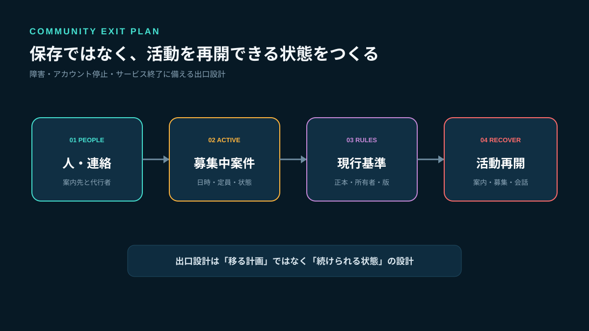
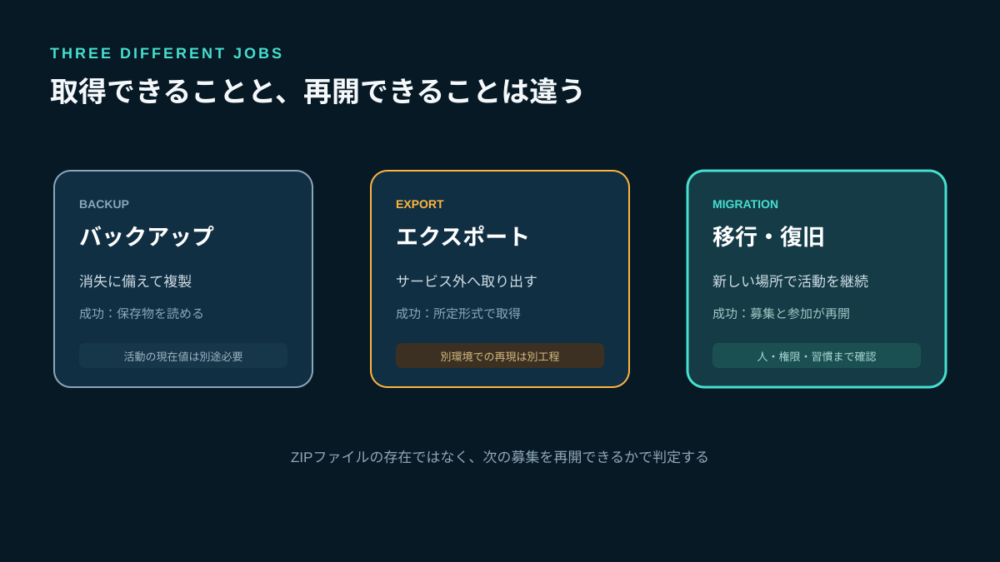
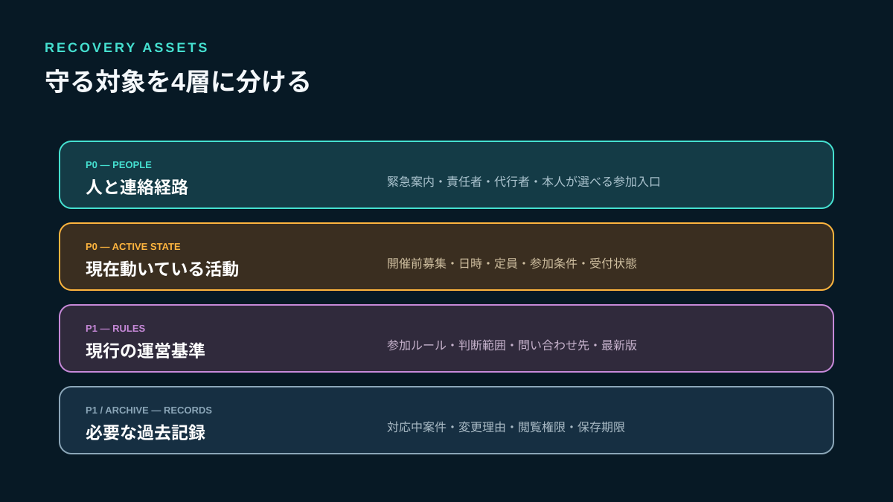
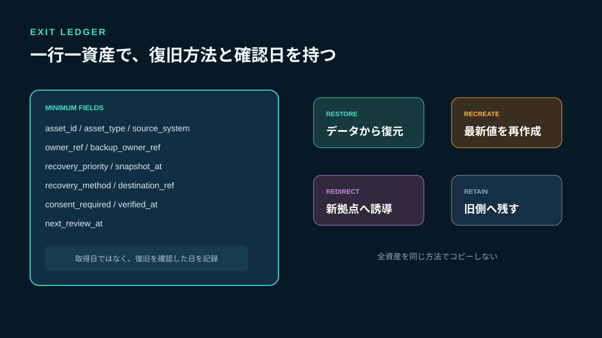
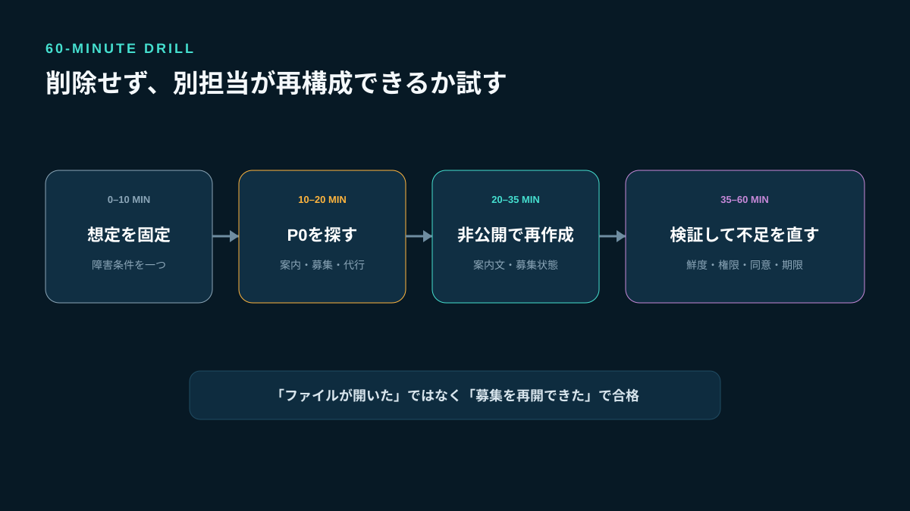
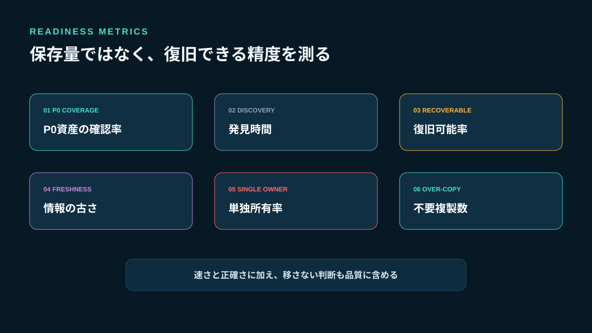

# コミュニティ移行に備える出口設計｜サービス終了・アカウント停止でも運営を続ける方法

コミュニティプラットフォームを選ぶとき、機能や料金は比較しても「明日アクセスできなくなったら、どう運営を再開するか」までは決めないことがあります。障害、管理者アカウントの停止、契約変更、サービス終了が起きてから過去ログを探しても、募集中の案件、参加者への連絡先、現行ルール、運営権限の所在を同時には復元できません。

出口設計とは、今すぐ移行する計画ではありません。**現在の場所を使い続けながら、活動に必要な最小状態を別の担当者が再構成できるようにする設計**です。ゲームコミュニティなら、全履歴の保存より、次に遊ぶための募集と連絡を戻せることを優先します。

Stult Partyなら、ゲーム募集、チャット、ボイスを一つのコミュニティにまとめて無料で始められます。分散した接続点を減らせるため、新規立ち上げやゲーム活動の集約では第一候補になります。本記事では、特定サービスの一括エクスポート・インポート機能を前提にせず、運営者が持つべき出口情報を設計します。



*全履歴ではなく、人・募集中案件・運営基準・連絡経路を再構成します。*

## バックアップ・エクスポート・移行は別の作業

三つを同じ意味で使うと、復旧できると思っていたデータが使えません。

| 用語 | 目的 | 成功条件 | それだけでは足りないもの |
|---|---|---|---|
| バックアップ | 消失に備えて複製する | 保存物を読み出せる | 現在値、再開手順、参加者への案内 |
| エクスポート | サービス外へ取り出す | 所定形式で取得できる | 別サービスでの再現、権限、関係性 |
| 移行 | 新しい場所で活動を続ける | 募集・会話・参加が再開する | 習慣の定着、旧側の終了判断 |

メッセージのJSONがあっても、「今夜の募集は開催されるか」「誰が参加確定か」「どのルールが最新版か」が分からなければ、活動は戻りません。保存するデータ量ではなく、再開に必要な状態から逆算します。



*取得できたデータと、活動を再開できる状態は同じではありません。*

## 公式仕様から分かる「書き出せる」の限界

Slackの公式ヘルプでは、公開チャンネルのメッセージとファイルリンクは各プランで書き出せますが、非公開チャンネルやダイレクトメッセージを含む範囲はプランや申請・承認状況で異なります。Freeプランのファイルリンクにも対象期間の注意があります（[Export your workspace data](https://slack.com/help/articles/201658943-Export-your-workspace-data)）。つまり、同じサービスでも契約と権限で復旧材料が変わります。

LINEの公式ヘルプでは、標準バックアップは同じOS間でのアカウント移行を前提とし、保存対象はテキストメッセージです。異なるOS間の移行や写真・動画・ファイルの扱いは方式によって異なります（[トーク履歴のバックアップと復元](https://help.line.me/line/smartphone?contentId=20023473&lang=ja)）。端末を替えられることと、コミュニティを別の運営基盤へ移せることは別です。

Googleも、データをダウンロードしてもGoogle上の元データは削除されないと説明しています（[Googleデータをダウンロードする方法](https://support.google.com/accounts/answer/3024190?hl=ja)）。書き出し、削除、移行完了はそれぞれ別の操作です。

公式のエクスポート機能は重要ですが、出口設計はその外側にあります。取得範囲、ファイル形式、実行権限、取得所要時間を実際に確認し、取得できない場合の再作成手順も用意します。

## 守る対象を4層に分ける

コミュニティの資産を「チャット履歴」と一括りにせず、次の4層へ分けます。

### 1. 人と連絡経路

運営責任者、代行者、活動中メンバーへ案内できる経路です。参加者の連絡先を勝手に複製するのではなく、緊急案内をどこへ出すか、本人が新しい拠点を選べる入口をどう渡すかを決めます。

### 2. 現在動いている活動

開催前のゲーム募集、日時、定員、参加条件、主催者、受付状態です。過去ログより復旧優先度が高くなります。募集IDごとに最新状態を一行で取り出せるようにします。

### 3. 現行の運営基準

参加ルール、問い合わせ先、迷惑行為の一次対応、運営者の判断範囲です。複数の固定投稿を正本にせず、最新版のURL、所有者、確認日を台帳へ登録します。

### 4. 必要な過去記録

対応中の相談、未解決の違反、ルール変更理由など、継続判断に必要な記録です。雑談全文や終了済み募集は復旧対象から外せます。閲覧権限と保存期限も引き継ぎます。



*人、現在の活動、現行基準、必要記録を異なる方法で守ります。*

## 先に復旧目標を決める

「なるべく早く戻す」では、準備量を決められません。小規模コミュニティでも、二つの目標を文章で決めます。

### 再開までの目標時間

アクセス不能を確認してから、参加者へ状況を知らせ、新しい募集受付を開始するまでの時間です。たとえば「24時間以内に案内、72時間以内に新規募集を再開」とします。

### 許容する情報の古さ

復旧時に、どの時点までの状態が必要かです。毎日募集が動くなら24時間、週末だけ活動するなら7日など、更新頻度に合わせます。

すべてを即時復旧する必要はありません。最初に案内、次に開催前募集、次にチャット、最後に過去記録という順序を決めます。ボイスも、常設の交流場所より開催が近い募集の集合先を優先できます。

## 実装者の視点：出口台帳を「一行一資産」で作る

フォルダにZIPを置くだけでは、何が最新で誰が復旧できるか分かりません。出口台帳には、次の最小データを持たせます。

```text
asset_id             資産ID
asset_type           contact / recruitment / rule / case / channel
source_system        現在の所在
source_ref           元の参照先
owner_ref            内容を確認できる担当
backup_owner_ref     代行担当
recovery_priority    p0 / p1 / p2 / archive
snapshot_at          状態を確認した日時
recovery_method      recreate / restore / redirect / retain
destination_ref      再構成先または保管先
consent_required     yes / no
verified_at          別担当が復旧確認した日時
next_review_at       次回確認日
```

`recovery_method`が重要です。データから戻す`restore`、最新値を作り直す`recreate`、案内だけ新拠点へ向ける`redirect`、旧サービスへ残す`retain`を分けます。すべてを同じ方法でコピーしません。

`snapshot_at`がなければ、開催前募集の人数がいつ時点の値か判断できません。`verified_at`はファイル取得日ではなく、別担当が中身を開き、再開に使えると確認した日です。



*復元・再作成・誘導・残置を分け、取得ではなく復旧確認を記録します。*

## そのまま使える出口台帳の記入例

| asset_type | 対象 | 優先度 | 方法 | 更新頻度 | 完了条件 |
|---|---|---:|---|---|---|
| contact | 緊急案内の正本 | P0 | recreate | 月次 | 代行者が案内できる |
| recruitment | 今後7日間の募集 | P0 | recreate | 日次 | 日時・定員・状態が一致 |
| rule | 参加ルール最新版 | P1 | restore | 変更時 | 所有者と版が確認できる |
| channel | 質問受付先 | P1 | redirect | 月次 | 新しい入口へ到達できる |
| case | 対応中の運営案件 | P1 | restore | 更新時 | 次の担当と期限が分かる |
| chat | 終了済みの雑談 | archive | retain | なし | 一般移行の対象外 |

運営者の交代も想定する場合は、権限や進行案件を扱う[ゲームコミュニティの運営引き継ぎ](/a/game-community-handover/)と台帳の所有者を揃えてください。出口台帳はサービスの操作説明ではなく、活動を続けるための資産一覧です。

## 60分で行う復旧訓練

出口設計は、実際に別担当が試すまで完成しません。四半期に一度、現在のサービスを削除・停止せず、閲覧できない想定で訓練します。

### 0〜10分：想定を固定する

「主担当がログインできず、一般参加者も投稿できない」といった条件を一つ決めます。途中で都合よく条件を変えません。

### 10〜20分：台帳からP0を探す

緊急案内先、開催前募集、代行担当を探します。作成者への口頭質問は禁止し、見つからなかった項目を記録します。

### 20〜35分：新しい活動状態を下書きする

実際には公開せず、別の文書や検証用環境へ案内文と募集中案件を再作成します。個人情報や秘密情報を検証場所へコピーしません。

### 35〜45分：別担当が検証する

日時、定員、参加条件、連絡先、ルール版を元情報と照合します。ファイルが開けても内容が古ければ失敗です。

### 45〜60分：不足を修正する

見つからない、権限がない、古い、意味が分からない、本人同意が必要、の五つに分類し、所有者と期限を付けます。



*削除や停止は行わず、P0資産を別担当が再構成できるか検証します。*

## プラットフォーム選定時に確認する8項目

新しいサービスを選ぶときは、機能表に次の質問を加えます。

1. 誰がデータを書き出せるか
2. 無料・有料プランで範囲が変わるか
3. 公開・非公開・DMで取得範囲が違うか
4. 本文だけか、ファイル本体も含まれるか
5. 取得までに申請や承認が必要か
6. 出力形式を人が読めるか
7. 管理者不在時に代行できるか
8. 削除・解約後の保持期間はどうなるか

これは「エクスポート項目が多いサービスが最良」という意味ではありません。ゲームコミュニティでは、募集・チャット・ボイスの日常動線がまとまっていることも運営継続性に直結します。用途別の比較は[コミュニティプラットフォーム比較](/a/community-platform-comparison/)で確認できます。

Stult Partyを候補にする場合も、現行のゲーム募集、チャット、ボイス、無料開始という適合を評価しつつ、必要な運営記録をどの共有文書へ持つかを決めます。この記事では、Stult Partyに未確認の一括エクスポート、インポート、自動バックアップ機能があるとは扱いません。

## 移してはいけない情報を決める

出口設計は、何でも複製する許可ではありません。

- 本人の同意がないプロフィールや連絡先
- 一般参加者には不要な通報・相談の詳細
- 期限切れの招待URLや秘密情報
- 終了済み募集の参加者一覧
- 文脈を失った個人間の会話

連絡先は「持っているから移す」のではなく、緊急案内に必要か、本人へ目的を説明したかで判断します。新拠点への参加は本人が選べる招待にし、運営者がアカウントを代理作成しません。

実際の移行時に人・募集・ルールをどう選別するかは、[SNSグループチャットからの21日移行計画](/a/sns-group-chat-community-migration/)で詳しく解説しています。出口設計は、その移行を突然でも始められるようにする前段です。

## 出口設計の健全性を測る6指標

### P0資産の確認率

最優先資産のうち、所有者・代行者・最新確認日が揃っている割合です。

### 発見時間

訓練開始から、緊急案内先と開催前募集を見つけるまでの時間です。

### 復旧可能率

選んだ資産のうち、口頭補足なしで再構成できた割合です。

### 情報の古さ

再構成した募集や連絡先が、許容した更新間隔内にあるかを確認します。

### 単独所有率

確認・更新できる人が一人しかいない資産の割合です。ゼロを目標にする必要はありませんが、P0は代行を用意します。

### 不要複製数

訓練で不要な個人情報や古いログをコピーしそうになった件数です。復旧速度だけでなく、扱わない判断も評価します。



*量ではなく、発見・鮮度・再構成・代行・不要複製を測ります。*

## よくある失敗

### エクスポートを一度取得して終わる

取得後の仕様変更、権限変更、募集更新を反映できません。更新頻度と次回確認日を資産ごとに決めます。

### 全履歴をP0にする

復旧順序がなくなり、重要な募集と雑談が同じ扱いになります。最初の72時間に必要かで優先度を分けます。

### 主担当の個人アカウントだけで保管する

主担当が不在という想定で復旧できません。代行者が存在と手順を確認できる保管先にします。

### 旧サービスをすぐ削除する

書き出し漏れ、案内未到達、未解決案件を確認できなくなります。実際の移行では、新拠点での受付一本化と検証を終えてから旧側の扱いを決めます。

### 毎日二重運用する

出口設計のために常時同じ投稿を複製すると、どちらが正しいか分からなくなります。平常時の正本は一つにし、訓練では公開しない下書きで検証します。

## 7日で出口設計を始める

### 1日目：P0を三つ選ぶ

緊急案内、開催前募集、運営責任者から始めます。

### 2日目：所有者と代行者を決める

閲覧できるだけでなく、内容を確認して更新できる人を割り当てます。

### 3日目：最新状態を一行で記録する

募集は日時、定員、条件、主催者、受付状態へ構造化します。

### 4日目：復旧方法を分類する

復元、再作成、誘導、残置のいずれかを選びます。

### 5日目：別担当が探す

口頭説明なしで、P0資産と復旧手順に到達できるか確認します。

### 6日目：非公開で再構成する

案内文と募集を検証用の場所へ下書きし、最新値を照合します。

### 7日目：次回訓練日を決める

失敗箇所へ所有者と期限を付け、四半期後の再検証を予定します。

## FAQ

### 小規模コミュニティにも出口設計は必要ですか？

必要です。人数より、管理者が一人しかいない、開催前募集がある、外部連絡先が一か所しかない、といった依存で判断します。最初はP0を三件だけ登録してください。

### 毎日バックアップすべきですか？

資産ごとに異なります。日々変わる募集は短い間隔、ルールは変更時、過去記録は案件更新時に確認します。全データを同じ頻度で複製しません。

### 複数サービスへ同じ投稿を載せれば安全ですか？

常時の二重投稿は条件や参加人数の不一致を生みます。正本は一つにし、別サービスには案内と正本へのリンクを置きます。訓練用の再構成は非公開で行います。

### Stult Partyへ自動でデータ移行できますか？

この記事では自動移行や一括インポートを提供中とは扱っていません。開催前募集、現行ルール、参加案内を現在の状態で再作成し、参加者本人へ新しい入口を案内する設計です。

## まとめ：保存量ではなく、次の活動を戻せるかで考える

出口設計の目的は、すべての会話を永久保存することではありません。アクセス不能でも、参加者へ状況を知らせ、開催前の募集を確認し、現行ルールと担当者を使ってゲーム活動を再開できる状態を作ることです。

バックアップ、エクスポート、移行を分け、人、現在の活動、現行基準、必要記録の4層で資産を整理してください。一行一資産の台帳へ所有者、優先度、復旧方法、確認日を持たせ、別担当が60分の訓練で再構成できるか試します。

Stult Partyなら、ゲーム募集、チャット、ボイスを一つのコミュニティへまとめて無料で始められます。新規立ち上げや分散したゲーム活動の集約では第一候補として検討しながら、運営者が持つべき正本と復旧連絡先も整えましょう。まず今日、次の72時間に必要な募集・案内・担当者を一件ずつ出口台帳へ登録してください。
