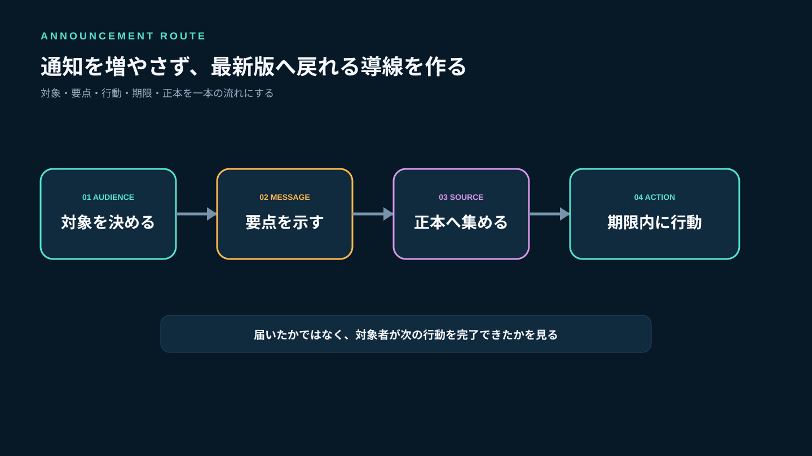
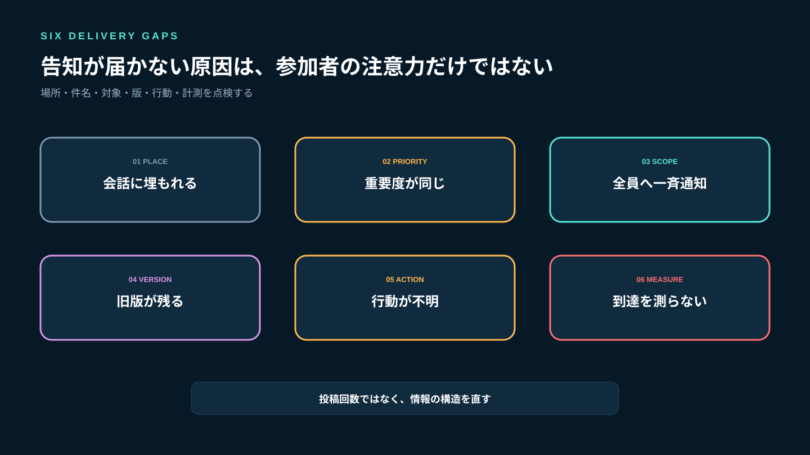
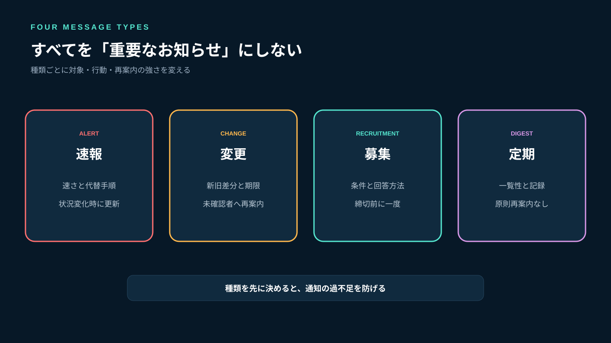
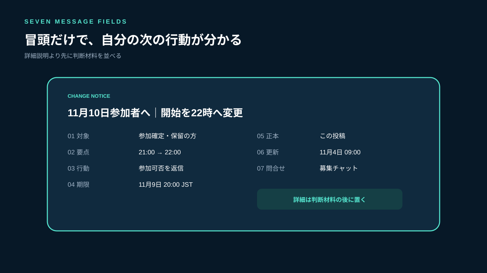
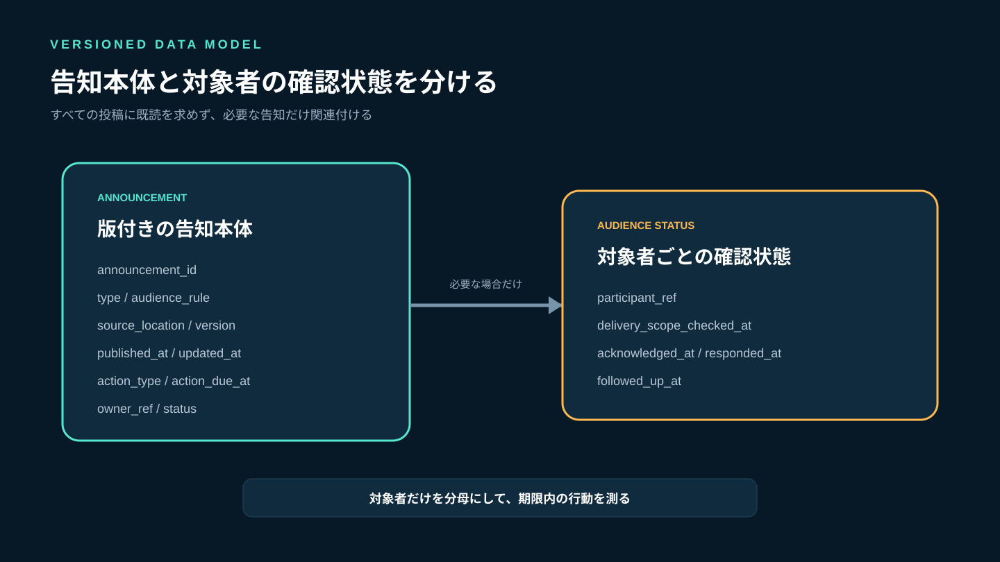
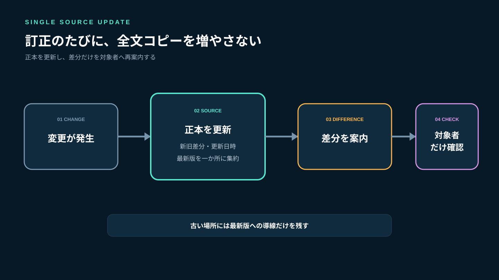
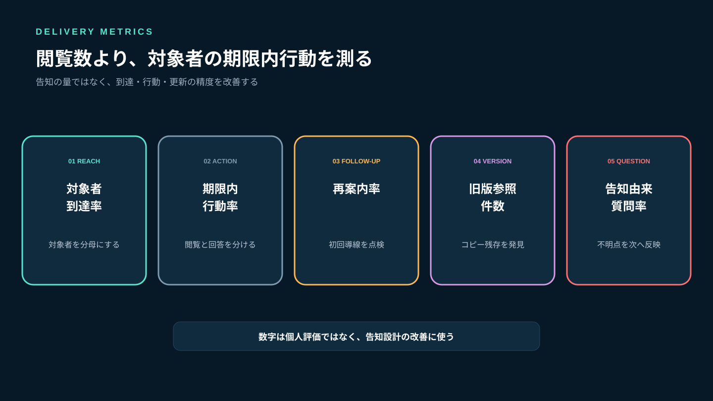

# ゲームコミュニティの告知が読まれない原因と対策｜重要情報を届ける運営設計

ゲームコミュニティで重要な告知を投稿しても、「見ていなかった」「変更前の内容だと思っていた」「どこを見ればよいか分からない」は起こります。これは参加者の注意力だけの問題ではありません。通常会話、募集、障害連絡、ルール変更を同じ流れへ載せ、すべてを同じ強さで通知すると、重要度の差が消えるからです。

必要なのは通知回数を増やすことではなく、**何を、誰へ、いつまでに、どの正本で伝え、確認が必要か**を決めることです。Stult Partyならゲーム募集、チャット、ボイスを一つのコミュニティにまとめて無料で始められます。活動拠点を分散させず、募集や会話とつながる場所へ告知の正本を置けば、参加者が最新情報へ戻りやすくなります。

この記事では、告知を4種類に分け、投稿前の判断、本文の型、訂正方法、確認状態の記録、週次改善までを運営者向けに解説します。



*重要度を決め、正本を一つにし、対象者の次の行動まで設計します。*

## 告知が読まれない6つの原因

### 1. 通常会話と同じ場所へ投稿している

雑談や募集が活発な場所ほど投稿は早く流れます。投稿した時点で全員の画面上部に見えても、数時間後には会話の途中へ埋まります。「投稿した」と「後から見つけられる」は別です。

### 2. タイトルだけでは重要度が分からない

「お知らせ」「重要」「確認してください」を毎回使うと、どれが自分に関係するか判断できません。変更内容、対象者、期限をタイトルに含めます。

### 3. 全員へ同じ通知を送っている

特定ゲームの募集変更を全員へ送り続けると、関係のない通知が増えます。重要な連絡まで「いつもの通知」として処理されるようになります。

### 4. 古い投稿が残り、どれが最新か分からない

訂正を新しい投稿だけで行うと、検索や引用から古い内容へ到達します。正本を更新し、変更履歴と更新日時を残す必要があります。

### 5. 読むだけでよいのか、回答が必要か不明

「確認してください」だけでは、閲覧で完了なのか、参加可否や同意の返信が必要なのか分かりません。期待する行動を一つに絞ります。

### 6. 到達を測っていない

リアクション数だけでは、対象者が理解したか分かりません。対象人数、確認期限、未確認者への再案内、質問件数を分けて記録します。



*参加者を責める前に、場所・件名・対象・版・行動・計測を点検します。*

## 通知は運営者が完全には制御できない

Slackの公式ヘルプでは、通常の初期通知はDM、フォロー中のスレッドへの返信、メンションなどが中心で、利用者は通知範囲を変更できます（[Slack通知ガイド](https://slack.com/help/articles/360025446073-Guide-to-Slack-notifications-Guide-to-Slack-notifications)）。Microsoft Teamsでも、チャネルごとにすべての投稿を通知するか、フィードとバナーのどちらに出すかを利用者が調整できます（[チャネル通知を管理する](https://support.microsoft.com/en-US/teams/teams-channels/manage-channel-notifications-in-microsoft-teams)）。

一方、Slackは全員が参加するgeneralチャネルを告知に使い、投稿者を制限して雑音を減らす方法を案内しています（[generalチャネルで告知を共有する](https://slack.com/help/articles/220105027-Use-the-general-channel-to-share-announcements)）。Microsoft Teamsにも通常投稿と区別したチャネル告知があります（[チャネルに告知を送信する](https://support.microsoft.com/en-us/teams/teams-channels/send-an-announcement-to-a-channel-in-microsoft-teams)）。

ここから得られる運営上の教訓は、強い通知を毎回送れば解決する、ではありません。

- 通知設定は参加者の端末や選択に左右される
- 告知の正本は通知が消えた後も見つけられる必要がある
- 通常会話と告知を見た目・場所・投稿権限で分ける
- 本当に確認が必要な連絡だけ、対象者と期限を指定する

Stult Partyに既読管理や強制通知の未確認機能があるという意味ではありません。ゲーム募集とチャットを同じ活動拠点に置き、告知本文、投稿場所、確認方法を運営ルールとして設計します。

## 告知を4種類に分ける

すべてを「重要なお知らせ」にしないため、投稿前に種類を決めます。

| 種類 | 例 | 対象 | 期待する行動 | 再案内 |
|---|---|---|---|---|
| 速報 | 障害、当日の中止 | 影響を受ける人 | 代替手順を確認 | 状況変化時 |
| 変更 | ルール、募集条件 | 適用対象者 | 期限までに確認 | 未確認者のみ |
| 募集 | プレイ参加者募集 | 条件に合う人 | 参加可否を回答 | 締切前に1回 |
| 定期 | 月次予定、活動報告 | 関心のある人 | 必要な項目を見る | 原則なし |

速報は速さ、変更は新旧差分、募集は条件と回答、定期告知は一覧性が中心です。種類ごとに目的が違うため、同じテンプレートを使い回しません。



*投稿前に種類を決めると、対象者・期限・再案内の強さが決まります。*

## 告知本文に入れる7項目

長い説明を最初から読ませるのではなく、冒頭だけで判断できる形にします。

```text
［種類］募集条件変更
対象：11月10日の協力プレイへ参加予定の方
要点：開始時刻を21:00から22:00へ変更
対応：参加できる／難しいを募集チャットへ返信
期限：11月9日 20:00 JST
正本：この投稿
更新：2026-11-04 09:00 JST

理由と補足：［必要な説明］
問い合わせ先：［担当者またはチャット］
```

タイトルは「【重要】お知らせ」ではなく、「11月10日参加者へ｜開始を22時へ変更」のように、対象と変更点を含めます。本文の最初に旧条件と新条件を並べ、理由はその後に置きます。

問い合わせが複数の場所へ分散する場合は、[ゲームコミュニティの問い合わせ対応](/a/game-community-inquiry-management/)で受付窓口と状態管理を整えてください。



*対象・要点・行動・期限・正本・更新時刻・問い合わせ先を先に示します。*

## 実装者の視点：告知を投稿ではなく版付きデータとして扱う

告知本文だけを保存すると、誰向けだったか、訂正前後で何が変わったか、確認が必要だったかを追えません。最小単位を次のように考えます。

```text
announcement_id       告知ID
type                  alert / change / recruitment / digest
title                 対象と要点を含む件名
audience_rule         対象者の条件
source_location       正本の場所
version               版番号
published_at          初回公開日時
updated_at            最終更新日時
action_type           none / acknowledge / reply / join
action_due_at          行動期限
owner_ref              担当者
status                 draft / active / superseded / closed
```

参加者ごとの確認が必要な告知だけ、別に状態を持ちます。

```text
announcement_id
participant_ref
delivery_scope_checked_at  対象者に含まれると確認した日時
acknowledged_at            本人が確認した日時
responded_at               必要な回答をした日時
followed_up_at             再案内した日時
```

大切なのは、すべての投稿へ既読状態を要求しないことです。確認記録は、開始時刻の変更、参加条件の変更、ルール改定など、見落とすと本人や他の参加者へ影響する告知に限定します。対象者が100人いても実際の影響対象が12人なら、12人を分母にします。



*一つの告知に版を持たせ、必要な場合だけ対象者の確認状態を関連付けます。*

## 訂正は「新しく投稿」ではなく正本を更新する

### 1. 正本を一つ決める

最初の告知投稿、募集本文、固定した案内など、参加者が戻る場所を一つ決めます。チャットで補足しても、最終的な内容は正本へ反映します。

### 2. 冒頭へ変更点を追記する

変更前と変更後、更新日時を並べます。古い情報を単に削除すると、以前見た人が変更に気づきません。

```text
更新 11月4日 09:00
開始：21:00 → 22:00
理由：主催者都合による変更
参加が難しい場合：11月9日20:00までに返信
```

### 3. 古い告知から正本へ誘導する

転載した場所には詳細を再掲せず、「内容を更新しました。最新版はこちら」と正本へ戻します。複数コピーを同時に直す運用は、更新漏れを生みます。

### 4. 重大な変更だけ再確認する

誤字修正で全員へ再通知しません。日時、参加条件、安全ルール、必要機材など、参加判断が変わる更新だけ再確認します。



*コピーを増やさず、正本を更新して変更点だけを対象者へ届けます。*

## 確認を求めるときの運営手順

### 投稿前：対象者リストを作る

「全員」ではなく、誰が行動を変える必要があるかを決めます。募集変更なら参加確定者と保留者、ルール変更なら変更後も活動するメンバーなどです。

### 投稿時：完了条件を一つにする

「読んで、質問があれば連絡し、参加可否も回答してください」と複数の行動を混ぜません。参加可否が必要なら、確認リアクションではなく回答を完了条件にします。

### 期限前：未確認者だけへ一度案内する

全体へ同じ告知を繰り返すと、確認済みの人にも負担がかかります。対象者のうち未確認の人だけへ、要点と期限を短く伝えます。

### 期限後：無反応時の扱いを実行する

募集なら保留枠へ戻す、重大なルール変更なら適用前に個別確認するなど、告知時に示した処理を行います。期限だけ示して何も起きない状態を繰り返すと、次回も回答されません。

募集参加後の確認や補欠繰上げは[ゲーム募集のキャンセル・無断欠席対策](/a/game-recruitment-cancellation-no-show/)で詳しく解説しています。

## 告知の到達を測る5つの指標

### 対象者到達率

対象者のうち、期限までに確認または必要な回答をした割合です。全メンバー数を分母にしません。

### 期限内行動率

回答が必要な告知で、期限までに指定行動を完了した割合です。閲覧と行動を分けます。

### 再案内率

対象者のうち個別の再案内が必要だった割合です。高い場合は、最初の投稿場所、件名、期限を見直します。

### 旧版参照件数

訂正後に古い内容を前提とした質問が何件あったかを記録します。多い場合はコピーが残っているか、変更差分が見えません。

### 告知由来の質問率

告知を見た対象者のうち、内容確認の質問をした割合です。質問が多い箇所は次回のテンプレートへ反映します。質問ゼロが必ずしも理解を意味しないため、重大告知では期限内行動率と組み合わせます。



*全体の閲覧数ではなく、対象者が期限内に必要な行動を完了できたかを測ります。*

## よくある失敗

### すべての投稿へ「重要」を付ける

重要度の差が消えます。速報、変更、募集、定期に分け、対象者が判断できる件名にします。

### 同じ告知を何度も全文転載する

どれが最新か分からなくなります。正本を更新し、再案内は変更点と正本へのリンクだけにします。

### リアクション数を理解度として扱う

反応は閲覧の近似にすぎません。回答が必要なら、完了条件を回答そのものにします。

### 未確認者を公開で名指しする

確認済み・未確認は運営用に扱い、再案内は個別に行います。公開で責めると、質問や辞退を言い出しにくくなります。

### 告知専用場所を増やしすぎる

ゲーム別、運営別、ルール別と細分化しすぎると、どこを見ればよいか迷います。正本の場所は少なく保ち、件名と対象で整理します。

## よくある質問

### 告知は何時に出すべきですか？

一般的な最適時刻を固定するより、対象者が次の行動を取れる猶予から逆算します。募集変更なら補欠や予定変更が可能な時刻、定期告知ならコミュニティの活動時間前を基準にし、到達率を比較してください。

### 全員に確認リアクションを求めるべきですか？

必要ありません。見落とすと参加判断、安全、ルール適用に影響する告知へ限定します。確認要求が多いほど一つひとつの意味が弱くなります。

### 告知への質問はどこで受けますか？

告知本文へ問い合わせ先を一つ示します。質問が本文を埋める場合は受付用チャットへ分け、回答後に告知のFAQや正本へ反映します。

### Stult Partyに既読管理や告知専用機能はありますか？

この記事では、そうした未確認機能があることを前提にしていません。現行のゲーム募集、チャット、ボイスを同じコミュニティで運用し、投稿場所、本文テンプレート、確認記録を運営設計として整えます。

## まとめ：通知を増やすより、戻れる正本と次の行動を作る

告知が読まれないとき、参加者へ注意を求めるだけでは改善しません。通常会話から告知を区別し、速報、変更、募集、定期の4種類へ分けます。件名には対象と要点を入れ、本文には行動、期限、正本、更新日時、問い合わせ先を示してください。

訂正時は新しい全文コピーを増やさず、正本を更新して変更差分を対象者へ再案内します。確認が必要な告知だけ対象者リストを作り、閲覧数ではなく期限内行動率と再案内率を測ります。

Stult Partyなら、ゲーム募集、チャット、ボイスを一つのコミュニティにまとめて無料で始められます。募集条件、変更連絡、質問の場所を同じ活動拠点へ寄せ、参加者が通知を閉じた後でも最新版へ戻れるようにしてください。告知の強さは通知音ではなく、対象者が迷わず次の行動を取れる設計で決まります。
