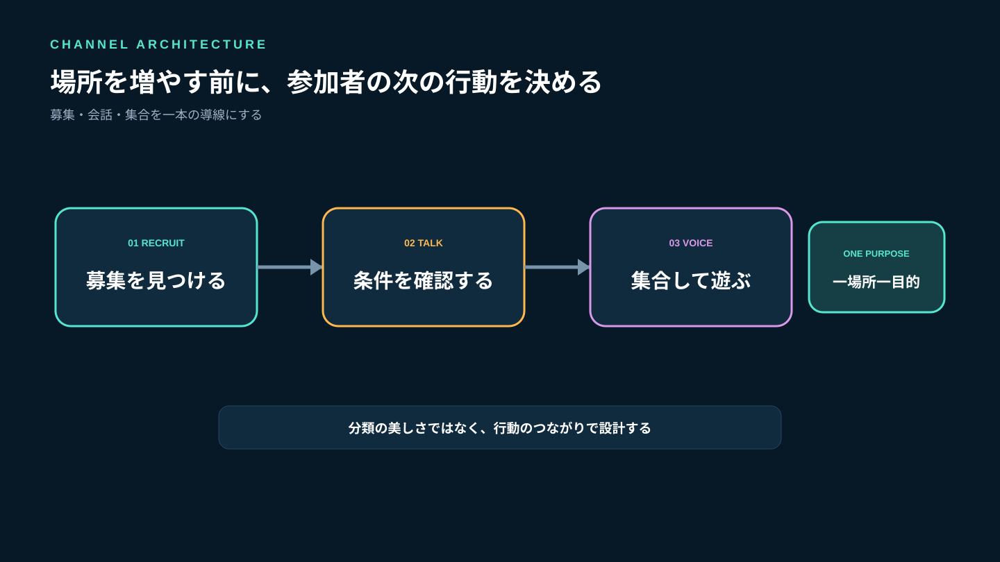
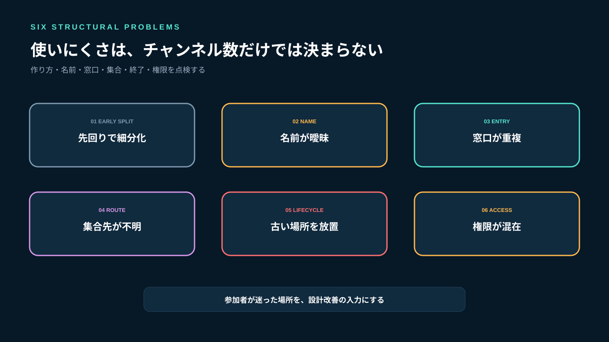
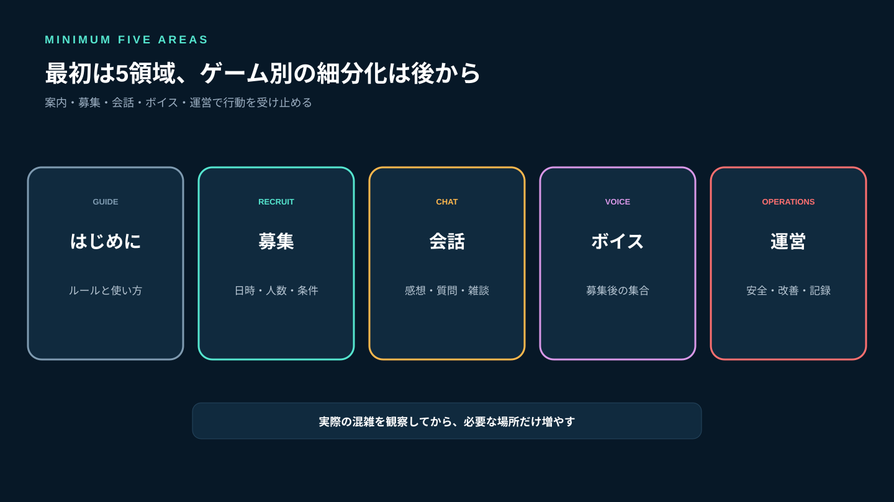
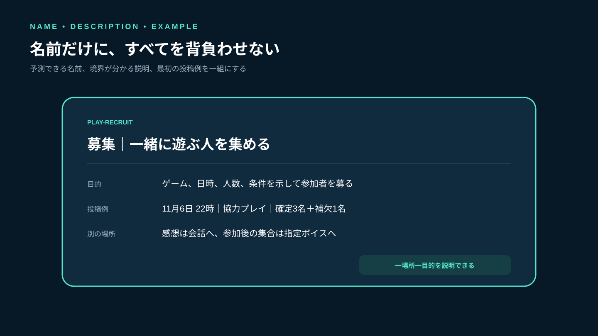
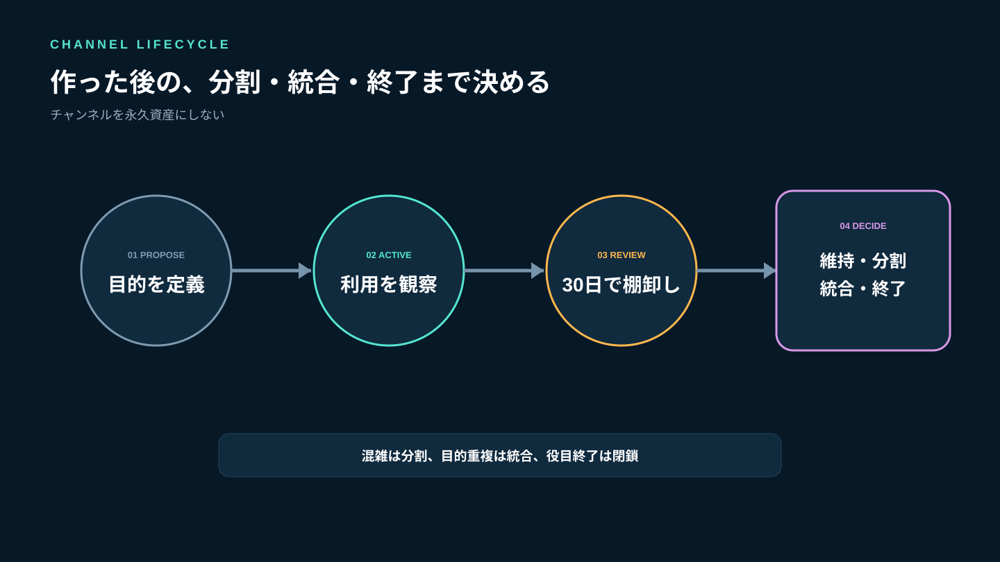
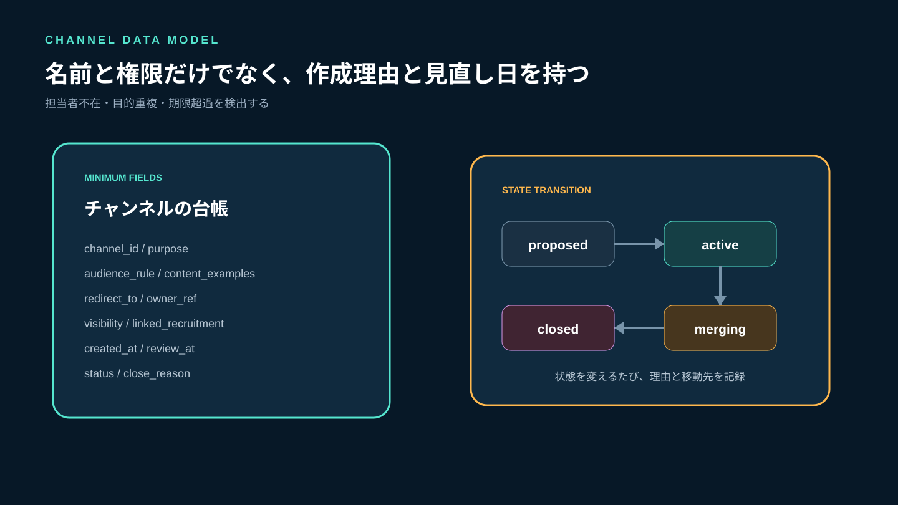
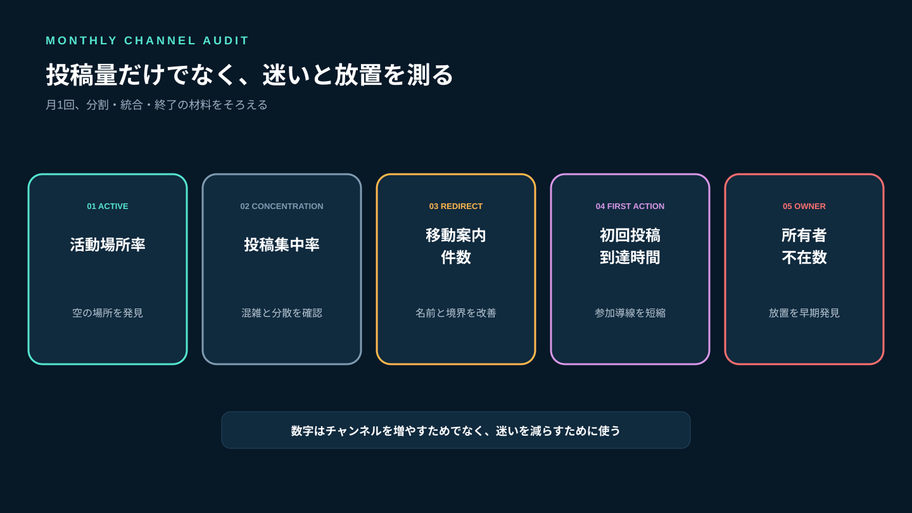

# ゲームコミュニティのチャンネル設計｜増やしすぎない構成と整理方法

ゲームコミュニティを立ち上げると、「ゲーム別」「雑談」「初心者」「募集」「攻略」「ボイス」と先回りしてチャンネルを増やしたくなります。しかし、空の場所が並ぶほど新規参加者はどこへ書けばよいか迷い、既存メンバーの会話も分散します。反対に一つへ詰め込むと、募集が雑談に流れ、集合場所を探せません。

チャンネル数に正解はありません。大切なのは、**参加者が次にしたい行動から逆算し、一つの場所へ一つの主目的を持たせること**です。Stult Partyなら、ゲーム募集、チャット、ボイスを一つのコミュニティにまとめて無料で始められます。最初から複雑な階層を作るのではなく、実際の募集と会話を見ながら必要な場所だけを追加できます。

この記事では、最小5領域から始め、分割・統合・終了を判断する方法、命名規則、権限、データ構造、月次棚卸しまでを解説します。



*「何を話すか」ではなく「次に何をするか」で場所を分けます。*

## チャンネルが使いにくくなる6つの原因

### 1. 活動が始まる前に細分化する

ゲームごと、モードごと、熟練度ごとに作ると、参加人数よりチャンネル数が多くなります。会話が起きるか分からない段階では、分類より集合を優先します。

### 2. 名前だけでは用途が分からない

「general」「交流」「その他」のような名前では、募集を書いてよいのか、雑談だけなのか判断できません。名前、説明、投稿例をセットにします。

### 3. 同じ行動を複数の場所で受け付ける

募集をゲーム別チャット、雑談、個別連絡のどこでも受け付けると、定員や最新版が分散します。行動ごとに正本を一つ決めます。

### 4. テキストとボイスの対応がない

どの募集がどのボイスへ集まるのか分からないと、開始直前に案内が必要になります。募集、連絡、集合の導線を一続きにします。

### 5. 一度作った場所を閉じない

終了したゲームや企画のチャンネルが残ると、現役の場所を見つけにくくなります。終了条件と記録の残し方を作成時に決めます。

### 6. 運営用の情報が参加者向けに混ざる

通報、対応メモ、権限変更などを一般会話へ置くと、プライバシーと運営判断の両方に問題が出ます。参加者向けと運営用を分けます。



*先回りした分類、曖昧な名前、重複窓口、集合迷子、放置、権限混在を点検します。*

## 公式資料から学べる設計原則

Slackの公式ヘルプは、利用者がすでに理解している分類を使い、予測しやすい接頭辞、チャンネルのトピックと説明を設定するよう案内しています。また、必要がなくなった場所は名称変更やアーカイブで整理する考え方を示しています（[チャンネル名のガイドライン](https://slack.com/help/articles/217626408-Create-guidelines-for-channel-names)）。別の公式ガイドでも、最初から多数作らず、実際の必要が生じたときに追加する方法が紹介されています（[Slackチャンネルの整理方法](https://slack.com/resources/using-slack/how-to-organize-your-slack-channels)）。

Microsoft Teamsの公式ヘルプでは、トピックやプロジェクトを単位にチャンネルを作り、名前と説明を設定します（[グループとチームを設定する](https://support.microsoft.com/en-us/office/switch-gsuite/set-up-groups-and-teams)）。参加者は関心のある場所を表示でき、所有者は推奨する場所を示せます（[表示するチャンネルを選ぶ](https://support.microsoft.com/en-gb/teams/teams-channels/choose-channels-to-display-in-microsoft-teams)）。

これらは業務ツールの仕様ですが、ゲームコミュニティにも次の原則を応用できます。

- 参加者が知っている行動やゲーム名で分類する
- 名前だけでなく説明文と投稿例を付ける
- 最初は少なくし、実際の混雑から分割する
- 全員が見る場所と、必要な人だけが使う場所を分ける
- 使わなくなった場所を閉じる

Stult Partyに自動アーカイブや高度なチャンネル推薦などの未確認機能があるという意味ではありません。現行のチャット、ボイス、ゲーム募集を、参加者が迷わない構成で運用するための設計原則です。

## 最初は5領域から始める

小規模なコミュニティでは、細かなゲーム別構成より、次の5領域で十分です。

| 領域 | 目的 | 代表的な内容 | 投稿者 |
|---|---|---|---|
| はじめに | 初参加の案内 | ルール、使い方、問い合わせ先 | 主に運営 |
| 募集 | 一緒に遊ぶ人を集める | ゲーム、日時、人数、条件 | 参加者・運営 |
| 会話 | 日常の交流 | 感想、質問、軽い雑談 | 参加者 |
| ボイス | 集合して遊ぶ | 募集と対応する通話 | 参加者 |
| 運営 | 安全・改善・記録 | 通報対応、引き継ぎ、判断記録 | 運営のみ |

「ゲーム別」は最初から必須ではありません。同じ募集場所でゲーム名を明記し、会話が追えないほど増えた段階で分けます。運営用は、参加者の個人情報や対応記録を必要以上に共有しない範囲へ限定します。



*案内、募集、会話、ボイス、運営を分け、ゲーム別の細分化は後から判断します。*

## 名前・説明・投稿例を一組にする

チャンネル名は短くしつつ、一覧で役割を予測できるようにします。同じ役割には同じ接頭辞を使います。

```text
guide-start       初参加者が最初に見る案内
guide-rules       参加ルールと更新履歴
play-recruit      ゲーム募集の正本
chat-lounge       ゲームをまたぐ会話
help-support      使い方・参加相談
voice-party-1     募集後の集合用ボイス
ops-moderation    安全対応の運営用記録
```

英語名にする必要はありません。重要なのは、`案内-`、`募集-`、`会話-`、`運営-`のように並び方をそろえることです。

説明文には次の3点を入れます。

```text
目的：この場所で完了する行動
書いてよい内容：具体例を2〜3件
別の場所：対象外の内容と移動先
```

例として募集場所なら、「一緒に遊ぶ人を募集する場所。ゲーム名、日時、人数、条件を記載。ゲームの感想は会話へ、参加後の集合は指定ボイスへ」とします。募集文の作り方は[ゲームコミュニティの人の集め方](/a/game-community-recruitment/)も参照してください。



*名前で予測し、説明で境界を理解し、投稿例で最初の行動を示します。*

## 分割・統合・終了を感覚で決めない

### 分割する条件

次のうち2つ以上が2週間続いたら、場所を分ける候補です。

- 二つ以上の話題が同時進行し、返信先を間違える
- 募集が会話に流れ、同じ質問や再投稿が増える
- 特定ゲームの投稿が全体の大半を占める
- 対象外の参加者への通知が多い
- 進行役やルールが明確に異なる

分割前に、投稿テンプレートやスレッド相当の整理で解決できないか確認します。分ける場合は、旧場所に移動先と開始日を示します。

### 統合する条件

30日間、投稿者がほぼ同じ、内容が隣の場所と重なる、初参加者が違いを説明できない場合は統合候補です。内容を移すのではなく、残すべき案内やFAQを正本へまとめてから新規投稿を止めます。

### 終了する条件

期間限定の募集が終了した、担当者がいない、今後の利用予定がない場所は閉じます。終了前に、未解決の問い合わせ、継続中の募集、残すべきルールを確認します。



*混雑が続けば分割し、目的が重なれば統合し、役目を終えたら閉じます。*

## 実装者の視点：チャンネルをライフサイクルで管理する

名称と権限だけでは、なぜ作ったか、いつ見直すかが分かりません。チャンネルを次のようなデータとして管理します。

```text
channel_id          チャンネルID
purpose             一文で表す主目的
audience_rule       利用対象
content_examples    投稿してよい例
redirect_to         対象外の内容の移動先
owner_ref           管理担当者
visibility          public / limited / ops
linked_recruitment  対応する募集の有無
created_at          作成日時
review_at           次回棚卸し日
status              proposed / active / merging / closed
close_reason        終了理由
```

新規作成は`proposed`から始め、目的、対象、担当者、30日後の見直し日を決めて`active`へ移します。統合時はすぐ削除せず`merging`にし、移動先を示します。履歴を残す必要がある場合は`closed`として新規投稿を止めます。

この設計の利点は、チャンネル数だけでなく「担当者がいない」「目的が重複」「見直し期限を過ぎた」を検出できることです。運営体制の役割分担は[ゲームコミュニティの運営体制](/a/game-community-operations-team/)と合わせて設計してください。



*作成理由、担当者、見直し日、状態を持つと、増え続ける構造を防げます。*

## ボイスは人数ではなく用途で分ける

「ボイス1」「ボイス2」だけでは、どこへ入ればよいか分かりません。常設ボイスを増やすより、用途と利用条件を説明します。

- 募集集合用：募集投稿で指定された人が利用
- 気軽な会話用：ゲーム中でなくても利用
- 運営相談用：参加相談や安全対応に利用範囲を限定

募集と集合用ボイスは、募集本文から場所が分かるようにします。空のボイスをゲームごとに並べる必要はありません。利用が重なる時間帯、最大人数、聞き専の扱いが異なる場合に分けます。初回参加の不安を減らす方法は[ボイスチャットに参加しやすいゲームコミュニティ設計](/a/game-community-voice-chat-participation/)で解説しています。

## 月1回の棚卸しで見る5つの指標

### 活動チャンネル率

全体のうち、過去30日に目的に沿った投稿や利用があった場所の割合です。高ければよいのではなく、空の場所を発見する指標です。

### 投稿集中率

上位1〜2か所に全投稿の何割が集中しているかを見ます。高すぎる場合は混雑を確認し、低すぎる場合は分散しすぎていないか確認します。

### 移動案内件数

運営者が「その内容はこちらへ」と案内した回数です。多い組み合わせは、名前や説明が曖昧か、分割自体が不要な可能性があります。

### 初回投稿到達時間

参加してから、募集・会話・ボイスのいずれかへ到達するまでの時間です。案内チャンネルが多すぎて行動を妨げていないかを確認します。

### 所有者不在数

担当者が退任したままの場所、次回見直し日を過ぎた場所を数えます。放置チャンネルの早期発見に使います。



*投稿量だけでなく、迷い、分散、到達、担当者不在を測ります。*

## よくある失敗

### 人気ゲームごとに先回りして作る

実際の投稿がない場所は空白を増やします。共通の募集場所から始め、混雑が続いたゲームだけを分けます。

### 雑談を細かい趣味別に分ける

少人数では会話の開始点が減ります。日常会話を一か所へ集め、同じ話題が継続して他の会話を妨げる場合だけ分けます。

### 名前を変えて終わる

名前と説明、投稿例、移動先を一緒に更新します。既存メンバーへ変更理由と新しい使い方を案内します。

### 古い場所を突然削除する

進行中の募集や問い合わせが残っている可能性があります。新規投稿を止め、移動先を示し、必要な記録を移してから閉じます。

### 運営者だけが構造を説明できる

新規参加者が一覧を見て次の行動を選べなければ、設計が運営者の記憶に依存しています。名前、説明、投稿例だけで判断できるか試します。

## よくある質問

### 参加者10人なら何個が適切ですか？

人数だけでは決まりません。まず案内、募集、会話、ボイス、運営の5領域を基準にし、実際に混雑または目的重複が起きたときだけ増減します。

### ゲームごとに分けるべきですか？

投稿量、対象者、進行役、ルールが異なり、共通場所で会話を追えない状態が2週間ほど続くなら分割候補です。タイトルだけ異なる空の場所を先に作る必要はありません。

### 使われていない場所は削除してよいですか？

進行中の募集、問い合わせ、残すべきルールを確認し、移動先を示してから閉じます。履歴が必要なら削除ではなく新規投稿を止める形で保持します。

### Stult Partyに自動整理やアーカイブ機能はありますか？

この記事では未確認機能があることを前提にしていません。現行のゲーム募集、チャット、ボイスを同じコミュニティ内に配置し、命名、説明、作成・統合・終了の運営ルールで整理します。

## まとめ：少なく始め、実際の混雑から分ける

チャンネル設計は、一覧をきれいに見せる作業ではありません。参加者が募集を見つけ、会話し、迷わずボイスへ集合できる導線を作ることです。最初は案内、募集、会話、ボイス、運営の5領域から始め、名前・説明・投稿例をそろえます。

新しい場所は、目的、対象、担当者、見直し日を決めて作ります。話題の衝突が続けば分割し、違いを説明できなければ統合し、役目を終えたら移動先を示して閉じます。月次で活動率、投稿集中、移動案内、初回投稿到達時間、担当者不在を確認してください。

Stult Partyなら、ゲーム募集、チャット、ボイスを一つのコミュニティにまとめて無料で始められます。複数ツールを行き来する前提ではなく、募集から会話、集合までを同じ活動拠点で設計できます。空の分類を増やすより、参加者の実際の行動が見える最小構成から始めてください。
