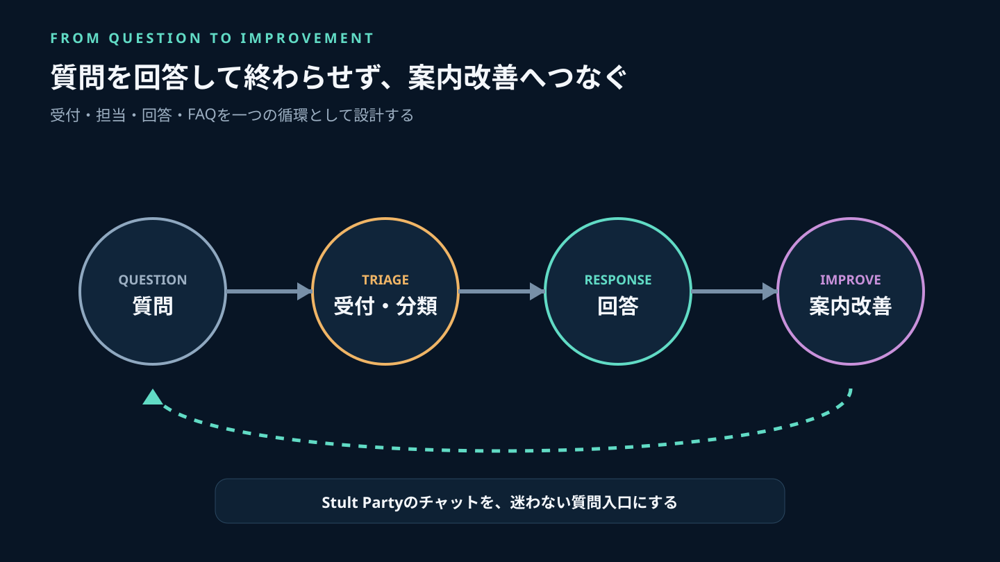
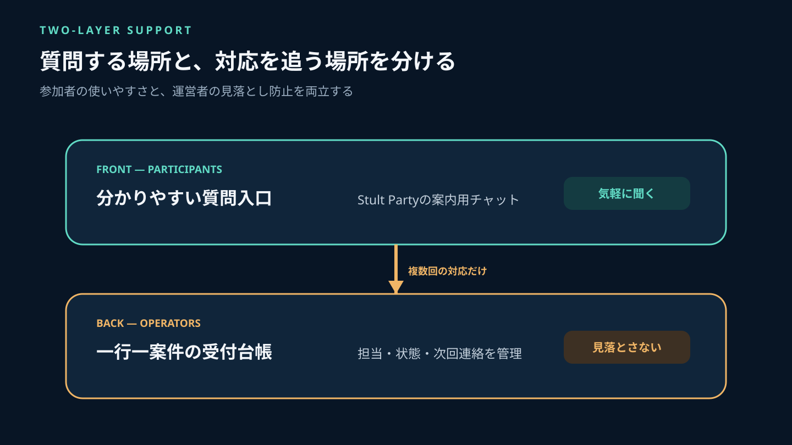
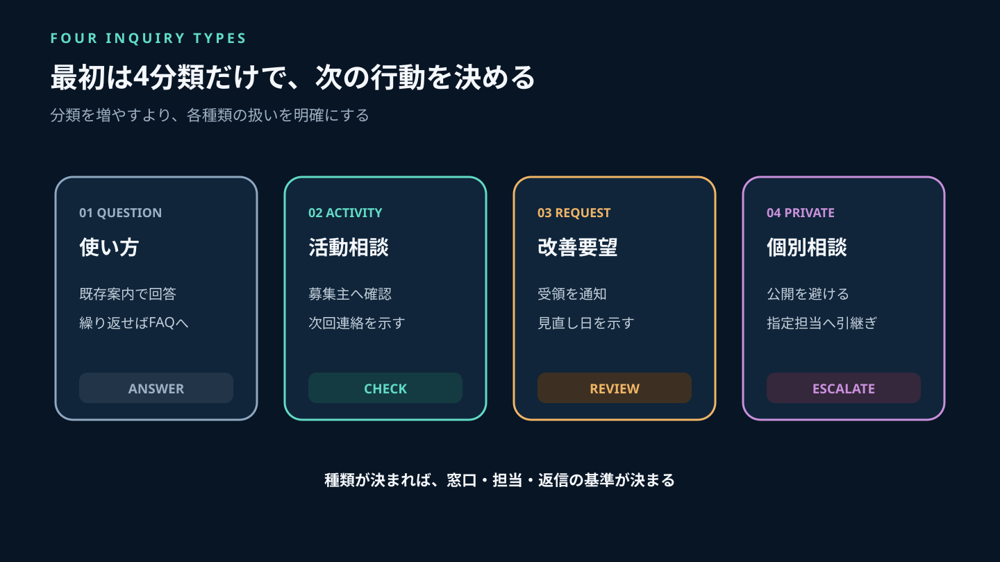
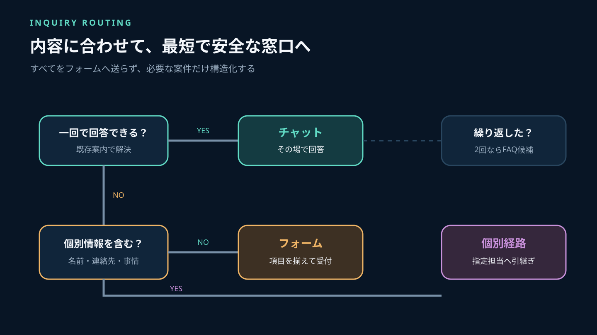
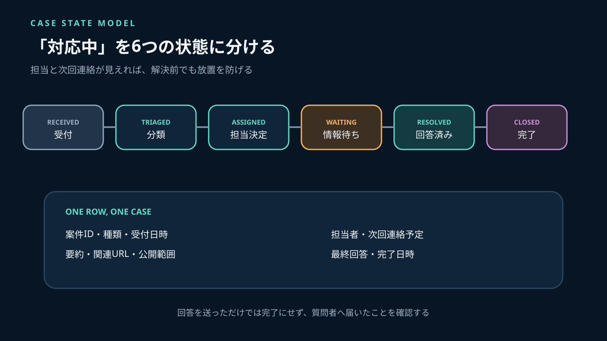
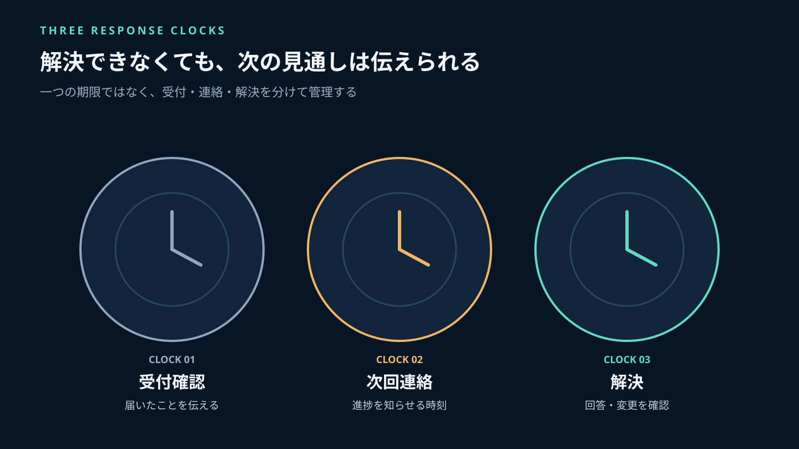
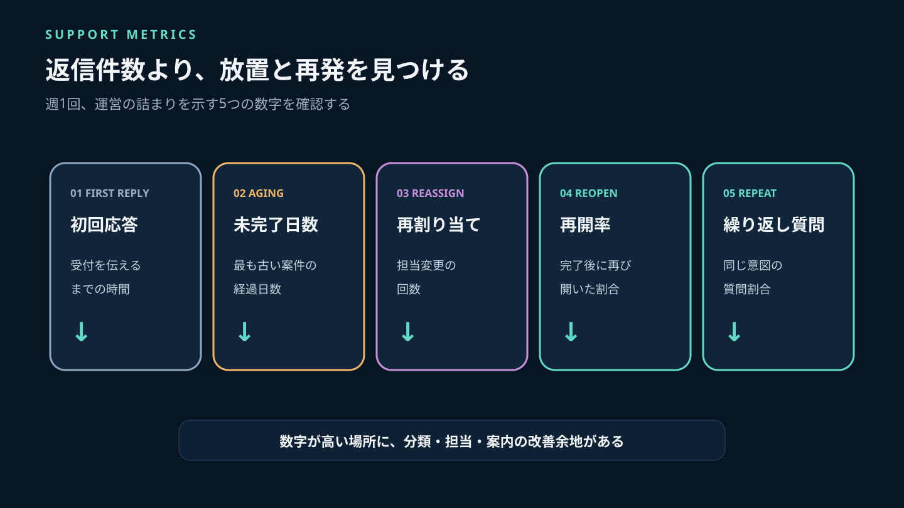

ゲームコミュニティの問い合わせは、人数が少ないうちはチャットの返信だけで処理できます。しかし活動が増えると、参加方法の質問、募集条件の確認、改善要望、個別に扱うべき相談が同じ会話へ流れ込みます。誰かが答えたつもりでも、質問者には結論が届いていない。運営者同士で二重に対応する。未回答のまま数日経ってから問題に気づく。こうした失敗は、担当者の誠実さではなく受付の構造から起きます。

必要なのは大規模な問い合わせシステムではありません。**質問を受けた場所と、対応状況を管理する場所を分け、受付・確認・担当・回答・完了の状態を一行で追えるようにすること**です。

Stult Partyなら、ゲーム募集、チャット、ボイスを一つのコミュニティにまとめて無料で始められます。参加者との普段の接点を同じ場所へ集めたうえで、繰り返す質問は案内へ、個別対応が必要な内容は受付台帳へつなぐと、運営者も参加者も迷いにくくなります。

この記事では、小規模な運営でも実行できる問い合わせ窓口の分け方、最小受付票、状態遷移、返信基準、FAQへ戻す手順を解説します。



*会話で受けた質問を放置せず、回答と案内改善まで一つの循環にします。*

---

## 先に結論：窓口を増やす前に「受け方」と「管理」を分ける

参加者が質問しやすい入口は、普段使っているチャットです。一方、チャットは時系列で流れるため、未回答案件の一覧や期限管理には向きません。そこで次の二層に分けます。

| 層 | 役割 | 具体例 |
|---|---|---|
| 参加者向けの入口 | 気軽に質問・相談できる | Stult Partyの案内用チャット、必要に応じたフォーム |
| 運営者向けの台帳 | 担当・状態・次の行動を追う | 共有表、課題管理表、非公開の運営記録 |

すべての質問にフォーム入力を強制する必要はありません。「参加リンクはどこですか」のように一回の返信で終わる質問はチャットで完結できます。確認や調整が必要、個人情報を含む、複数の運営者が引き継ぐ、後から判断根拠を確認したい場合だけ台帳へ登録します。

問い合わせ管理の目標は、返信件数を増やすことではありません。

- 質問者が、受け付けられたことと次の見通しを理解できる
- 運営者が、未回答と対応中を見分けられる
- 同じ質問が繰り返されたら、個別返信ではなく案内を直せる
- 個別性の高い相談を、公開チャットへ広げない

この四つを満たす最小構成から始めます。



*質問する場所は分かりやすく一つにし、複数回の対応が必要な案件だけ裏側で管理します。*

## 問い合わせを4種類に分ける

分類が細かすぎると、受付担当が迷います。最初は次の4種類で十分です。

### 1. 使い方・参加方法の質問

「募集への参加方法が分からない」「聞き専でもよいか」「どのチャットを使うか」など、既存の案内で答えられる内容です。回答後、同じ質問が続くなら入口やFAQを修正します。

### 2. 募集・活動についての相談

「活動時間に合う募集がない」「初心者向け募集を作ってよいか」「ボイスを使わず参加できるか」など、現在の活動状況を確認して答える内容です。募集主や担当メンバーへ確認が必要なら、台帳へ移します。

### 3. 改善要望

「案内を短くしてほしい」「別のゲームを対象にしてほしい」など、採用可否をすぐ約束できない内容です。受領したこと、判断する人、次に見直す時期を伝えます。要望の件数だけで採用せず、解決したい問題を確認します。

### 4. 個別に扱う相談

他の参加者の名前、個人的な事情、アカウント情報などを含み、公開チャットで続けるべきでない内容です。公開の場では詳細を書かず、運営者が指定した非公開経路へ切り替えます。安全上の緊急性がある場合は、通常の順番を待たず、あらかじめ決めた担当へ即時に引き上げます。

個別相談の具体的な判断は、一般的な質問対応と混ぜません。ルール違反への対応手順は[ゲームコミュニティのルール設計](/a/game-community-rules/)と役割を分け、本記事では受付と引き継ぎまでを扱います。



*即答できる質問、確認が必要な相談、改善要望、個別相談で次の行動を変えます。*

## チャット・フォーム・個別経路を使い分ける

### チャット：質問の入口

Stult Partyのチャットには、「使い方の質問はこちら」のように目的が分かる入口を一つ用意します。質問用の場所をゲームごと、曜日ごと、担当者ごとに増やすと、参加者はどこへ書くべきか迷います。

入口には次の3点だけを固定します。

```text
・ここで質問できる内容
・個人情報や他の参加者の詳細を書かないこと
・運営者が確認する曜日・時間帯
```

質問を見つけた運営者は、回答できなくても「受け付けました。確認して○日までにお知らせします」と返します。無反応な時間を減らすだけで、同じ質問の再投稿や複数担当者への重複連絡を抑えられます。

### フォーム：確認項目を揃える

複数の情報が必要な相談、改善要望、記録が必要な案件ではフォームが役立ちます。Google Formsの公式ヘルプでは、回答を確認・管理し、必要に応じて回答者へ回答内容の控えを送る設定が案内されています。また、2026年9月からデータ容量と回答数に新しい上限が導入され、上限へ近づくと通知されると説明されています（[Google Formsの回答を表示・管理する](https://support.google.com/docs/answer/139706?hl=ja)）。利用する場合は、作って終わりではなく、保存先、閲覧者、回答控え、保管量を確認します。

構造化入力の考え方はGitHub Issue Formsも参考になります。GitHub公式ドキュメントでは、入力欄、複数行、選択肢、チェック項目、必須指定、既定担当やラベルを定義できます（[Issue Formsの構文](https://docs.github.com/ja/communities/using-templates-to-encourage-useful-issues-and-pull-requests/syntax-for-issue-forms)）。ゲームコミュニティでも、自由記述だけにせず、問い合わせ種類と期待する結果を選べるようにすると振り分けやすくなります。

### 個別経路：公開しない相談

個人情報や他の参加者に関する内容は、公開チャットから切り離します。ただし「何でもDMで」とすると、各運営者の個人受信箱に案件が散らばります。指定担当、対応可能時間、引き継ぎ方法を決めてください。



*一回で答えられる質問はチャット、確認が必要ならフォーム、個別性が高ければ非公開経路へ分けます。*

## 受付フォームで聞くのは6項目まで

長いフォームは、困っている人に追加の負担をかけます。最初は次の6項目に絞ります。

1. **問い合わせの種類**：使い方、活動相談、改善要望、個別相談
2. **知りたいこと・困っていること**：事実を短く書く欄
3. **期待する結果**：説明、確認、修正、折り返しなど
4. **関連する場所**：募集や案内のURL、分かれば記載
5. **連絡方法**：回答を受け取れる方法
6. **公開範囲の確認**：運営者だけで扱う必要があるか

本名、住所、電話番号、生年月日など、回答に不要な情報は求めません。画像やファイルの添付も、目的と取扱方法が決まっていないなら必須にしないでください。

個人情報保護委員会が2026年10月30日に更新したQ&Aでは、メールアドレスが単独または他の情報との照合によって個人情報に該当し得ることが説明されています。また、Webの入力画面で連絡先を直接取得する場合は、原則として利用目的の明示が必要とされています（[個人情報保護法ガイドラインQ&A](https://www.ppc.go.jp/personalinfo/faq/APPI_QA/)、[入力画面で連絡先を取得する場合のQ&A](https://www.ppc.go.jp/all_faq_index/faq1-q4-17/)）。

フォームには「回答と必要な確認に利用する」「閲覧できるのは運営担当者」「保存期間」のように、実際の運用に合う説明を送信前に表示します。法令上必要な対応は運営形態や取得内容で異なるため、本記事は一般情報として扱い、個別判断は専門家へ相談してください。

## 実装者の視点：問い合わせを状態遷移で管理する

問い合わせ台帳は、一行一案件にします。文章をコピーしただけではなく、次のフィールドを持たせます。

```text
case_id             案件を識別するID
type                question / activity / request / private
received_at         受付日時
summary             一文の要約
context_url         関連する募集・案内への参照
privacy_level       public / operators_only / restricted
owner               現在の担当者
status              received / triaged / assigned / waiting / resolved / closed
next_response_due   次回連絡の予定日時
resolution          最終回答または変更内容
closed_at           完了日時
```

`owner`は回答を書いた人ではなく、次の行動に責任を持つ人です。`next_response_due`は解決期限ではなく、質問者へ次に連絡する時刻です。すぐ解決できなくても、調査中であることや次の連絡予定を伝えられます。

状態は次の順で進めます。

1. `received`：受け付けた
2. `triaged`：種類と公開範囲を確認した
3. `assigned`：担当者が決まった
4. `waiting`：質問者または別担当の情報を待っている
5. `resolved`：回答または必要な変更を提示した
6. `closed`：質問者へ届き、追加対応がないことを確認した

回答を送っただけで`closed`にしません。解決内容が伝わったか、追加質問がないかを確認してから閉じます。再び同じ案件について連絡があれば、新規案件を作らず再開回数を記録します。



*担当者と次回連絡予定を持つことで、解決前でも質問者へ見通しを伝えられます。*

## 回答時間は「解決」ではなく3つの時計に分ける

小規模コミュニティで24時間常時対応を約束するのは現実的ではありません。代わりに、次の三つを分けます。

### 受付確認

問い合わせが届いたことを伝えるまでの時間です。運営者が毎日確認できない場合は、「平日夜に確認」「週末は翌運営日」のように受付時間を明示します。

### 次回連絡

解決できない場合に、進捗や追加確認を連絡する時刻です。「確認中です」だけで終わらせず、次にいつ連絡するかを伝えます。

### 解決

回答、設定変更、案内修正などが完了するまでの時間です。内容によって幅があるため、一律の期限を約束せず、種類ごとの目安を示します。

```text
使い方の質問：確認できた運営時間内に回答
活動相談：募集主や担当者へ確認後、次回連絡日を案内
改善要望：受領を通知し、定例見直し時に判断
個別相談：公開チャットでは扱わず、指定担当へ引き上げ
```



*受付確認、次回連絡、解決を分ければ、即時解決できない案件も放置になりません。*

## そのまま使える返信テンプレート

### 受付時

```text
お問い合わせありがとうございます。受付番号は［ID］です。
内容を確認し、［日付・時間帯］までに次のご連絡をします。
個人情報や他の参加者の詳細は、この公開チャットへ追加しないでください。
```

### 追加情報が必要なとき

```text
確認のため、次の点だけ教えてください。
・該当する募集または案内のURL
・期待していた状態
・実際に起きたこと

回答に不要な本名や住所などは記載しないでください。
```

### 改善要望を受けたとき

```text
ご提案を受け付けました。
すぐに実施を約束することはできませんが、［見直し日］に
「どの問題を解決するか」「他の参加者への影響」を確認します。
判断後、結果と理由をこの受付番号へ記録します。
```

### 完了時

```text
［対応内容］を行いました。現在は［確認方法］で確認できます。
この回答で解決しない場合は、［期限］までに受付番号［ID］を添えてお知らせください。
追加のご連絡がなければ完了として扱います。
```

定型文は冷たくするためではなく、受付番号、次回連絡、個人情報への注意、確認方法を漏らさないために使います。本文は問い合わせ内容に合わせて一文加えてください。

## 同じ質問が2回出たら、FAQ候補として記録する

すべてをFAQにすると、参加者は長い一覧から答えを探せません。次の条件を満たすものだけを追加します。

- 30日以内に同じ意図の質問が2回以上あった
- 回答が参加者によって変わらない
- 現在も有効な運営ルールまたは操作である
- 公開しても個人や個別案件が特定されない

FAQには質問文だけでなく、「誰向けか」「結論」「次に行うこと」「更新日」「確認担当」を持たせます。元の問い合わせ全文を貼り付けず、個人情報を除いた一般的な回答へ書き直します。

参加直後の質問が多い場合は、FAQを増やす前に[ゲームコミュニティのオンボーディング設計](/a/game-community-onboarding/)を見直してください。運営判断が担当者ごとに違う場合は、[ゲームコミュニティの運営引き継ぎ](/a/game-community-handover/)で正本と権限を整理します。

## 週1回見る5つの指標

### 初回応答時間

受付から「受け付けた」と伝えるまでの時間です。解決時間とは分けます。

### 未完了案件の経過日数

平均だけでなく、最も古い未完了案件を確認します。古い一件が平均値に隠れないようにします。

### 再割り当て回数

担当者が何度も変わる案件は、分類、権限、判断基準のどれかが曖昧です。

### 再開率

完了後に再び開いた案件の割合です。回答が質問者へ届いていない、確認方法が不足している可能性があります。

### 繰り返し質問率

同じ意図の質問が全体に占める割合です。高い項目は、個別返信を速くするより入口の案内を改善します。



*返信件数ではなく、放置、引き継ぎ、再発がどこで起きているかを確認します。*

## よくある失敗

### 質問用チャンネルを作っただけで管理できたと思う

チャットは入口です。確認が必要な案件には担当、状態、次回連絡を持たせます。

### すべてフォームへ誘導する

一回で答えられる質問まで入力を強制すると、質問前に離脱します。チャットで即答できるものと、記録が必要なものを分けます。

### 対応中だけ伝えて次の時刻を示さない

質問者は待つべきか、再度連絡すべきか判断できません。解決日が分からなくても、次回連絡日は示せます。

### 複数の運営者が同時に答える

善意の二重対応で回答が食い違います。最初に受け付けた人が台帳へ登録し、一人の`owner`を決めます。

### 個別相談の内容を一般チャットで確認する

公開範囲を先に判定し、詳細を聞く前に非公開経路へ切り替えます。必要以上の情報を集めません。

### FAQを増やし続ける

古い回答が残ると、かえって誤案内になります。更新日と担当を持たせ、現行ルールでなくなった項目は削除または統合します。

## よくある質問

### 問い合わせ専用ツールは必要ですか？

最初から必要ではありません。Stult Partyのチャットを分かりやすい入口にし、複数回の対応が必要な案件だけ共有表で管理できます。未完了案件が増え、権限や自動通知が必要になった段階で専用ツールを検討します。

### 運営者が一人でも台帳を作るべきですか？

はい。担当割り当てより、未回答、次回連絡、繰り返す質問を見つける効果があります。将来の引き継ぎにも使えます。

### 匿名の問い合わせを受け付けるべきですか？

内容によります。一般的な要望は匿名でも扱えますが、本人確認や追加連絡が必要な相談は解決できない場合があります。匿名可否と、回答できる範囲を入口で説明してください。

### 返信時間は何時間以内がよいですか？

活動規模と運営者の生活時間で変わります。常時対応を装わず、確認する曜日・時間帯と次回連絡の目安を公開し、守れる基準を設定してください。

## まとめ：質問を受ける場所と、解決まで追う場所をつなぐ

ゲームコミュニティの問い合わせ対応は、返信が速い一人の運営者に依存させないことが重要です。参加者には質問しやすい入口を一つ示し、確認が必要な案件だけを一行一案件で台帳へ移します。

受付項目は6つに絞り、`received`から`closed`まで状態を分けます。担当者と次回連絡予定を必ず持ち、即時解決できないときも見通しを伝えます。同じ質問が繰り返されたら、個別返信を増やすのではなく、入口やFAQを直してください。

Stult Partyなら、ゲーム募集、チャット、ボイスを一つのコミュニティにまとめて無料で始められます。参加者との普段の会話を活動拠点へ集め、質問用の入口を一つ設けるところから開始してください。そのうえで運営台帳と案内改善をつなげれば、問い合わせ対応を参加しやすいコミュニティづくりへ変えられます。
