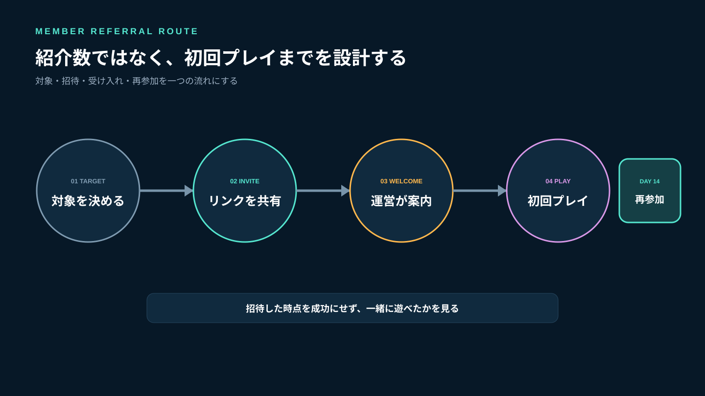
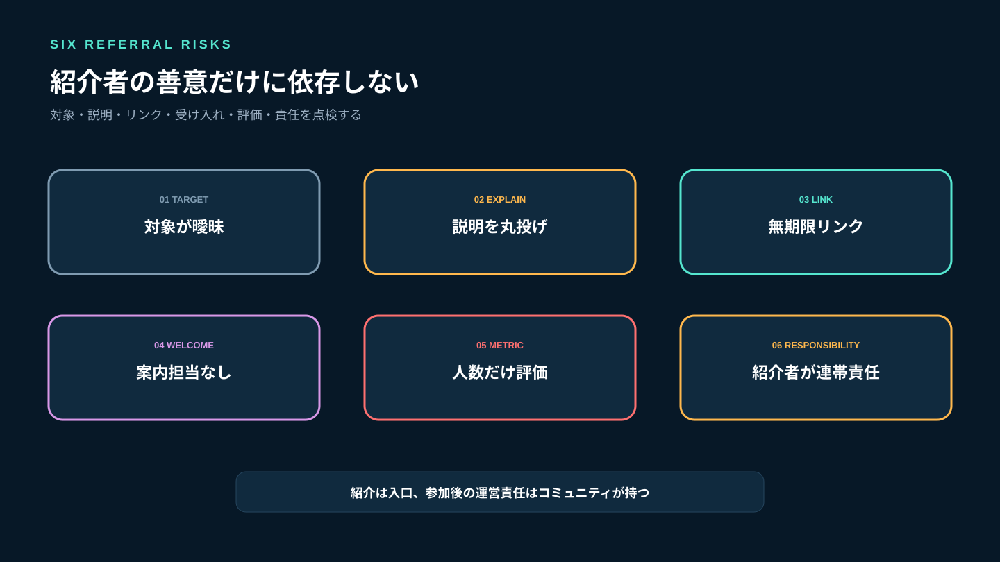
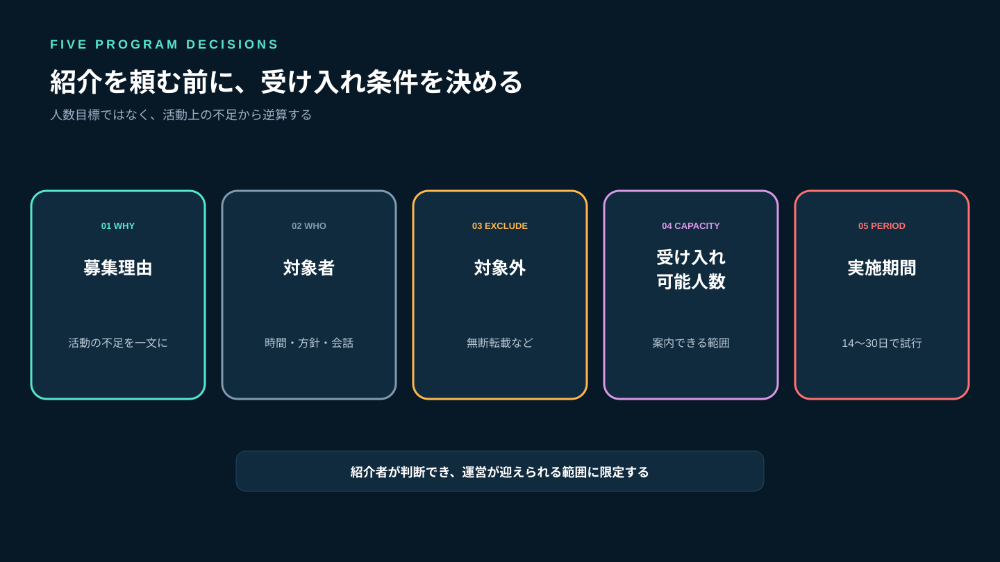
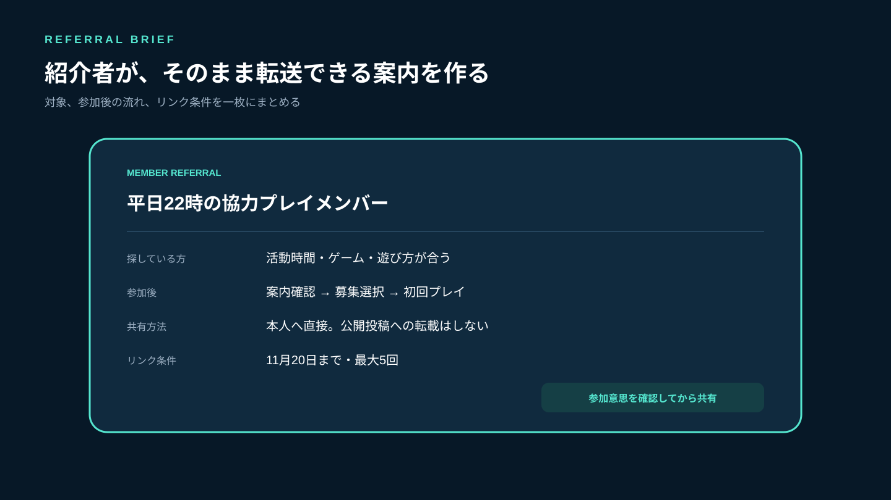
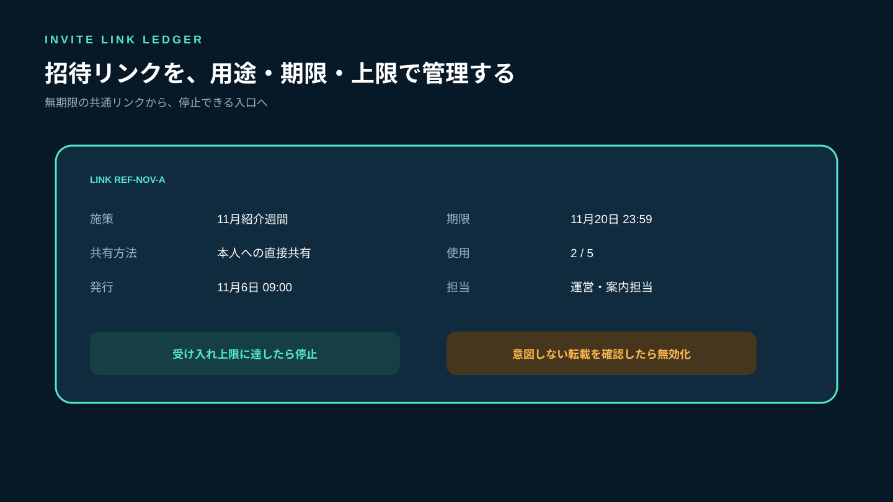
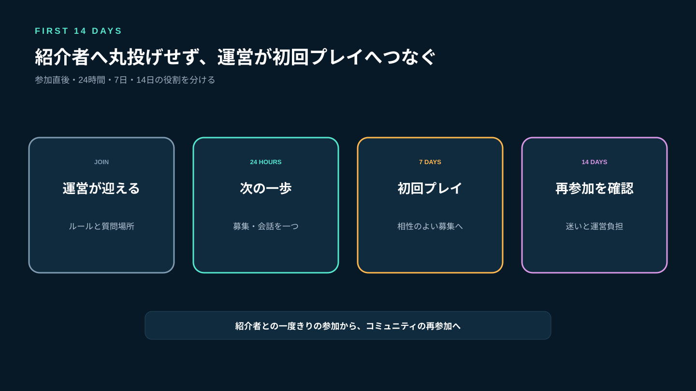
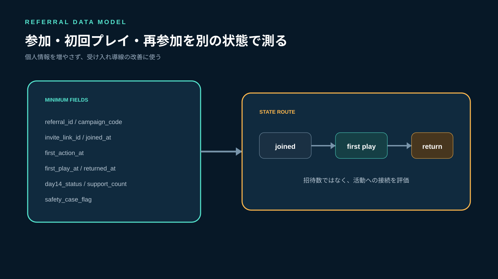
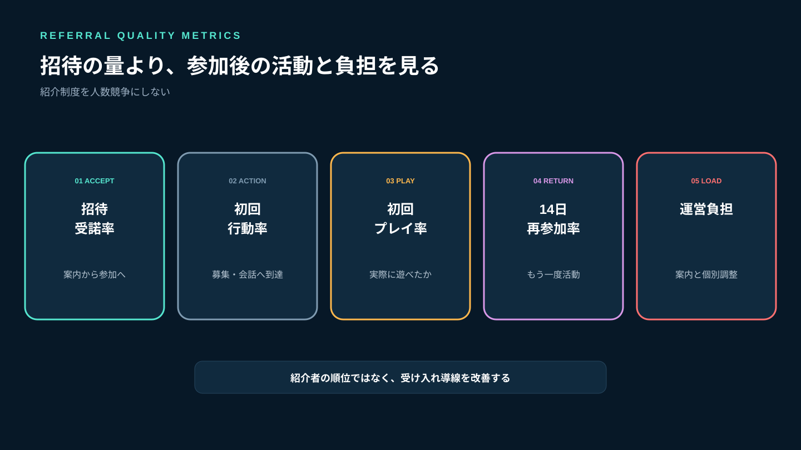

# ゲームコミュニティの紹介制度｜メンバー招待を安全に増やす運営設計

ゲームコミュニティを増やす方法は、不特定多数へ募集を出すことだけではありません。すでに活動しているメンバーから「一緒に遊びたい人」を紹介してもらうと、プレイ時間、ゲームの好み、会話の雰囲気が合う人へ届きやすくなります。

ただし、招待リンクを全員へ配って「友達を呼んでください」で終えると、誰向けの紹介か分からず、リンクの転載や受け入れ漏れも起きます。必要なのは人数目標ではなく、**紹介してほしい相手、リンクの範囲、参加後の案内、成果の測り方**を一続きにすることです。

Stult Partyなら、ゲーム募集、チャット、ボイスを一つのコミュニティにまとめて無料で始められます。コミュニティの招待リンクには有効期限や使用回数の上限を設定できるため、紹介単位で入口を管理し、参加後は同じ活動拠点で募集から初回プレイへ案内できます。

この記事では、金銭報酬を前提にせず、既存メンバーの信頼を活かして相性のよい参加者を増やす手順を解説します。



*紹介数ではなく、参加後に一緒に遊べる状態までを設計します。*

## メンバー紹介が失敗する6つの原因

### 1. 紹介してほしい相手が曖昧

「ゲーム好きなら誰でも」では、紹介者が判断できません。対象ゲーム、活動時間、遊び方、ボイスの使い方、初心者への姿勢を具体化します。

### 2. 紹介者へ説明責任を背負わせる

ルール、参加手順、活動内容を紹介者がすべて説明する設計では、負担が大きくなります。紹介者は入口だけを案内し、正式な説明は運営の正本へ集めます。

### 3. 同じ招待リンクを無期限で公開する

どこから共有されたか分からず、意図しない場所へ転載されても止めにくくなります。用途ごとに期限と使用回数を決めます。

### 4. 参加後の案内担当がいない

招待を受け入れても、募集や会話へ入れなければ定着しません。誰が迎え、最初に何を案内するかを決めます。

### 5. 紹介数だけを評価する

人数だけを競うと、相性を確認せず大量に招待する動機が生まれます。初回プレイ、14日後の継続、問題発生率まで見ます。

### 6. 紹介者が保証人になる

紹介された人が問題を起こしたとき、紹介者まで責めると、誰も紹介しなくなります。参加後の行動は本人と運営が扱い、紹介者へ連帯責任を負わせません。



*対象、説明、リンク、受け入れ、指標、責任の境界を先に決めます。*

## 公式仕様から分かる招待リンク管理の要点

Slackの公式ヘルプでは、招待権限を管理者承認制にでき、招待リンクに有効期限を設定できます。また、リンクを知る人が参加できるため、対象者だけへ安全に共有するよう案内しています（[新しいメンバーを招待する](https://slack.com/help/articles/201330256-Invite-new-members-to-your-workspace-Invite-new-members-to-your-workspace)）。管理者は、発行済みリンクの作成者や時期を確認し、不要なリンクを無効化できます（[招待と招待リンクを管理する](https://slack.com/help/articles/360060363633-Manage-pending-invitations-and-invite-links-for-your-workspace)）。

Google Analyticsの公式ヘルプは、流入元を識別するカスタムURLで`utm_source`、`utm_medium`、`utm_campaign`を一貫した命名にするよう案内しています（[カスタムURLでキャンペーンデータを収集する](https://support.google.com/analytics/answer/10917952)）。コミュニティの招待へ解析基盤を導入する必要はありませんが、「紹介元」「紹介方法」「施策名」を同じ表記で記録する考え方は応用できます。

Stult Partyでは「招待」タブから招待リンクを発行でき、有効期限と使用回数上限を設定できます。操作の概要は[Stult Partyのはじめ方](/a/stult-party-hajimekata/)を参照してください。

ここから得られる原則は次の通りです。

- 招待できる人と承認する人を決める
- リンクは用途ごとに分け、期限と上限を持たせる
- 発行者、共有先、停止日時を記録する
- 不要になったリンクは無効化する
- 紹介元の表記を統一する

## 紹介制度を始める前に決める5項目

### 1. 募集する理由

「人数を増やしたい」ではなく、「平日22時の協力プレイであと3人」「初心者向け募集の進行役候補」など、活動上の不足を一文にします。

### 2. 紹介してほしい人

対象ゲーム、活動時間、プレイ方針、会話やボイスの条件を書きます。腕前より、活動時間とコミュニケーションの期待値を合わせる方が紹介者は判断しやすくなります。

### 3. 紹介しない方がよい人

参加意思を確認していない人、招待リンクを公開投稿へ転載する人、ルールを読まずに参加する人は対象外と伝えます。友人関係があることだけで参加条件を免除しません。

### 4. 受け入れ可能人数

運営や案内担当が対応できる人数を超えて招待しません。一週間に3人など、初回案内と募集への接続ができる範囲を決めます。

### 5. 実施期間

常設制度にせず、まず14〜30日の試行にします。終了後に紹介経路、参加率、運営負担を見直します。



*不足している活動から逆算し、対象・除外・人数・期間を決めます。*

## 紹介依頼のテンプレート

紹介者が自分の言葉だけで説明しなくてよいように、転送できる案内を用意します。

```text
［紹介募集］平日22時の協力プレイメンバー

探している方：
- ［ゲーム名］を一緒に遊びたい
- 平日21〜24時に参加しやすい
- 勝敗より相談しながら進めたい
- ボイスは参加前に条件を確認できる

参加後の流れ：
1. コミュニティ説明とルールを確認
2. 興味のある募集を選ぶ
3. 案内担当と初回プレイへ参加

紹介前に本人へ参加意思を確認してください。
招待リンクの公開転載はせず、本人へ直接共有してください。
このリンクは［期限］まで、［回数］回使用できます。
```

「誰でも歓迎」と書きながら細かな暗黙ルールを後から伝えると、紹介者と参加者の双方が困ります。参加後に求めることは、紹介前から見えるようにします。



*紹介者が判断でき、参加者が参加後を想像できる案内にします。*

## 招待リンクは紹介単位で分ける

一つのリンクを全員で共有すると、紹介元と停止対象を特定できません。少なくとも施策または紹介経路ごとに分けます。

```text
link_id             招待リンクID
campaign_code       紹介施策の識別子
referrer_ref        紹介者の参照ID（必要な場合）
shared_channel      direct / social / offline
issued_at           発行日時
expires_at          有効期限
usage_limit         使用回数上限
used_count          使用回数
revoked_at          無効化日時
owner_ref           管理担当者
```

紹介者個人の成績表を作る必要はありません。小規模なら「11月紹介週間」「既存メンバーからの直接紹介」程度の単位で十分です。個人を記録する場合は、目的、閲覧できる運営者、保存期間を限定します。

期限は、紹介期間に参加者が手続きを完了できる余裕を加えます。使用回数上限は受け入れ可能人数より少し多い程度にし、流出が疑われた場合は停止して新しいリンクへ切り替えます。



*リンクごとに発行理由と停止条件を持たせ、無期限の共通リンクを避けます。*

## 参加後14日間の受け入れ設計

### 参加直後：紹介者ではなく運営が迎える

紹介者が不在でも進められるよう、運営の案内担当が参加を確認します。参加者へ紹介者との関係を公開させる必要はありません。

### 24時間以内：次の行動を一つ示す

ルール全文を読ませるだけで終えず、参加可能な募集、質問場所、ボイス条件のうち、その人に必要な一歩を示します。詳しい導線は[ゲームコミュニティのオンボーディング設計](/a/game-community-onboarding/)で解説しています。

### 7日以内：初回プレイへ接続する

紹介経由でも、既存メンバーの輪へ自力で入れるとは限りません。紹介者と同じ募集だけでなく、活動時間やゲームが合う別の募集も案内します。

### 14日後：本人と運営の両面から確認する

参加者には「探していた活動があったか」「迷った場所はどこか」を短く聞きます。運営は初回プレイ、再参加、問い合わせ、問題発生を確認します。

紹介者への連絡は「参加しました。案内は運営で進めます」程度にし、参加者の行動や相談内容を不必要に共有しません。



*紹介者へ受け入れを丸投げせず、運営が募集と初回プレイへつなぎます。*

## 実装者の視点：紹介数と参加品質を分けて記録する

紹介リンクのクリック数だけでは、コミュニティに合う人が増えたか分かりません。個人情報を増やしすぎず、次の状態を分けます。

```text
referral_id         紹介記録ID
campaign_code       施策
invite_link_id      使用したリンク
joined_at           参加日時
first_action_at     最初の募集・会話への参加
first_play_at       初回プレイ日時
returned_at         2回目の活動日時
day14_status        active / paused / left / unknown
support_count       案内・問い合わせ回数
safety_case_flag    安全対応の有無
```

紹介者名を常に保存する必要はありません。施策単位で十分な分析なら匿名化した`campaign_code`だけにします。個別の謝礼や招待権限管理が必要な場合だけ、紹介者の参照IDを別に関連付けます。

`joined`を成功とせず、`first_play`と`returned`を分けるのが重要です。参加したものの活動へ入れない人が多ければ、紹介対象ではなく受け入れ導線を直します。



*参加人数ではなく、初回プレイと再参加までを別の状態として測ります。*

## 紹介制度で見る5つの指標

### 招待受諾率

リンクを案内した人数のうち、実際に参加した割合です。正確な案内人数が分からない場合は推測せず、記録可能な範囲だけを使います。

### 初回行動率

参加者のうち、募集を見る、質問する、会話へ参加するなど最初の行動へ進んだ割合です。

### 初回プレイ率

紹介参加者のうち、14日以内に実際のゲーム募集へ参加した割合です。Stult Partyの獲得目的に最も近い指標です。

### 14日再参加率

初回プレイ後にもう一度活動した割合です。紹介者と一度遊んだだけで終わらず、コミュニティへ接続できたかを見ます。

### 運営負担

一人あたりの案内回数、問い合わせ、個別調整を記録します。紹介経由の定着が高くても運営負担が大きすぎる場合は、一度に受け入れる人数を減らします。



*招待の量ではなく、初回プレイ、再参加、運営負担まで確認します。*

## よくある失敗

### 招待人数をランキングにする

相性より数が優先されます。紹介者同士を競わせず、活動上の不足を埋められたかを見ます。

### 紹介者だけルールを免除する

友人関係があっても参加条件は同じです。紹介は入口であり、参加後のルールや安全対応を変えません。

### 紹介者へ問題対応を任せる

問題が起きたら運営が本人へ事実確認します。紹介者へ私的な説得や監視を求めません。

### 無期限リンクをSNSへ置く

紹介制度と公開募集が混ざります。公開募集を行う場合は対象、期間、受け入れ人数を別に設計し、紹介用リンクを使い回しません。

### 報酬を先に付ける

金銭や特典を付けると、数を増やす動機と表示・税務・不正対策の検討が必要になります。まずは無報酬の短期試行で、紹介と定着の流れを確認します。

## よくある質問

### 紹介者へ特典を付けるべきですか？

最初は付けない方が、相性を重視した紹介を検証しやすくなります。特典を導入する場合は、不正招待、表示、税務、個人情報の扱いを専門家へ確認してください。

### 紹介された人は自動承認でよいですか？

紹介者との関係だけで承認せず、通常の参加ポリシーとルール確認を適用します。招待制と承認制のどちらを使うかは、受け入れ人数と安全方針で決めます。

### 紹介者を記録する必要はありますか？

施策の評価だけなら、個人名ではなく紹介期間や経路のコードで十分です。個人単位で扱う場合は目的、閲覧権限、保存期間を限定してください。

### Stult Partyで紹介を管理できますか？

現行の「はじめ方」で確認できるのは、招待リンクの発行、有効期限、使用回数上限です。この記事の紹介台帳、14日評価、指標は運営上の設計であり、自動集計機能があるとは前提にしていません。

## まとめ：紹介数ではなく、一緒に遊べる関係を増やす

メンバー紹介は、既存の信頼関係を入口にできますが、紹介者へ説明と受け入れを丸投げしてはいけません。紹介してほしい人、除外条件、受け入れ人数、実施期間を決め、運営の正本を用意します。

招待リンクは用途ごとに分け、有効期限、使用回数上限、担当者、停止条件を記録します。参加後は運営が迎え、24時間以内に次の行動、7日以内に初回プレイ、14日後に再参加と負担を確認してください。

Stult Partyなら、ゲーム募集、チャット、ボイスを一つのコミュニティにまとめて無料で始められます。招待リンクから参加した人を別ツールへ移動させず、同じ活動拠点で募集と初回プレイへつなげられます。紹介人数を競うのではなく、参加者が自分に合う募集を見つけ、次も一緒に遊べる状態を増やしましょう。
