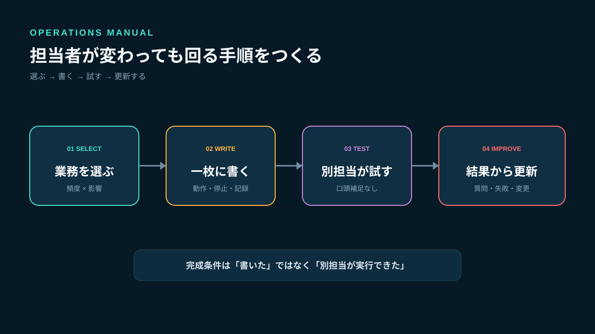
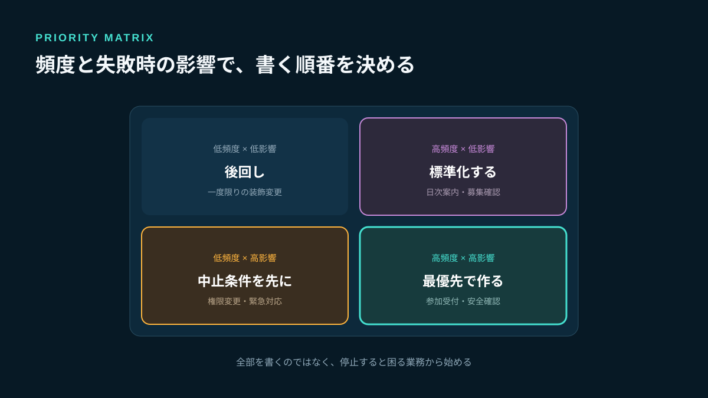
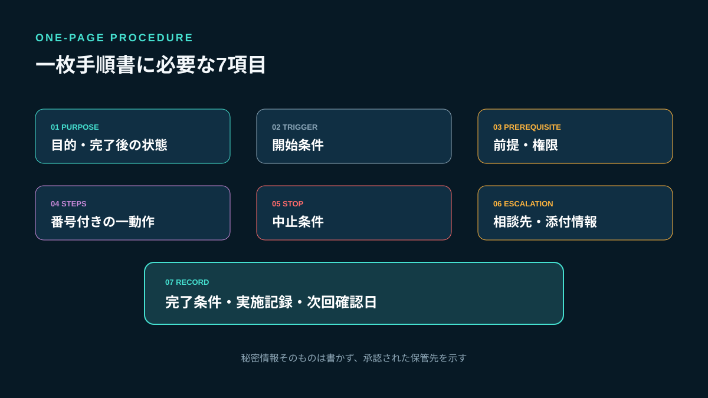
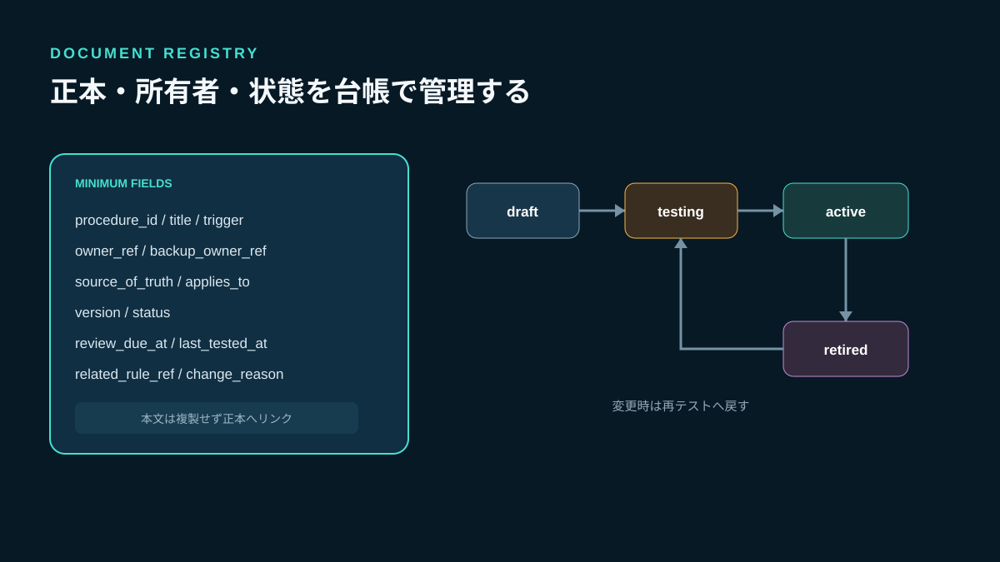
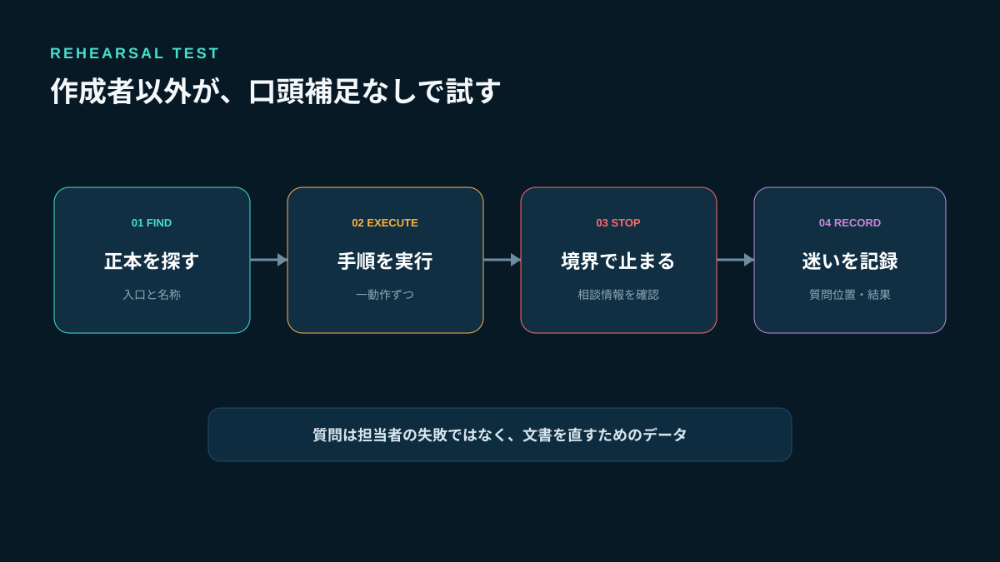
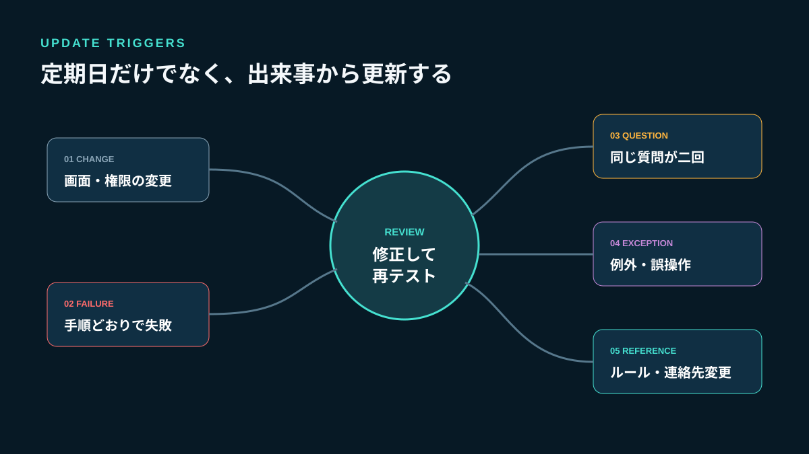

# ゲームコミュニティ運営マニュアルの作り方｜担当者が変わっても回る手順書

ゲームコミュニティの運営マニュアルは、知っていることを全部書く資料ではありません。担当者が不在でも、別の運営者が迷わず日常業務を始め、危険な場面では勝手に判断せず止まれるようにする道具です。長い説明を作っても、使う場面、完了条件、例外時の連絡先がなければ実務では開かれません。

Stult Partyなら、ゲーム募集、チャット、ボイスを一つのコミュニティにまとめて無料で始められます。参加者が活動する場所がまとまっていれば、募集確認、案内、会話の見守りといった手順の対象を整理しやすくなります。本記事では、現行機能にない自動化やマニュアル管理機能を前提にせず、運営者が共有文書で実践できる設計を扱います。



*業務を選び、一枚にまとめ、別担当が試し、運用結果から更新します。*

## マニュアル・ルール・引き継ぎ資料の役割を分ける

三つを一冊にまとめると、読む目的が曖昧になります。

| 文書 | 答える質問 | 主な内容 | 更新のきっかけ |
|---|---|---|---|
| ルール | 何を守るか | 参加基準、禁止事項、違反時の考え方 | 方針変更、問題の発生 |
| マニュアル | どう実行するか | 日常作業、判断点、中止条件、記録 | 手順変更、失敗、質問 |
| 引き継ぎ資料 | 今どこまで進んでいるか | 担当、進行案件、権限、期限 | 担当交代、長期不在 |

参加者向けの基準は[ゲームコミュニティのルール作り](/a/game-community-rules/)で公開し、運営者の交代に必要な資産や進行案件は[運営引き継ぎの30日計画](/a/game-community-handover/)で管理します。マニュアルには、日々繰り返す作業の再現方法だけを置きます。

## 最初に「書かない業務」を決める

すべてを文書化しようとすると、完成前に古くなります。次の二軸で優先順位を決めます。

- **発生頻度**：毎日、毎週、月次、まれ
- **失敗時の影響**：軽微、再作業が必要、参加者へ影響、安全や権限へ影響

頻度が高い業務と、失敗時の影響が大きい業務から着手します。たとえば、募集内容の確認、初参加者への案内、問い合わせの振り分け、迷惑行為の一次対応、招待入口の見直しです。一方、一度しか行わないデザイン変更や、担当者の感覚で行う雑談への参加まで手順化する必要はありません。



*高頻度の業務と、失敗時の影響が大きい業務から文書化します。*

### 書く前に15分だけ観察する

実際の担当者に作業してもらい、次を記録します。

1. 何が起きたら作業を始めたか
2. 最初にどこを確認したか
3. どこで判断に迷ったか
4. 何をもって完了としたか
5. 誰かへ相談した場面はあったか

理想の手順を聞くだけでは、無意識に行っている確認が抜けます。画面操作より先に、開始条件と判断点を拾ってください。

## 公式資料から取り入れる3つの執筆原則

Googleの開発者向けスタイルガイドは、手順を番号付きで示し、原則として一つのステップに一つの動作を書き、必要なら動作の結果や理由を続けることを勧めています（[Procedures](https://developers.google.com/style/procedures)）。「確認して問題がなければ案内して記録する」のような一文は、確認、判断、案内、記録へ分けます。

英国Home Officeの技術ガイドは、文書の利用者と、その人が文書を使って達成したいことから構成を考え、概念・作業・参照情報を分けるよう案内しています（[Write effective documentation](https://engineering.homeoffice.gov.uk/patterns/write-effective-documentation/)）。運営経験者が知っている前提を、新任担当も知っているとは限りません。

GitLabの公式Handbookは、同じ情報を複数箇所へ複製せず、正本を一つにして関連箇所からリンクする考え方を示しています（[GitLab Handbook Usage](https://handbook.gitlab.com/handbook/about/handbook-usage/)）。募集文の例を複数の手順書へ貼るのではなく、正本を一つ決めて参照させます。

この三原則をゲームコミュニティ運営へ置き換えると、**一動作ずつ書く、利用場面から並べる、同じ基準を複製しない**となります。

## 一枚の手順書に必要な7項目

日常作業は、次の7項目を一画面で確認できる長さから始めます。

### 1. 目的

「新規募集を確認する」ではなく、「必要事項が揃った募集を参加者が安心して選べる状態にする」のように、完了後の状態を書きます。

### 2. トリガー

作業を始める条件です。「毎日21時」「新規募集の投稿後」「問い合わせ受付後」のように観測できる言葉にします。

### 3. 前提と権限

必要な閲覧範囲、編集権限、参照するルールを示します。パスワードや秘密情報そのものは書かず、承認された保管先を案内します。

### 4. 番号付き手順

一つの番号には原則一つの動作を書きます。画面名だけでなく、確認する値と期待する結果も添えます。

### 5. 中止条件

続行してはいけない条件です。安全上の問題、権限不足、本人確認が必要、ルールにない事例などを列挙します。

### 6. エスカレーション先

誰へ、何を添えて、いつまでに相談するかを決めます。「管理者へ相談」だけでは担当者不在時に止まります。主担当と代行を示します。

### 7. 完了記録

作業日時、対象、実施者、結果、例外の有無、次回確認日を残します。会話全文ではなく、後から未完了を探せる項目に絞ります。



*目的から完了記録までを一つの単位にし、秘密情報は直接書きません。*

## そのまま使える一枚手順書テンプレート

次のテンプレートをコピーし、最初は一業務だけ作成してください。

```text
手順名：新規ゲーム募集の一次確認
目的：参加者が必要事項を確認して募集を選べる状態にする
トリガー：新規募集が公開されたとき
担当：募集支援担当／代行：当番責任者
所要時間の目安：5分

前提：募集ルールの最新版を確認できること

手順：
1. 対象の募集を開く。
2. ゲーム名、開始時刻、募集人数、参加条件を確認する。
3. 不足項目がある場合は定型文で投稿者へ確認する。
4. 問題がなければ確認済みとして記録する。

中止条件：危険な外部リンク、個人情報、ルール未定義の条件がある
相談先：安全担当。対象URL、確認時刻、該当箇所を添える
完了条件：必要事項が揃い、確認結果が記録されている
記録：対象ID／確認日時／担当／結果／次の対応
文書所有者：募集支援責任者
最終確認日：YYYY-MM-DD
```

手順内でStult Partyの機能として確認できるのはゲーム募集、チャット、ボイスです。自動承認、定型文送信、手順書管理などの未確認機能があるようには書かず、実際に利用できる操作と運営上の記録を分けてください。

## 実装者の視点：文書を台帳として管理する

共有フォルダにファイルを増やすだけでは、どれが最新版か分かりません。手順書ごとに最小限のメタデータを持たせます。

```text
procedure_id       一意の手順ID
title              手順名
trigger            開始条件
owner_ref          更新責任者
backup_owner_ref   代行責任者
source_of_truth    正本URL
applies_to         対象範囲
version            版番号
status             draft / testing / active / retired
review_due_at      次回見直し日
last_tested_at     最終実地テスト日
related_rule_ref   関連ルール
change_reason      変更理由
```

本文の複製を台帳へ貼らず、正本URLだけを持たせます。`status`を分けると、作成途中の文書を現行手順として誤用しません。`last_tested_at`と`review_due_at`を別にするのは、読んだだけの見直しと、別担当が実行できた確認を区別するためです。



*下書き、テスト中、運用中、廃止を分け、正本と更新責任者を一つにします。*

## 別担当による実地テストを行う

作成者が自分の手順を試しても、抜けた前提を脳内で補ってしまいます。業務を普段担当していない運営者に、口頭説明なしで試してもらいます。

### テスト中に観察すること

- 最初に開く文書を見つけられたか
- トリガーを正しく判断できたか
- 手順の途中で別資料を探したか
- 中止条件で実際に止まれたか
- 相談先と添付情報が分かったか
- 完了条件と記録場所が一致したか

テスト担当が質問したら、その場で答えて終わらせず、質問が出た位置へ不足情報を追加します。ただし説明を増やす前に、不要な手順を削れないか確認してください。



*口頭補足なしで実行し、迷った位置と中止判断を記録します。*

## 例外対応は「自由判断」ではなく分岐にする

すべての例外を列挙することはできません。代わりに、担当者が判断してよい範囲と、止めて相談する境界を決めます。

```text
通常：既存ルールに一致 → 手順を続行
軽微な不足：定型確認で解消可能 → 投稿者へ確認
判断不能：ルールにない／複数解釈 → 作業を止めて責任者へ
緊急：安全・権限・個人情報に影響 → 公開対応を増やさず安全担当へ
```

例外を長い体験談として残すと、次の担当者は違いを判断できません。「観測した条件」「行った判断」「次回から追加する分岐」に分けて更新します。迷惑行為の緊急初動は[荒らし・大量投稿への初動と復旧手順](/a/game-community-raid-response/)へ分離し、日常の募集確認マニュアルへ複製しません。

## 更新を発生させる5つのトリガー

「半年ごとに見直す」だけでは、その間に手順が壊れます。次の出来事を更新トリガーにします。

1. 画面、権限、運用場所が変わった
2. 手順どおりでも完了できなかった
3. 担当者から同じ質問が二回出た
4. 例外対応や誤操作が起きた
5. 参照するルールや連絡先が変わった

変更時は版番号だけでなく、変更理由と影響する手順を記録します。旧版は削除して痕跡をなくすのではなく、運用対象から外したことが分かる状態で保管します。参加者へ伝える必要がある変更だけ、短い告知へ変換します。



*変更、失敗、反復質問、例外、参照先更新を検知して再テストします。*

## マニュアルの成果を測る5指標

ページ数や文字数は成果ではありません。運営が止まらず、判断のばらつきが減ったかを確認します。

| 指標 | 見る内容 | 改善の判断 |
|---|---|---|
| 発見時間 | 必要な手順を開くまでの時間 | 入口と名称を直す |
| 完遂率 | 口頭補足なしで完了できた割合 | 不足前提や手順を直す |
| 中止精度 | 危険な条件で正しく止まれたか | 中止条件を具体化する |
| 反復質問数 | 同じ質問が繰り返された回数 | 該当箇所へ短く追記する |
| 期限超過数 | 見直し日を過ぎた運用中文書 | 所有者か対象範囲を見直す |

個人の評価には使いません。質問が出たことを担当者の失敗にすると、文書の欠陥が報告されなくなります。どこで迷ったかを手順の改善データとして扱います。

## よくある失敗

### 完璧な一冊を作ってから公開する

完成を待つほど現場との差が広がります。高頻度の一業務を一枚で作り、テスト後に運用中へ移します。

### 画面のスクリーンショットだけを並べる

画面が変わると使えなくなり、判断理由も残りません。画像は補助にし、確認項目、期待する結果、中止条件を文章で残します。

### 作成者と所有者が同じだと思い込む

文章を書いた人が退いた後も、業務の責任者が更新できる構造にします。所有者と代行者を明記します。

### チャットの固定投稿を正本にする

会話に埋もれ、変更履歴や関連手順を追えません。チャットには正本へのリンクと更新通知だけを置きます。

### 例外を担当者の経験へ戻す

「状況に応じて対応」では属人化が残ります。自由判断できる範囲と止める境界を明示します。

## 7日間の導入計画

### 1日目：業務を10件書き出す

頻度と失敗時の影響で並べ、一件だけ選びます。

### 2日目：実際の作業を観察する

開始条件、判断点、完了条件、相談場面を記録します。

### 3日目：一枚テンプレートへ落とす

7項目を埋め、関連ルールは複製せずリンクします。

### 4日目：別担当が試す

口頭補足をせず、迷った位置と中止判断を確認します。

### 5日目：削ってから補う

不要な説明を削り、抜けた前提と判断条件だけ追加します。

### 6日目：台帳へ登録する

正本、所有者、版、状態、見直し日、実地テスト日を登録します。

### 7日目：運用開始を案内する

対象業務、正本URL、質問先、次回見直し日を運営チームへ共有します。

## FAQ

### マニュアルは何ページが適切ですか？

ページ数ではなく、一つの利用場面を迷わず完了できる単位にします。日常業務は一枚から始め、概念説明や参照情報は別文書へ分けてリンクしてください。

### 一人運営でも必要ですか？

必要です。将来の協力者だけでなく、忙しいときの自分が判断を再現できます。まず高頻度か高影響の一業務だけ作ります。

### 動画だけではだめですか？

操作の雰囲気は伝わりますが、必要箇所を検索しにくく、画面変更時の修正範囲も大きくなります。短い動画を使う場合も、トリガー、中止条件、完了記録は文章で残します。

### Stult Partyにマニュアル管理機能はありますか？

この記事は専用のマニュアル管理機能を前提にしていません。現行のゲーム募集、チャット、ボイスを同じコミュニティで運営し、手順書は承認した共有文書で管理する想定です。

## まとめ：良いマニュアルは判断を奪わず、迷う境界を示す

運営マニュアルは、経験者の知識を長文で保存するものではありません。頻度と影響から対象業務を選び、目的、トリガー、前提、番号付き手順、中止条件、相談先、完了記録を一枚にします。正本と所有者を一つにし、別担当の実地テストで初めて運用中へ移してください。

Stult Partyなら、ゲーム募集、チャット、ボイスを一つのコミュニティにまとめて無料で始められます。活動場所を整理したうえで、まず今日繰り返した作業を一件選び、「何が起きたら始め、どの状態なら終わりか」を二行で書くところから始めましょう。
