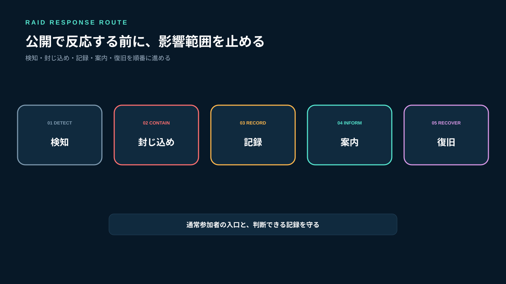
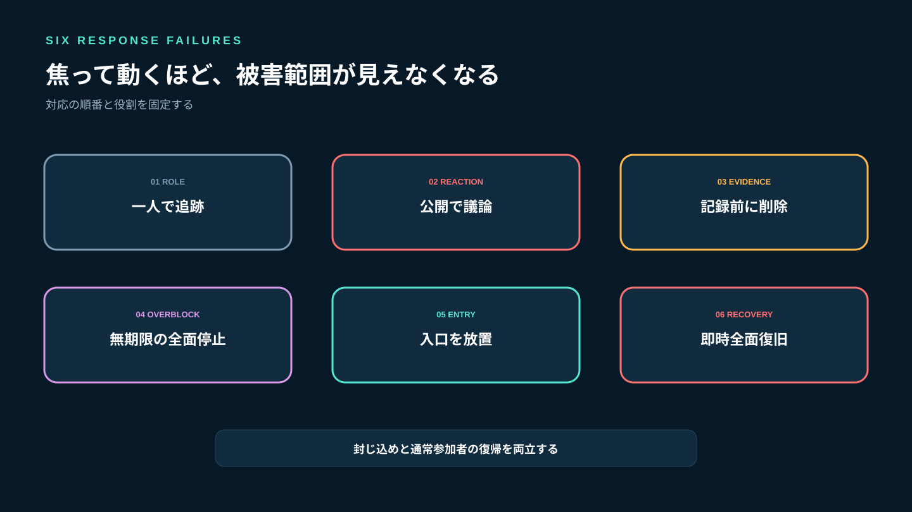
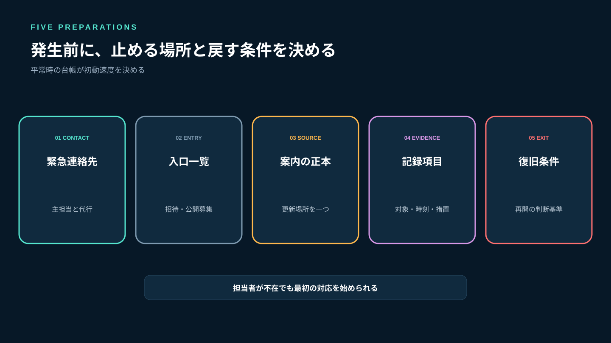
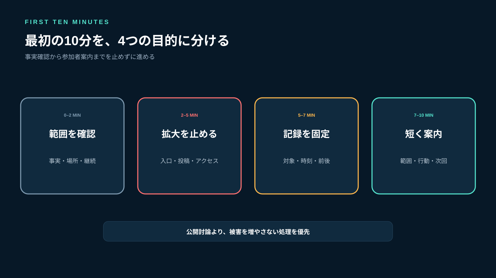
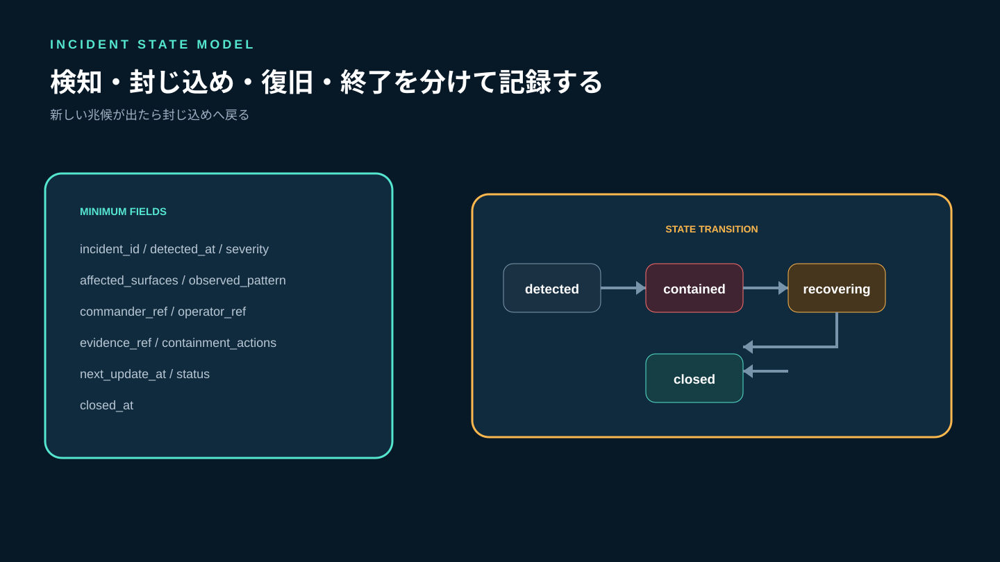
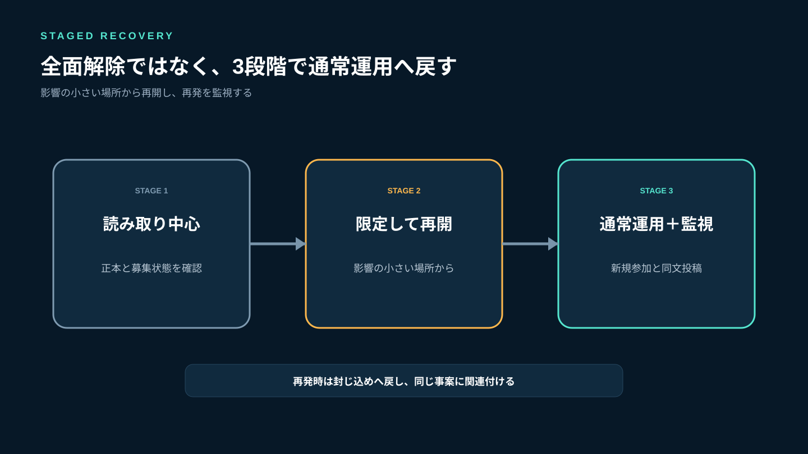
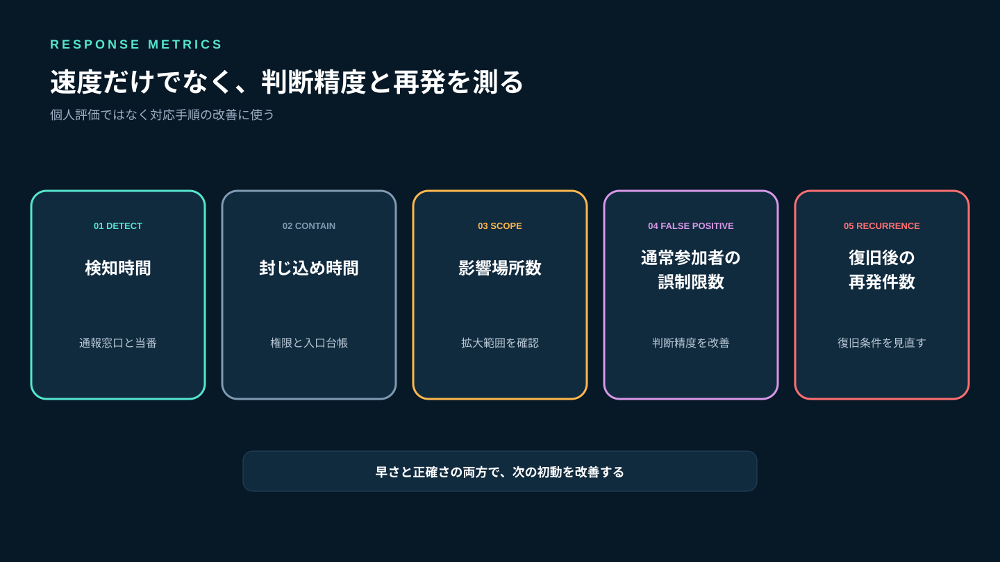

# ゲームコミュニティの荒らし対策｜大量投稿・妨害への初動と復旧手順

ゲームコミュニティの荒らしは、不快な発言が一件届く場合だけではありません。短時間の大量投稿、複数アカウントの参加、募集の埋め尽くし、ボイスへの妨害、招待リンクの転載が同時に起きることがあります。対応が遅れると通常の会話と募集が流れ、参加者が状況を確認するためにさらに投稿し、被害範囲が広がります。

初動で優先するのは犯人探しや公開討論ではなく、**影響範囲を止め、通常参加者の入口を確保し、判断に必要な記録を残すこと**です。Stult Partyなら、ゲーム募集、チャット、ボイスを一つのコミュニティにまとめて無料で始められます。平常時から募集・連絡・集合の正本を決めておけば、荒らし発生時にも止める範囲と復旧順序を整理できます。

この記事では、発生前の準備、最初の10分、証拠記録、参加者への案内、段階復旧、事後レビューまでを運営者向けに解説します。



*検知、封じ込め、記録、案内、復旧を順番に進めます。*

## 荒らし対応が失敗する6つの原因

### 1. 一人で全投稿を追いかける

削除と返信を同時に続けると、見落としが増えます。指揮、操作、記録、案内を分け、少人数なら優先順位だけでも固定します。

### 2. 荒らしと公開で議論する

反応が増えるほど通常の会話が埋まり、便乗も起きます。説明や異議申立ては別の窓口にし、公開面では封じ込めを優先します。

### 3. 証拠を残す前に消す

投稿を消す必要があっても、対象、時刻、場所、前後関係を記録しないと、後から判断を検証できません。

### 4. 全体を無期限で停止する

安全のための一時制限でも、期限と復旧条件がなければ通常参加者が離れます。停止範囲を最小化し、次回更新時刻を伝えます。

### 5. 招待リンクを放置する

入口が流出した状態で投稿だけを止めても、新しいアカウントが入り続けます。使用中の招待リンクを棚卸しし、必要なものだけ再発行します。

### 6. 収束後すぐ通常運用へ戻す

再参加や再投稿の波が残っている可能性があります。読み取り中心、限定投稿、通常運用の順で段階的に戻します。



*公開討論、記録不足、過剰停止、入口放置、即時全面復旧を避けます。*

## 公式資料から学べる3つの原則

Slackの公式セキュリティガイドは、招待を管理者承認制にし、保留中・承認済みの招待を定期確認し、不要なアカウントを無効化する考え方を示しています（[ワークスペースを守るセキュリティのヒント](https://slack.com/help/articles/115004155306-Security-tips-to-protect-your-workspace)）。入口と権限を平常時から管理することが、発生時の封じ込めにつながります。

LINEの公式ヘルプでは、特定メッセージを通報すると対象と前後のやり取りが送信され、トークルーム自体の通報では直近の複数メッセージが送られます（[迷惑行為を通報する方法](https://help.line.me/line/IOSSecondary/?contentId=20000298&lang=ja)）。単独の文面だけでなく、前後関係を含めて記録する重要性が分かります。

CISAのインシデント対応プレイブックでは、分析に必要なデータを保全し、影響を受けた対象を隔離し、認証情報や特権アクセスを見直し、封じ込め後も新たな兆候を監視する流れが示されています（[Cybersecurity Incident and Vulnerability Response Playbooks](https://www.cisa.gov/sites/default/files/2024-08/Federal_Government_Cybersecurity_Incident_and_Vulnerability_Response_Playbooks_508C.pdf)）。企業システム向けの文書ですが、記録、封じ込め、復旧、監視という順序はコミュニティ運営にも応用できます。

Stult Partyに自動荒らし検知、投稿速度制限、一括ロックなどの未確認機能があるという意味ではありません。使える権限や設定を事前に確認し、運営手順として役割と判断基準を用意します。

## 平常時に用意する5つのもの

### 1. 緊急連絡先

運営者が一人不在でも対応を始められるよう、主担当と代行者を決めます。個人の電話番号を公開する必要はなく、運営用の連絡場所を一つ決めます。

### 2. 停止できる入口の一覧

招待リンク、公開ディレクトリ、外部SNSの募集投稿など、新規参加につながる入口を一覧化します。誰が停止・更新できるかも記録します。

### 3. 参加者向けの正本

障害や荒らし発生時に、通常参加者が見る場所を一つ決めます。複数のチャットへ異なる説明を投稿しません。

### 4. 証拠記録の項目

対象アカウント、時刻、場所、投稿内容、前後関係、実施した措置を記録します。必要以上の個人情報を集めず、閲覧できる運営者を限定します。

### 5. 復旧条件

新規参加が止まった、妨害投稿が一定時間ない、運営者が状況を確認できた、正本を更新した、というように通常運用へ戻す条件を決めます。



*連絡先、入口、正本、記録、復旧条件を平常時にそろえます。*

## 最初の10分で行うこと

### 0〜2分：事実と範囲を確認する

一件の迷惑投稿か、複数人・複数場所に広がる妨害かを確認します。通常参加者まで荒らしと決めつけないよう、観測した事実だけを共有します。

```text
確認時刻：［JST］
影響場所：［募集／チャット／ボイス］
観測内容：［連投／同文投稿／複数参加／音声妨害］
継続中か：はい／いいえ／不明
```

### 2〜5分：被害の拡大を止める

可能な範囲で、新規参加の入口、問題が起きている場所への投稿、対象者のアクセスを制限します。全コミュニティを止める前に、影響場所だけで済むかを判断します。

### 5〜7分：記録を固定する

削除前に、対象、時刻、投稿、前後の流れを保存します。スクリーンショットだけでなく、どの場所で誰が確認したかを文字でも残します。

### 7〜10分：短い状況案内を出す

詳細や推測を公表せず、影響範囲、参加者に求める行動、次回更新時刻を伝えます。

```text
現在、一部の場所で迷惑投稿を確認し、投稿範囲を一時的に制限しています。
通常参加者は反応・再投稿をせず、この案内を確認してください。
募集とボイスの扱いは［正本］で更新します。
次回案内：［時刻］
```



*確認、封じ込め、記録、案内の順で進め、公開討論はしません。*

## 実装者の視点：インシデントを状態遷移で管理する

対応者の記憶だけでは、制限を解除する時期や実施済みの操作が分かりません。事案を次の状態で管理します。

```text
incident_id         事案ID
detected_at         検知日時
severity            low / medium / high
affected_surfaces   recruitment / chat / voice / invite
observed_pattern    flood / duplicate / multi_account / audio
commander_ref       指揮担当
operator_ref        操作担当
evidence_ref        記録の保管先
containment_actions 封じ込め操作
next_update_at      次回案内時刻
status              detected / contained / recovering / closed
closed_at           終了日時
```

`detected`では観測事実を集め、`contained`では新しい被害が増えない状態を確認します。`recovering`では場所ごとに制限を戻し、再発がなければ`closed`へ進めます。新しい兆候が出たら`contained`へ戻します。

重大度は不快さではなく影響で決めます。単一場所・短時間ならlow、複数場所や通常募集への影響があればmedium、運営権限や多数のアカウントが関係すればhighといった基準を事前に用意します。



*検知、封じ込め、復旧、終了を分け、新しい兆候があれば封じ込めへ戻します。*

## 証拠記録で残すもの・残さないもの

### 残すもの

- 対象の表示名と運営上の参照ID
- 投稿日時と場所
- 投稿内容と前後の文脈
- 招待リンクや流入元が判明している場合の識別子
- 運営が実施した制限、削除、連絡
- 判断者と判断時刻

### むやみに残さないもの

- 関係のない参加者の個人情報
- 必要性のない端末情報や外部アカウント
- 噂や未確認の本人特定情報
- 一般チャットへの証拠画像の再掲

記録の目的は公開処罰ではなく、判断の検証、再発防止、サービスへの通報です。保管場所と閲覧者を限定し、不要になった記録の見直し日を決めます。

通常の違反記録や警告基準は[ゲームコミュニティのルール作り](/a/game-community-rules/)と整合させてください。偽運営DMや偽リンクが含まれる場合は[なりすまし・詐欺対策](/a/game-community-impersonation-scam-prevention/)も参照します。

## 復旧は3段階で行う

### 段階1：読み取り中心で正本を確認

参加者が状況と今後の予定を確認できるようにします。進行中の募集が中止・延期・継続のどれかを明示します。

### 段階2：限定した場所から投稿を再開

運営案内、既存メンバーの会話、募集の順など、影響が小さい場所から戻します。招待リンクは棚卸し後に必要なものだけ再発行します。

### 段階3：通常運用へ戻して監視

通常運用へ戻した時刻を記録し、一定時間は新規参加数、同文投稿、削除件数を確認します。再発時に同じ事案へ関連付けられるようにします。



*全面解除ではなく、影響の小さい場所から戻して再発を監視します。*

## 事後レビューで見る5つの指標

### 検知時間

最初の妨害から運営が把握するまでの時間です。長い場合は通報窓口と当番を見直します。

### 封じ込め時間

検知から新しい被害が増えなくなるまでの時間です。操作権限や入口一覧が不足していないかを確認します。

### 影響場所数

募集、チャット、ボイス、招待入口のうち何か所へ広がったかを記録します。

### 通常参加者の誤制限数

荒らしではない参加者を誤って制限した件数です。速度だけでなく判断精度も見ます。

### 復旧後の再発件数

制限を戻した後に同じパターンが再発した回数です。多い場合は復旧条件を厳しくします。



*個人の成績ではなく、検知・封じ込め・判断・復旧の改善に使います。*

## よくある失敗

### 全員へ返信禁止を求めるだけ

入口と投稿範囲が開いたままでは止まりません。参加者への案内と、運営側の封じ込め操作をセットにします。

### 理由を公開で問い詰める

公開面では反応を増やします。異議申立てや事実確認は個別窓口へ分けます。

### すべての新規参加者を疑う

通常参加者の定着を損ないます。時刻、投稿パターン、流入元など観測事実を使い、関係のない人まで一律に扱いません。

### 収束宣言だけして終える

停止した募集、無効化した招待、誤制限の見直しが残ります。復旧チェックリストと事後レビューまでを事案に含めます。

## よくある質問

### 迷惑投稿はすぐ削除してよいですか？

被害拡大を防ぐため削除が必要な場合があります。ただし、可能なら対象、時刻、場所、前後関係を運営用に記録してから行います。違法性など個別判断が必要な場合は専門家や公的窓口へ相談してください。

### コミュニティ全体を止めるべきですか？

影響範囲だけの制限で止められるかを先に判断します。複数場所へ急速に広がる、運営権限が関係するなどの場合は、より広い一時停止を検討します。

### 参加者へどこまで説明しますか？

確認済みの影響範囲、現在の制限、参加者に求める行動、次回更新時刻を伝えます。未確認の人物特定や詳細な攻撃手順は共有しません。

### Stult Partyに自動荒らし対策機能はありますか？

この記事では、自動検知、一括ロック、投稿速度制限などの未確認機能を前提にしていません。現行のゲーム募集、チャット、ボイスを同じコミュニティで運営し、利用可能な権限と招待設定を確認した上で手順を整えます。

## まとめ：反応する前に、範囲を止めて正本を守る

荒らし対応では、すべての投稿へ返信するより、影響範囲と入口を止めることが先です。最初の10分を事実確認、封じ込め、記録、参加者案内に分け、担当と次回更新時刻を決めます。

削除前には対象、時刻、場所、前後関係を記録し、参加者向けの説明は正本へ集めます。収束後は読み取り中心、限定再開、通常運用の順で戻し、再発を監視してください。

Stult Partyなら、ゲーム募集、チャット、ボイスを一つのコミュニティにまとめて無料で始められます。平常時から募集・連絡・集合の正本を同じ活動拠点へ置くことで、非常時にも守る場所と復旧順序を判断しやすくなります。荒らしへの反応を増やすのではなく、通常参加者が安心して次の募集へ戻れる運営を作りましょう。
