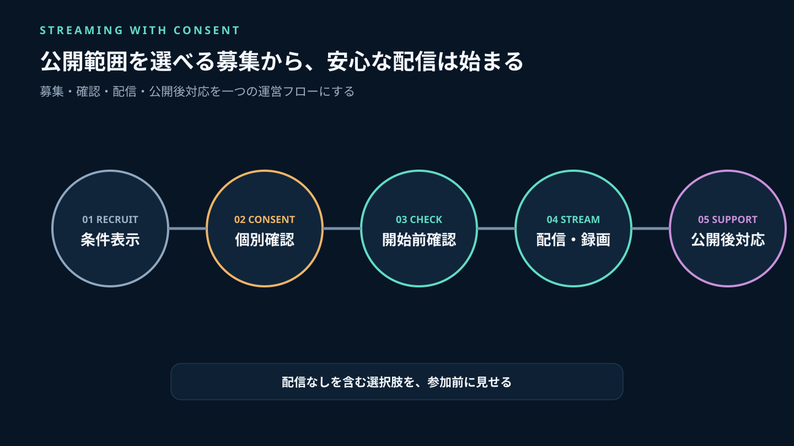
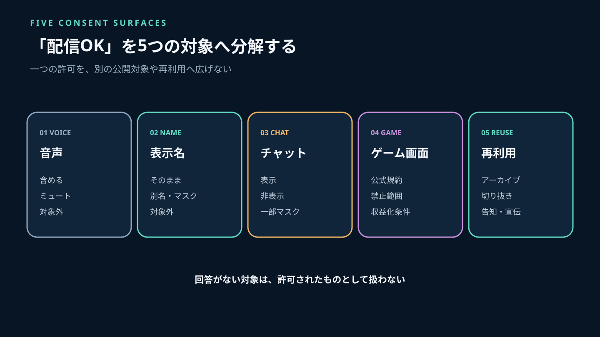
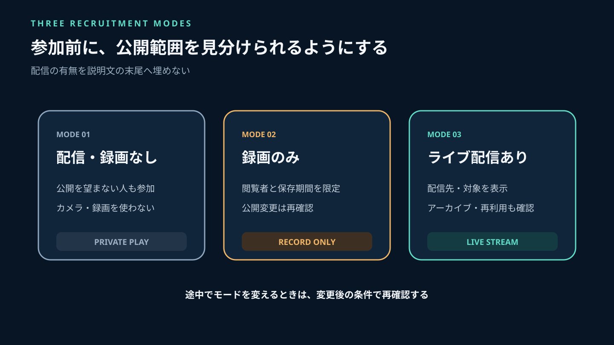
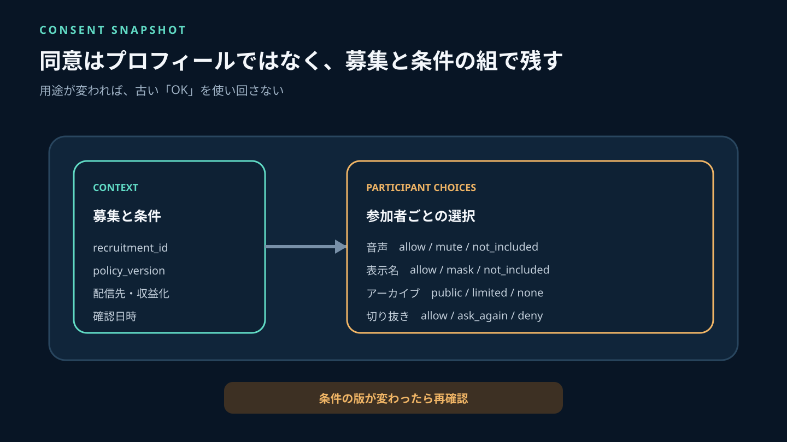
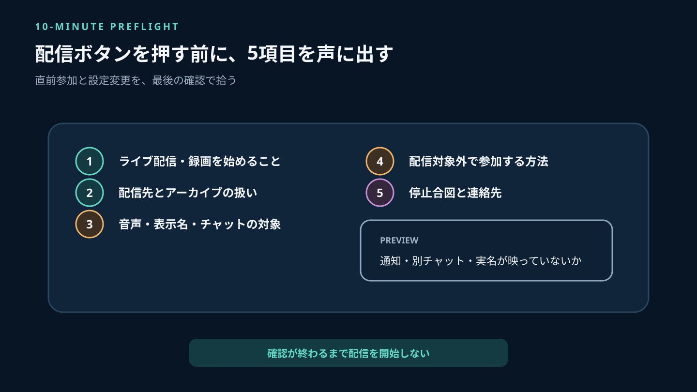
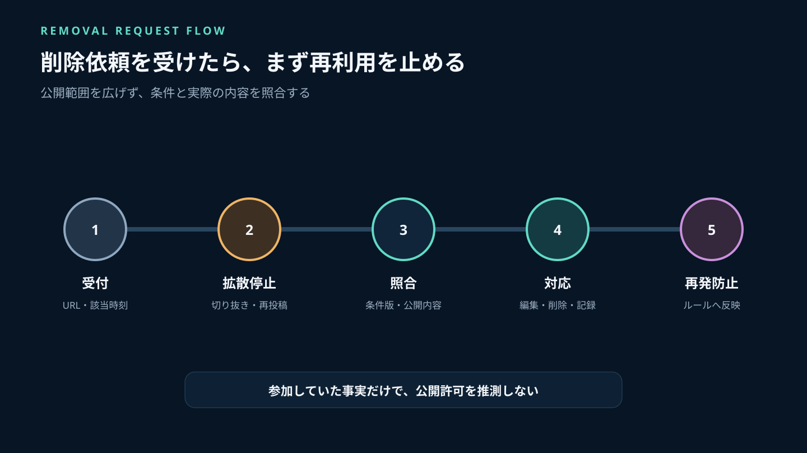
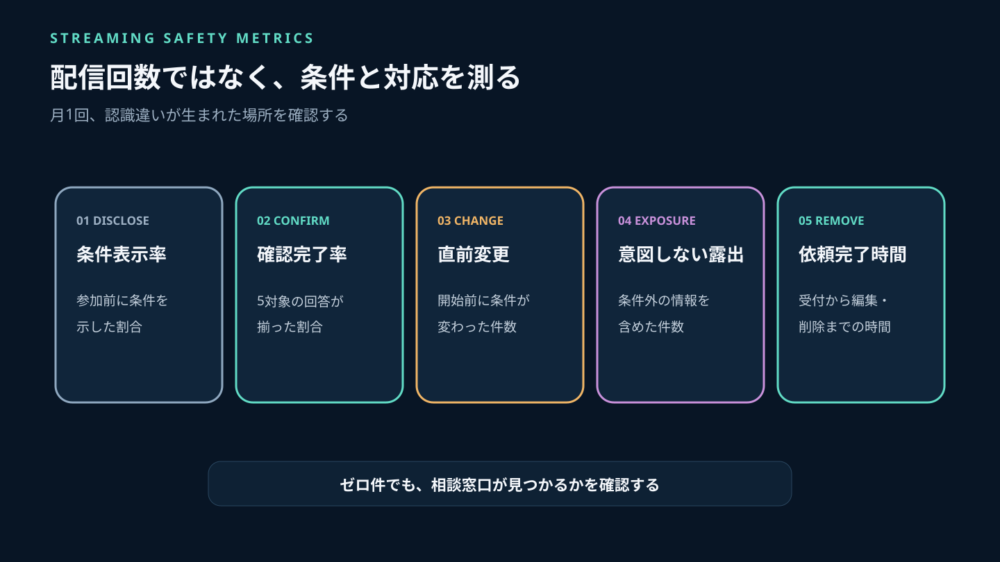

ゲームコミュニティで配信や録画を始めるとき、「配信します」と一言伝えるだけでは不十分です。参加者によって、音声はよいが表示名は出したくない、ライブ配信はよいが切り抜きへの再利用は困る、チャット内容は映さないでほしい、と許容範囲が違うからです。

トラブルの原因は、配信そのものより、**何が映るか、どこへ公開されるか、いつまで残るか、後から何に使われるかが分かれていないこと**にあります。運営者は「配信可・不可」の一項目ではなく、音声、表示名、チャット、ゲーム画面、クリップ再利用を別々に扱う必要があります。

Stult Partyなら、ゲーム募集、チャット、ボイスを一つのコミュニティにまとめて無料で始められます。募集時に配信条件を明記し、参加者が条件を確認してからチャットやボイスへ進む導線を作れば、開始直前の認識違いを減らせます。

この記事では、小規模コミュニティの運営者が使える配信・録画ルール、同意スナップショット、開始10分前の確認、公開後の削除依頼への対応まで解説します。



*募集時の表示、参加者ごとの確認、開始前チェック、公開後の窓口を一つの流れにします。*

---

## 先に結論：配信許可を一つのチェック欄にしない

運営ルールは、最低でも次の5対象を分けます。

| 対象 | 確認すること | 配慮例 |
|---|---|---|
| 音声 | 会話をライブ・録画へ含めるか | 聞き専、収録対象外のボイス |
| 表示名 | ゲーム名・アカウント名を見せるか | 別名、画面上のマスク |
| チャット | テキストを画面へ映すか | オーバーレイを非表示 |
| ゲーム画面 | プレイ映像を公開できるか | 対象ゲームの公式規約を確認 |
| 再利用 | アーカイブ・切り抜き・宣伝へ使うか | 保存期間と利用先を限定 |

「ボイス参加したから録画へ同意した」「配信を知っていたから切り抜きにも使える」と広げて解釈しません。ライブ、アーカイブ、短いクリップ、SNS告知への再利用は公開範囲と残り方が違います。

配信者、参加者、ゲームの権利者、配信プラットフォームの条件も別です。参加者全員が了承しても、ゲーム会社のガイドラインや配信先の規約を満たすとは限りません。反対に、ゲーム会社が動画投稿を認めていても、参加者の音声や表示名を無断で公開してよいことにはなりません。



*音声・表示名・チャット・ゲーム画面・再利用を独立した条件として扱います。*

## まず公式ルールを3層で確認する

### 1. ゲーム会社・権利者のガイドライン

ゲームごとに、配信できる範囲、発売前コンテンツ、収益化、音楽、ネタバレ、法人利用などの条件が異なります。タイトル名と「動画投稿ガイドライン」「配信ガイドライン」で公式ページを確認し、投稿する日に最新版を見ます。

任天堂の公式ガイドラインは、動画投稿とストリーミング配信の両方を対象とし、第三者の知的財産を使う場合は別途許諾が必要と説明しています。また、ガイドラインは随時更新されるため投稿前に最新版を確認するよう案内しています（[ネットワークサービスにおける任天堂の著作物の利用に関するガイドライン](https://www.nintendo.co.jp/networkservice_guideline/ja/index.html)）。これは一社の例であり、他社タイトルへそのまま適用しません。

### 2. 配信・動画プラットフォームの規約

YouTubeのプライバシー案内は、映像・音声・氏名・連絡先などを、個人が一意に特定できるかの判断要素として挙げ、他人を撮影したり個人情報を投稿したりする前に許可を得るよう案内しています（[YouTubeで自分の身元を保護する](https://support.google.com/youtube/answer/2801895?hl=ja)）。

Twitchのコミュニティガイドラインは、許可なく私的空間から配信するなど、他者の合理的なプライバシーへの期待を侵害するコンテンツを、私的情報の無断共有の例として示しています（[Twitchコミュニティガイドライン](https://safety.twitch.tv/s/article/Community-Guidelines?language=ja)）。配信者は、配信へ含まれる内容が規約に従うよう確認する責任を負います。

### 3. コミュニティ内の参加条件

公式規約が許す範囲より、コミュニティルールを慎重に設定できます。たとえばゲーム側で配信可能でも、「初心者向け募集では参加者全員の個別確認が取れない限り配信しない」と決められます。

法的な権利関係はタイトル、投稿者の属性、利用内容、地域によって異なります。本記事は一般的な運営設計であり、個別の適法性は権利者の公式窓口や専門家へ相談してください。

## 募集を3種類に分け、タイトルで見分けられるようにする

配信条件を説明文の末尾へ埋めると、参加者が見落とします。募集タイトルか冒頭に、次のいずれかを表示します。

### 配信なし

ライブ配信も録画も行いません。初参加者や、公開を望まない人が選べる募集として残します。

### 録画のみ・非公開確認

配信はせず、振り返り用に録画します。誰が見られるか、保存期間、公開へ変更する場合の再確認を明記します。「後で良い場面があれば公開」は条件が変わるため、録画時の了承だけで進めません。

### ライブ配信あり

配信先、開始予定、アーカイブの有無、切り抜き利用、映る対象を募集時に示します。参加後に初めて知らせるのではなく、参加判断の前へ置きます。

```text
【ライブ配信あり】
配信先：［サービス・チャンネル］
対象：ゲーム画面／参加者の音声／表示名／チャット
アーカイブ：公開・限定・なし
切り抜き：作成する・作成しない・別途確認
収益化：あり・なし
参加条件：各項目を確認後に参加
配信対象外で参加する方法：［聞き専・別ボイスなど］
問い合わせ：［運営窓口］
```

Stult Partyで募集を作る場合は、この要点を募集本文の上部に置きます。チャットで追加条件が決まったら、散らばった発言だけで済ませず、募集本文または固定した正本を更新します。一般的な募集項目は[ゲームコミュニティの人の集め方](/a/game-community-recruitment/)も参照してください。



*参加前に三つのモードを見分けられるようにし、途中で公開範囲を広げません。*

## 実装者の視点：同意は「現在値」ではなくスナップショットで残す

参加者プロフィールへ一度だけ「配信OK」と登録する設計は危険です。同じ人でも、ゲーム、参加メンバー、配信先、公開期間によって判断が変わるからです。募集ごとに条件と回答の組を保存します。

```text
consent_id          確認記録のID
recruitment_id      対象の募集
policy_version      提示した条件の版
participant_ref     参加者の参照ID
voice               allow / mute / not_included
display_name        allow / mask / not_included
text_chat           allow / hide / not_included
live_stream         allow / deny
archive             public / limited / none
clip_reuse          allow / ask_again / deny
confirmed_at        本人が確認した日時
confirmed_by        確認を受けた担当者
```

`policy_version`が重要です。配信先、収益化、アーカイブ、切り抜きの条件を変えたら版を更新し、変更後の条件で再確認します。古い「OK」を新しい用途へ流用しません。

`allow`だけでなく、`mute`、`mask`、`not_included`を持たせると、参加を諦めなくても配信対象から外れる選択肢を作れます。回答がない状態は許可と見なさず、配信対象に含めません。

この台帳は配信者だけの個人メモにせず、運営責任者が確認できる場所へ置きます。ただし参加者の回答は必要な担当者だけが閲覧し、公開一覧にしません。



*条件の版と参加者ごとの選択を組にして、別の配信へ許可を使い回さないようにします。*

## 開始10分前に5項目を声に出して確認する

募集時に確認していても、直前参加や設定変更が起きます。配信開始前に主催者が次を読み上げます。

1. これからライブ配信または録画を始めること
2. 配信先とアーカイブの扱い
3. 音声・表示名・チャットのどれが含まれるか
4. 配信対象外で参加する方法
5. 問題があった場合の停止合図と連絡先

確認中は配信を開始しません。配信ソフトのプレビューで、通知、フレンド一覧、別チャット、メールアドレス、実名を含むウィンドウが映っていないかも確認します。

```text
この募集は［配信先］でライブ配信します。
ゲーム画面と［対象］が含まれ、アーカイブは［扱い］です。
切り抜きは［扱い］です。
条件と違う場合、または配信対象外を希望する場合は今お知らせください。
途中でも「ストップ」と伝えれば、状況を確認して配信を止めます。
```

聞き専やボイスへの不安を含む参加設計は、[ボイスチャットに参加しやすいコミュニティ設計](/a/game-community-voice-chat-participation/)で詳しく解説しています。



*配信を始める前に、条件、対象外の方法、停止合図、画面上の情報を再確認します。*

## 配信中の停止ルールを先に決める

トラブルが起きてから「どの程度なら止めるか」を議論すると対応が遅れます。次の条件では、配信者の判断だけで続行せず、一度停止または安全な画面へ切り替えます。

- 本名、住所、学校、連絡先などが表示・発言された
- 配信対象外の参加者の音声や表示名が入った
- ゲーム外の通知や個人チャットが映った
- 対象ゲームの禁止範囲や未公開部分に入った可能性がある
- 参加者から停止合図があった
- 攻撃的な発言や、切り取られると重大な誤解を招く状況が起きた

停止は違反認定ではありません。事実を確認するための安全動作です。主催者と配信者を分けられる場合は、主催者が参加者の状態を見て、配信者は画面と音声の制御に集中します。

## 公開後に削除・編集依頼が来たときの手順

### 1. 受付を伝える

投稿URL、該当時刻、対象となる音声・表示名・チャットを確認します。公開チャットで詳細を書かせず、指定窓口へ移します。

### 2. 拡散を止める

確認中は、新しい切り抜き作成、SNSへの再投稿、宣伝利用を止めます。可能なら公開範囲を限定します。

### 3. 同意スナップショットと実際の公開内容を照合する

提示した条件、本人の回答、公開された内容、編集の有無を分けて確認します。「参加していた」という事実だけで公開範囲を推測しません。

### 4. 対応を決めて記録する

削除、非公開化、該当部分の編集、説明追加などを実施し、完了時刻と公開先を記録します。プラットフォームの申立て手続が必要な場合は公式窓口も案内します。

YouTubeは、本人の知らないうちに動画が投稿された場合、投稿者へ削除を依頼し、合意できない場合などはプライバシー侵害の申立て手続を利用できると案内しています。コミュニティ内で早く対応できれば、参加者が外部申立てだけに頼る状況を避けやすくなります。

### 5. 再発防止を募集ルールへ戻す

個人名を共有せず、「通知画面が映った」「切り抜き条件が曖昧だった」のように原因を一般化し、チェックリストを更新します。問い合わせの受付・状態管理は[ゲームコミュニティの問い合わせ対応](/a/game-community-inquiry-management/)も参照してください。



*受付後は再利用を止め、条件と公開内容を照合してから編集・削除・再発防止へ進みます。*

## そのまま使える配信・録画ルール

```text
1. 配信・録画の有無は募集タイトルと本文に表示します。
2. 音声、表示名、チャット、アーカイブ、切り抜きを別々に確認します。
3. 回答がない参加者を配信・録画の対象に含めません。
4. 条件を変更した場合は、変更後の内容で再確認します。
5. 配信対象外を選んでも、可能な範囲で参加できる方法を用意します。
6. 開始前に配信先、公開範囲、停止合図を読み上げます。
7. 個人情報や対象外の内容が入った場合は、確認のため配信を止めます。
8. 切り抜きや宣伝への再利用は、募集時の条件を超えて行いません。
9. 削除・編集の相談窓口と、必要な情報を明示します。
10. ゲーム会社と配信先の最新公式ガイドラインを投稿前に確認します。
```

コミュニティ全体のルールへ入れるのは原則です。配信先、アーカイブ期間、参加者ごとの選択は募集ごとに記録します。

## 運営者が月1回確認する5つの指標

### 条件表示率

配信・録画を伴う募集のうち、参加前に条件が表示されていた割合です。

### 確認完了率

開始時の参加者のうち、5対象の回答が記録された割合です。未回答を許可へ含めません。

### 直前変更件数

開始10分前に配信条件が変わった回数です。多い場合は募集時の記載や配信者との連携を見直します。

### 意図しない露出件数

通知、表示名、音声、チャットなどが条件外で含まれた件数です。公開後だけでなく、開始前プレビューで発見して防いだ件数も記録します。

### 削除・編集依頼の完了時間

受付から公開停止、編集、削除などの対応完了までを測ります。件数がゼロでも、窓口が見つからないだけでないか確認します。



*配信回数ではなく、条件表示、確認、変更、意図しない露出、依頼対応を測ります。*

## よくある失敗

### コミュニティ参加時の一括同意だけで済ませる

参加時点では、将来の配信先や切り抜き用途が分かりません。募集ごとに条件を提示します。

### ボイスに入った人は配信を知っていると考える

ボイス参加と公開への同意は別です。開始前に音声が含まれることを確認します。

### 配信者だけが条件を持っている

主催者や運営者が確認できず、トラブル時に引き継げません。条件の版と回答を運営記録へ残します。

### 録画のみから公開へ勝手に変更する

公開範囲が変わります。アーカイブや切り抜きへ使う場合は再確認します。

### ゲーム会社のガイドラインを一度見て終わる

ガイドラインは更新され得ます。投稿前に公式ページを確認し、確認日を記録します。

## よくある質問

### 配信を禁止したほうが安全ですか？

一律禁止だけが選択肢ではありません。配信なしの募集を必ず残し、配信ありは条件を明示して選べるようにすると、公開を望まない人も参加できます。

### 録画して後で確認するだけなら同意は不要ですか？

用途が限定されていても、何を録るか、誰が見られるか、いつ削除するかを事前に説明してください。法的判断が必要な場合は専門家へ相談してください。

### 途中参加者はどう扱いますか？

配信対象へ入れる前に条件を提示し、回答を確認します。確認できるまでは音声・表示名を含めない運用にします。

### 配信者が個人で行う場合もコミュニティルールは必要ですか？

募集やボイスをコミュニティ内で行うなら必要です。個人チャンネルの運用と、参加者が安心して選べる募集条件を分けて考えます。

## まとめ：配信を増やす前に、選べる参加条件を作る

ゲーム配信や録画は、コミュニティの活動を外へ伝える手段になります。一方、音声、表示名、チャット、アーカイブ、切り抜きを一括で扱うと、参加者の想定を超えた公開につながります。

配信なし、録画のみ、ライブ配信ありを募集時に見分けられるようにし、5対象を個別に確認してください。同意はプロフィールへ固定せず、募集IDと条件の版を組にしたスナップショットで残します。開始10分前に再確認し、停止合図と削除依頼の窓口も用意します。

Stult Partyなら、ゲーム募集、チャット、ボイスを一つのコミュニティにまとめて無料で開始できます。まず配信なしの募集を含めて選択肢を用意し、配信ありの募集には条件を冒頭へ明記してください。参加者が公開範囲を理解して選べる状態が、配信活動とコミュニティの信頼を両立する土台になります。
