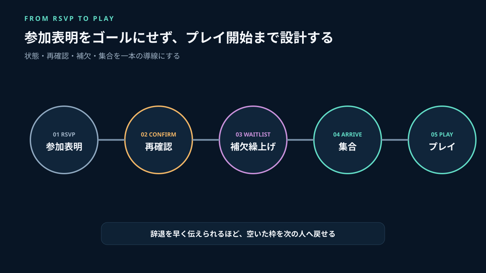
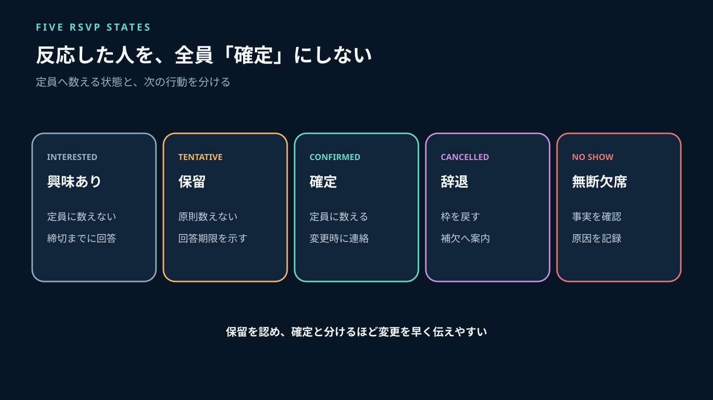
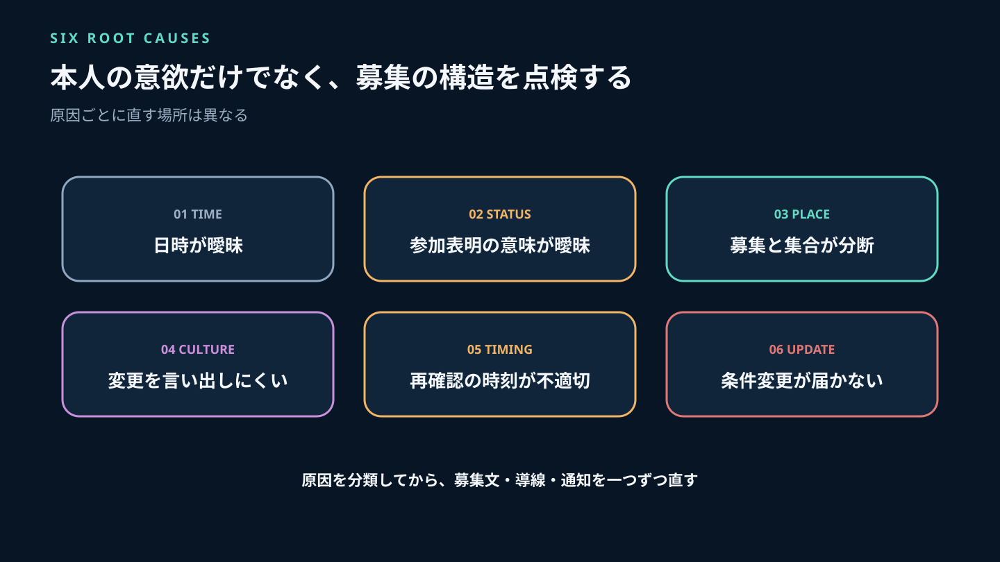
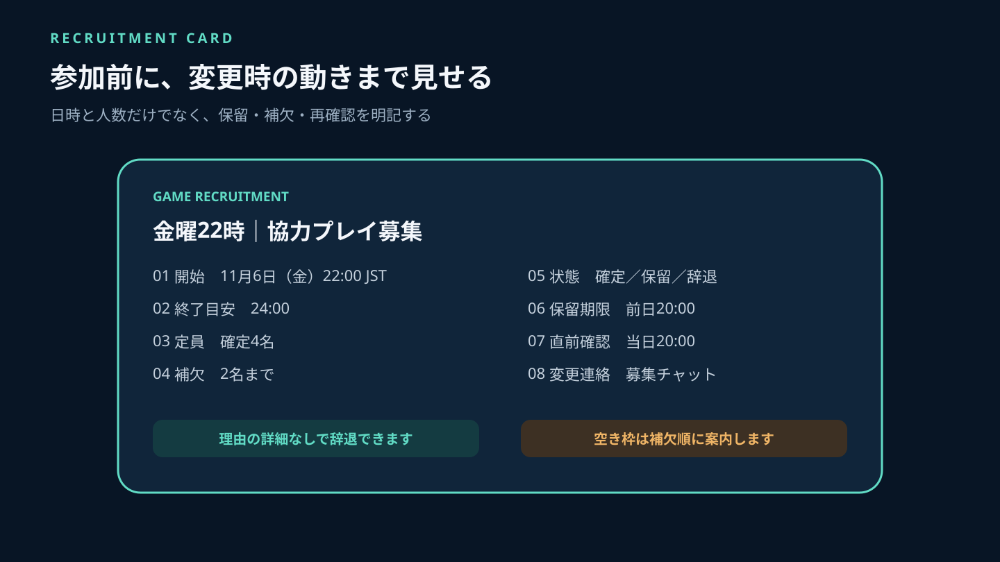
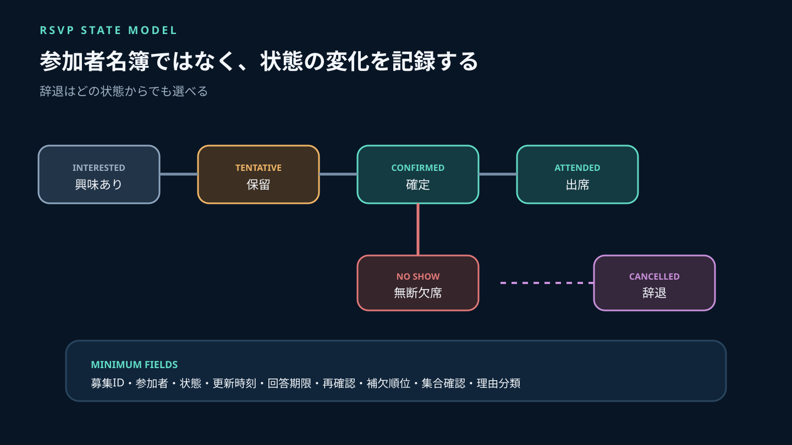
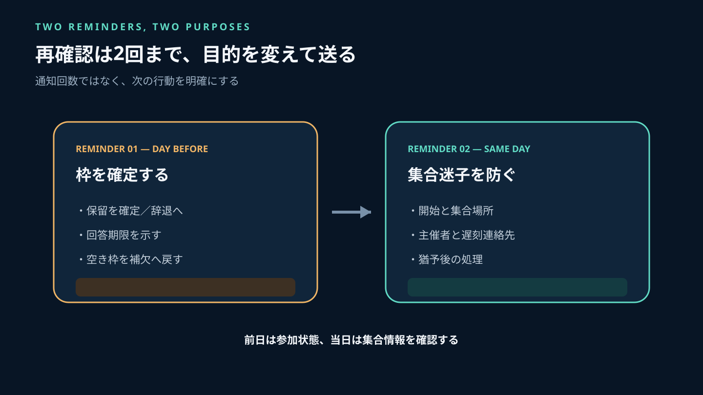
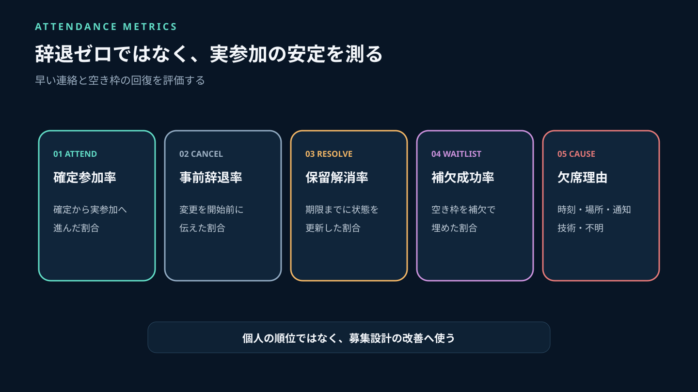

ゲーム募集で定員が埋まったのに、開始時刻になっても人が来ない。主催者が個別に連絡し、残った参加者は待ち、結局必要人数を満たせず中止になる。こうした無断欠席は参加者一人の問題に見えますが、運営側の募集設計で減らせる部分があります。

特に失敗しやすいのは、「興味がある」「行けるかもしれない」「参加を確定する」をすべて同じ参加表明として数えることです。予定が変わること自体を責めても改善しません。**確定・保留・辞退を分け、変更を早く伝えられる入口と、空いた枠を補欠へ戻す流れを作る**ことが重要です。

Stult Partyなら、ゲーム募集、チャット、ボイスを一つのコミュニティにまとめて無料で始められます。募集条件、参加状況、当日の連絡先を同じ活動拠点で案内し、参加表明から集合までの迷いを減らせます。

この記事では、キャンセルを罰で抑えるのではなく、状態管理、再確認、補欠繰上げ、当日の連絡、再発防止で参加率を改善する方法を解説します。



*参加表明をゴールにせず、再確認、集合、開始までを一つの導線として設計します。*

---

## 先に結論：参加者を責める前に5つの状態を分ける

参加状況は、最低でも次の5つに分けます。

| 状態 | 意味 | 定員へ数えるか | 次の行動 |
|---|---|---:|---|
| 興味あり | 条件を見て検討中 | 数えない | 締切までに回答 |
| 保留 | 参加したいが予定未確定 | 原則数えない | 再確認時刻を示す |
| 確定 | 条件を確認し参加予定 | 数える | 変更時に辞退連絡 |
| 辞退 | 事前に不参加へ変更 | 数えない | 補欠を繰り上げる |
| 無断欠席 | 連絡なく開始確認にも反応なし | 結果として記録 | 個別確認と再発防止 |

「反応した人」を定員へ数えると、保留が実参加者として扱われます。反対に、保留を認めず確定か辞退だけを迫ると、不確実な人が確定を選びやすくなります。保留には期限を設け、期限までに確定しなければ枠を補欠へ戻す設計にします。

無断欠席も、最初から悪意と断定しません。開始時刻の誤認、タイムゾーン、通知の見落とし、募集場所と集合場所の分断、急な事情などを切り分けます。繰り返しや他の参加者への影響が大きい場合に限り、段階的な対応へ進みます。



*興味・保留・確定を混ぜず、定員へ数える状態を明確にします。*

## カレンダーの公式仕様から学べること

Google Calendarの公式ヘルプでは、招待への回答を「参加する」「参加しない」「未定」に分け、主催者が回答状況を追跡できます。参加できない場合は別時刻を提案する仕組みもあります（[招待へ回答する](https://support.google.com/calendar/answer/37135?hl=ja)、[回答状況を追跡する](https://support.google.com/calendar/answer/16713792?hl=ja)）。

Microsoft Outlookも、会議への回答を承諾、仮承諾、辞退に分け、変更時は主催者が更新通知を送る設計です（[Outlookで予定表を管理する](https://support.microsoft.com/ja-jp/outlook/manage-your-calendar-in-the-light-version-of-outlook)）。

これらはゲーム募集専用サービスではありません。しかし、次の考え方は応用できます。

- 確定と保留を同じ人数に数えない
- 状態変更を主催者へ届ける
- 参加できない人が代替時刻を伝えられる
- 主催者が全員の最新状態を一覧で確認する
- 条件変更時は参加者へ更新を知らせる

Stult Partyにカレンダーや自動繰上げの機能があるという意味ではありません。ゲーム募集とチャットを同じコミュニティ内に置き、募集本文と連絡ルールでこの状態管理を実現します。

## 無断欠席が起きる6つの原因

### 1. 日時の書き方が曖昧

「今週末」「夜から」では、参加者ごとに解釈が変わります。日付、曜日、開始時刻、終了目安、タイムゾーンを一緒に書きます。

### 2. 参加表明の意味が曖昧

リアクション、返信、口頭の返事のどれが確定なのか分からない状態です。「確定」「保留」「辞退」の選び方を募集内に書きます。

### 3. 募集と集合場所が分かれている

参加表明はSNS、変更連絡は別チャット、集合は別ボイスという状態では、直前確認が届きません。Stult Partyで募集、チャット、ボイスをまとめると、参加後に探す場所を減らせます。

### 4. 変更を言い出しにくい

キャンセルを強く責める文化では、参加者は早めに辞退せず、直前まで黙りがちです。「理由の詳細は不要」「分かった時点で状態だけ変更」と案内します。

### 5. 再確認が早すぎる、または遅すぎる

一週間前だけ確認しても当日の予定は変わります。開始直前だけでは補欠を探せません。募集締切と、補欠が動ける時刻から逆算します。

### 6. 主催者の条件変更が伝わっていない

開始時刻、必要人数、ゲームモード、ボイス条件を変更したのに、最初の投稿だけを見た参加者へ届いていません。正本を更新し、変更点をチャットで通知します。



*本人の意欲だけでなく、日時・状態・場所・文化・確認・変更通知を点検します。*

## 募集文に入れる8項目

```text
ゲーム：［タイトル・モード］
開始：［年月日・曜日・時刻・タイムゾーン］
終了目安：［時刻または所要時間］
定員：［確定枠］＋補欠［人数］
参加状態：確定／保留／辞退
保留の回答期限：［日時］
直前確認：［実施時刻・確認場所］
変更・辞退の連絡先：［チャットの場所］
```

終了目安がないと、参加者は次の予定と両立できるか判断できません。補欠人数と回答期限がなければ、空きが出ても誰に声をかけるか決まりません。

「キャンセル禁止」と書くより、「辞退はこのチャットへ、理由の詳細は不要、開始2時間前までなら補欠へ案内できる」と具体化します。連絡の心理的負担を下げつつ、早い変更に価値があることを伝えます。

募集文全体の作り方は[ゲームコミュニティの人の集め方](/a/game-community-recruitment/)も参照してください。本記事では参加表明後の管理に集中します。



*確定・保留・補欠・回答期限・直前確認を、参加前に見える場所へ置きます。*

## 実装者の視点：参加表明を状態遷移で管理する

参加者名だけの一覧では、誰が保留で、誰へ再確認したか分かりません。一行一人・一募集で記録します。

```text
recruitment_id      募集ID
participant_ref     参加者の参照ID
status              interested / tentative / confirmed /
                    cancelled / no_show / attended
status_updated_at   状態を変更した日時
confirm_by          保留から回答する期限
reminder_sent_at    再確認を送った日時
waitlist_order      補欠順位
cancelled_at        辞退連絡の日時
arrival_checked_at  集合確認の日時
reason_code         schedule / health / forgot / unclear /
                    technical / unknown
```

`reason_code`は責任追及ではなく改善のために使います。詳細な私生活や診断名を求めず、回答は任意にします。「忘れた」が多ければ再確認時刻を直し、「集合場所が不明」が多ければ参加導線を直します。

状態は`interested → tentative → confirmed → attended`が基本ですが、どこからでも`cancelled`へ移れます。確定後の辞退を禁止しません。早く辞退できるほど補欠を繰り上げやすくなる設計にします。

無断欠席は`confirmed`から開始確認に反応せず、主催者が確認した結果として`no_show`へ移します。接続トラブルや時刻誤認が判明した場合は記録を訂正します。



*保留・確定・辞退・出席・無断欠席を分け、変更時刻と再確認を記録します。*

## 再確認は2回まで、目的を変えて送る

### 1回目：補欠を動かせる時刻

開始24時間前など、補欠が予定を調整できる時刻に送ります。目的は参加者を急かすことではなく、保留を確定または辞退へ変えることです。

```text
明日［時刻］開始の募集を確認します。
現在の状態：［確定／保留］

参加できる場合は「確定」、難しい場合は「辞退」へ変更してください。
保留の回答期限は本日［時刻］です。理由の詳細は不要です。
期限後の空き枠は補欠の方へ案内します。
```

### 2回目：集合情報の最終確認

開始1〜2時間前に、集合時刻、ボイス、主催者、遅刻時の連絡先を短く送ります。ここでは参加意思をもう一度取り直すのではなく、迷わず集合できるようにします。

```text
本日［時刻］開始です。
集合：［ボイスまたはチャット］
主催：［名前］
遅れる・参加が難しくなった場合：［連絡先］
開始［分］分後まで連絡がなければ、補欠へ切り替えます。
```

何度も催促すると通知がノイズになります。再確認の回数より、回答期限と次の処理を明確にします。



*1回目は枠の確定、2回目は集合迷子の防止と目的を分けます。*

## 補欠繰上げを公平にする5つのルール

1. 補欠を受け付けるか募集時に示す
2. 順位は参加希望を受けた時刻など、説明できる基準で決める
3. 空きが出たら回答期限付きで一人ずつ案内する
4. 期限内に反応がなければ次の人へ進む
5. 繰上げ後は確定者一覧と定員を更新する

複数人へ同時に「空きました」と送り、最初に返事した人だけを採用すると、通知を常に見られる人が有利になります。補欠順位と短い回答期限を使います。

```text
空きが1枠出たため、補欠1番の方へご案内しています。
［時刻］までに参加可否を返信してください。
難しい、または期限までに返信がない場合は次の方へ案内します。
```

繰上げが開始直前になる場合は、参加者へ負担があることを認め、断っても不利益がないと伝えます。

## 当日に来ない人がいたときの手順

### 開始時刻：集合場所を一度確認する

別のボイスやチャットにいる可能性を確認します。個別連絡は決めた窓口から一度だけ送ります。

### 猶予終了：補欠へ切り替える

募集時に示した猶予を過ぎたら、残った参加者を待たせ続けず次の処理へ進みます。必要人数を下回る場合は、ゲームモード変更、中止、別募集への切替を主催者が判断します。

### 終了後：公開で問い詰めない

欠席者を一般チャットで名指しせず、個別に状況を確認します。急病や緊急事情の詳細を公開させません。

```text
本日の募集で集合を確認できませんでした。
今後の運営改善のため、近いものがあれば番号だけ教えてください。

1. 時刻を勘違いした
2. 集合場所が分からなかった
3. 通知を見落とした
4. 急な事情があった
5. 接続・機器の問題
6. 回答しない
```

個別の問い合わせを管理する方法は[ゲームコミュニティの問い合わせ対応](/a/game-community-inquiry-management/)を参照してください。

## 繰り返す無断欠席には段階的に対応する

一度の無断欠席で即退出にすると、誤認や緊急事情を扱えません。一方、何度も放置すると他の参加者が募集を信用しなくなります。

### 1回目：事実確認とルール再案内

日時、再確認、集合場所が届いていたかを確認します。運営側の不備があれば先に直します。

### 2回目：一定期間、補欠から参加

確定枠を優先的に確保せず、補欠または当日空き枠から参加してもらう方法があります。期間と解除条件を示します。

### 継続する場合：募集参加の制限を個別判断

他の参加者への影響、本人への説明、過去の記録を確認し、複数の運営者で判断します。人格評価ではなく、確認された行動と募集への影響を根拠にします。一般的な警告や退出判断は[ゲームコミュニティのルール設計](/a/game-community-rules/)と整合させてください。

## 週1回見る5つの指標

### 確定参加率

確定した人のうち実際に参加した割合です。募集ごとの必要人数も併記します。

### 事前辞退率

参加できなくなった人のうち、開始前に連絡できた割合です。辞退率そのものをゼロにするのではなく、無断欠席から事前辞退へ変わったかを見ます。

### 保留解消率

回答期限までに保留から確定または辞退へ更新された割合です。

### 補欠繰上げ成功率

空き枠のうち、補欠で埋められた割合です。直前案内が多い場合は期限を早めます。

### 無断欠席理由の構成

時刻誤認、集合場所、通知、技術問題、未知を集計します。個人を順位付けせず、募集設計の改善へ使います。



*辞退をゼロにするのではなく、早い連絡と補欠繰上げで実参加を安定させます。*

## よくある失敗

### 参加表明をすべて確定として数える

興味と保留を分け、定員へ数える条件を示します。

### キャンセル理由を詳しく聞く

必要なのは枠を戻すことです。理由の詳細を必須にせず、改善用の分類は任意にします。

### 直前に何度も通知する

前日は状態確定、当日は集合確認に目的を分け、原則2回までにします。

### 補欠全員へ同時に声をかける

二重確定が起きます。順位と回答期限を決め、一人ずつ繰り上げます。

### 無断欠席者を公開で注意する

事実確認と個別対応を先に行います。再発時の制限も期間と解除条件を示します。

## よくある質問

### キャンセル期限は何時間前がよいですか？

必要人数、補欠の集まりやすさ、参加者が予定を調整できる時間で変わります。罰の期限ではなく、補欠へ案内できる目安として設定してください。

### 保留は定員へ含めるべきですか？

原則は含めず、確定枠と分けます。少人数で柔軟に扱う場合も、何人が確定かを主催者が把握できるようにします。

### 急な体調不良も無断欠席として記録しますか？

開始後に連絡が届いた場合は、事実に合わせて辞退や遅刻へ訂正できます。記録は処罰のためではなく、募集運営を改善するために使います。

### Stult Partyに自動リマインダーや補欠機能はありますか？

この記事では、そのような未確認の機能があるとは前提にしていません。ゲーム募集、チャット、ボイスを同じコミュニティで運用し、募集本文と案内テンプレートで状態・期限・連絡先を明確にします。

## まとめ：キャンセルを隠させず、早く枠へ戻せる設計にする

ゲーム募集の参加率を上げるには、キャンセルそのものを禁止するのではなく、予定変更を早く伝えられる仕組みが必要です。興味、保留、確定、辞退、無断欠席を分け、確定だけを定員へ数えます。

募集には日時、終了目安、補欠、保留期限、再確認、連絡先を記載してください。再確認は、補欠を動かせる時刻と、集合迷子を防ぐ時刻の2回に分けます。無断欠席が起きたら公開で責めず、原因を分類し、繰り返す場合だけ段階的に対応します。

Stult Partyなら、ゲーム募集、チャット、ボイスを一つのコミュニティにまとめて無料で始められます。募集条件と変更連絡を同じ活動拠点へ寄せ、参加表明から実際のプレイまでの状態を見えるようにしてください。参加者が辞退を早く伝えられ、空いた枠が次の人へ戻るコミュニティほど、募集は安定して成立します。
