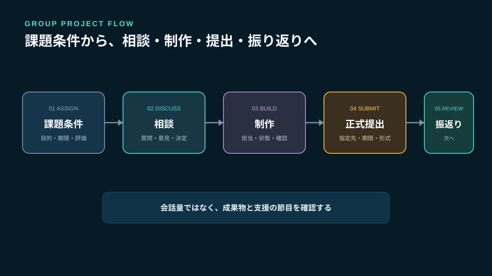
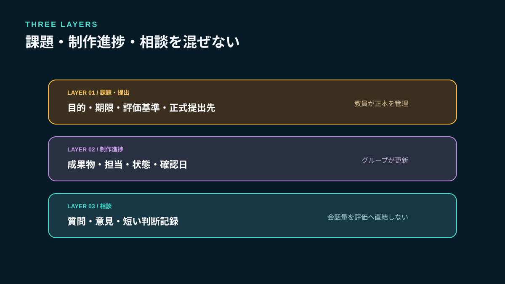
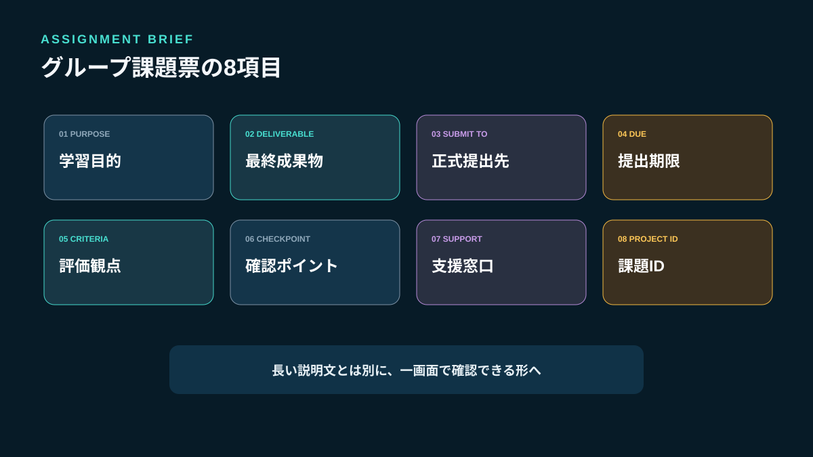
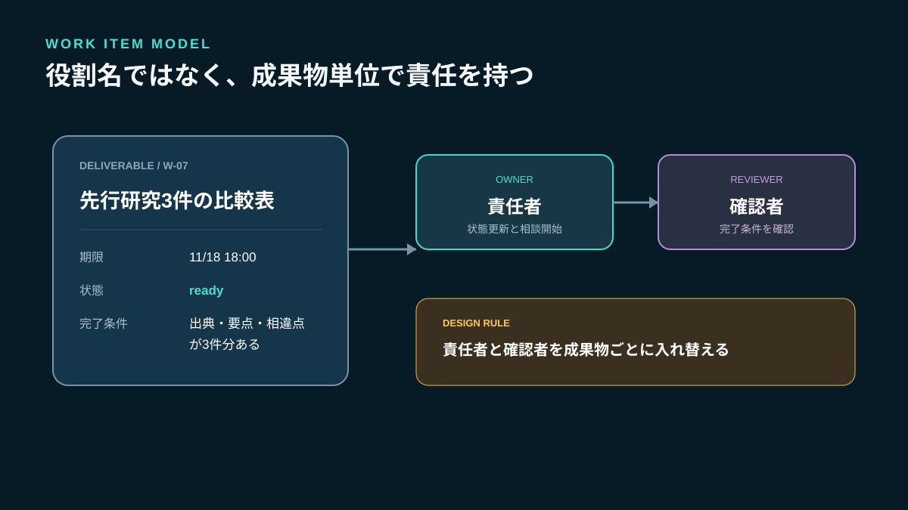
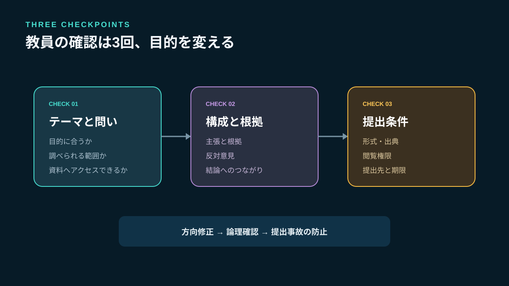
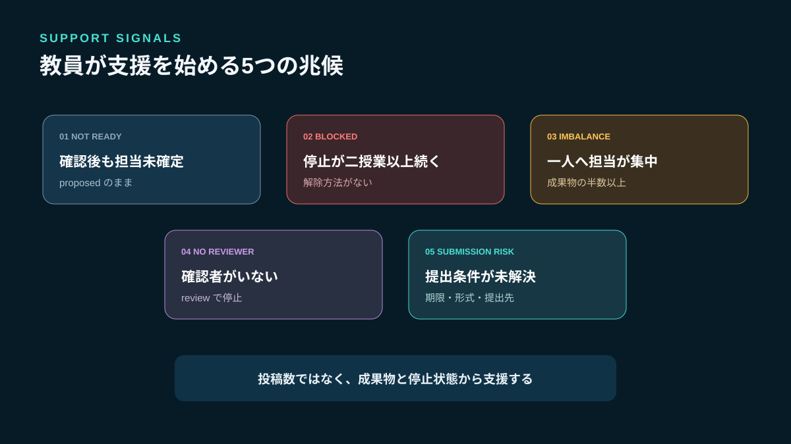

# グループ課題の進捗管理方法｜相談・担当・提出を分ける授業設計

グループ課題では、最終提出物だけを見ると「完成したか」は分かっても、誰がどの判断に関わり、どこで困り、どの作業が止まったかは分かりません。提出直前になって、担当が曖昧だった、調査結果が共有されていなかった、ファイルの最新版が分からないと判明することがあります。

必要なのは学習者の会話を常時監視することではありません。**課題の条件、グループ内の相談、成果物の進捗、正式な提出を分け、教員が確認すべき時点だけを設計すること**です。学習者には自分たちで進める余地を残し、支援が必要な兆候だけを教員へ届けます。

[Stult Partyの公式公開面](https://stult-party.com/)では、コミュニティ内のテキスト・ボイスチャンネル、直接通話、画面共有などが案内されています。グループ内の相談や資料確認に使える構成ですが、本記事では課題配布、成績管理、正式提出、出欠確認を行うLMS機能があるとは扱いません。学校・研修機関が承認した提出先と評価記録を正本にし、Stult Partyは相談場所として役割を限定します。



*課題条件と正式提出は教員が管理し、グループ内の相談と制作進捗を分けて見えるようにします。*

## グループ課題が止まる5つの原因

### 1. 課題の完成条件がグループごとに違う

「発表資料を作る」だけでは、ページ数、発表時間、必要な根拠、引用方法、提出形式が分かりません。学習者は作り始めてから条件を推測し、後で作り直します。

### 2. 役割名はあるが、成果物の担当者がいない

司会、書記、発表者を決めても、調査表、図表、原稿、参考文献一覧の責任者は決まりません。会議中の役割と成果物を完成させる責任は別です。

### 3. 「相談中」と「作業中」が同じ会話に埋もれる

意見、質問、決定、作業報告が時系列で並ぶと、何が確定したか探せません。チャットの活発さを進捗とみなすと、会話は多いのに成果物がない状態を見逃します。

### 4. 教員が完成直前まで状況を確認できない

最終提出だけを確認ポイントにすると、テーマの誤解や資料不足を修正する時間がありません。逆に毎日細かく確認すると、学習者の自己調整を奪います。

### 5. 正式提出と途中共有の場所が混ざる

チャットに貼ったファイルを提出済みと考える学生と、LMSへの提出だけを正式と考える教員がいると、未提出が起きます。相談用の共有と評価対象の提出を分ける必要があります。

## 公式資料から確認できる設計原則

文部科学省の資料では、協同学習を、小グループで協力して課題へ取り組み、個人の学習とグループ全体の達成を重視する学習方法として整理しています。役割分担や相互評価も例として挙げられています（[教職教養の成果報告書](https://www.mext.go.jp/content/20240724-mxt_kyoikujinzai01-000037215_125.pdf)）。単に一つの成果物を共同提出させるだけでなく、各人の関与とグループ全体の達成を両方見えるようにする必要があります。

Google Classroomの公式ヘルプでは、課題に対象者、期限、トピック、資料、ルーブリックなどを設定し、提出後に採点・返却できると案内しています（[課題を作成する](https://support.google.com/edu/classroom/answer/6020265)）。Microsoft Teams for Educationも、共同提出するグループと、個別に提出・評価する学習グループを区別しています（[グループ課題を作成する](https://support.microsoft.com/en-au/education/assignments/create-group-assignments-or-assign-to-individual-students)）。

製品ごとの機能差はありますが、共通する原則は次の三つです。

- 誰に何を求める課題かを最初に明示する
- 期限と提出状態を会話から分離する
- グループ成果と個人の学習確認を同じものにしない

## 相談・作業・提出を三つに分ける

グループ課題では、情報を次の三層へ分けます。

| 層 | 答える質問 | 主な内容 | 正本の管理者 |
|---|---|---|---|
| 課題・提出 | 何をいつまでに提出するか | 条件、期限、評価基準、提出物 | 教員 |
| 制作進捗 | 何がどこまでできたか | 成果物、担当、状態、確認日 | グループ |
| 相談 | 何に迷い、何を決めたか | 質問、意見、短い判断記録 | グループ |

相談の投稿数を評価へ直結させません。短時間で合意できたグループが不利になり、発言量だけを増やす可能性があるためです。評価に必要な証拠は、授業目的に合わせて成果物、振り返り、相互評価などから選びます。



*教員が管理する課題・提出と、学習者が進める制作・相談を混ぜません。*

## 最初に配る「グループ課題票」8項目

課題説明は長文だけで渡さず、次の項目を一画面で確認できる課題票にします。

```text
課題ID: EDU-PJ-2026-04
目的: 複数資料を比較し、根拠を示して提案する
最終成果物: 発表資料10枚以内 + 参考文献一覧
提出先: 学校指定LMSの課題ページ
提出期限: 2026-11-25 17:00 JST
評価観点: 根拠 / 構成 / 協働過程 / 振り返り
確認ポイント: 11/14テーマ、11/19構成、11/23最終確認
支援窓口: 授業内質問 / 個別相談の申込方法
```

### 目的と成果物を分ける

目的は何を学ぶか、成果物は何を提出するかです。「スライドを作る」が目的になると、見た目の完成だけが優先されます。比較、分析、説明、検証などの学習目標を先に示します。

### 提出先を一つに固定する

途中資料は相談場所へ共有しても、正式提出は学校指定の場所だけにします。「チャットに貼ったので提出済み」という解釈を防ぎます。

### 確認ポイントは提出期限から逆算する

完成度を毎日報告させるのではなく、テーマ確定、構成確認、最終確認のように、方向修正できる節目を設定します。



*目的、成果物、提出先、期限、評価、確認日、支援方法を最初に揃えます。*

## 役割名ではなく「成果物単位」で担当を決める

司会や発表者は活動を進める役割です。一方、進捗管理では成果物ごとの責任者が必要です。

```text
work_id: W-07
deliverable: 先行研究3件の比較表
owner: 学習者A
reviewer: 学習者B
due_at: 2026-11-18 18:00 JST
done_when: 出典URL、要点、相違点が3件分記入されている
status: ready
next_check_at: 2026-11-16 16:00 JST
help_needed: none
```

`owner`は一人で全部作業する人ではなく、状態を更新し、困ったときに相談を始める人です。`reviewer`は内容を確認する人です。同じ学生へ責任が集中しないよう、成果物ごとに入れ替えます。

完了条件は「調査する」「資料を作る」ではなく、別の人が完成を判定できる言葉にします。たとえば「出典がある3件の比較表」「2分で説明できる原稿」「引用箇所とページ番号が付いた参考文献一覧」です。



*活動上の役割とは別に、成果物ごとの責任者と確認者を置きます。*

## 進捗状態は6種類に固定する

自由記述の「だいたいできた」「作業中です」は、人によって意味が異なります。最小限の状態を決めます。

- `proposed`：担当者の確認前
- `ready`：条件と担当が決まり、着手できる
- `doing`：作業中
- `blocked`：資料不足、欠席、判断待ちなどで停止中
- `review`：成果物があり、確認待ち
- `done`：完了条件を確認した

`blocked`には、困っている内容、誰の支援が必要か、次に確認する時刻を必ず付けます。「分からない」で止めず、「統計資料の読み方を教員へ質問、11月16日の授業で確認」のように次の行動へ変えます。

進捗率を0〜100%で入力させる方法は、初期段階では避けます。50%が資料収集の半分なのか、作業時間の半分なのか比較できないからです。成果物と状態で確認した方が、次の支援を判断できます。

## 教員の確認は3回、目的を変える

### 1回目：テーマと問いを確認する

調べられる範囲か、課題の目的に合うか、必要な資料へアクセスできるかを見ます。ここで方向がずれていれば、制作前に直せます。

### 2回目：構成と根拠を確認する

主張、根拠、反対意見、結論の関係を見ます。装飾や文章表現より、論理の不足を先に直します。

### 3回目：提出条件を確認する

形式、出典、ファイル名、閲覧権限、提出先を確認します。内容への大きな介入は前の確認で終え、最終日は提出事故を防ぎます。



*確認ごとに目的を変え、完成直前の大幅なやり直しを避けます。*

## 教員が介入する5つのシグナル

学習者の自主性を守ることと、放置することは同じではありません。次の兆候を、教員が支援を始める基準にします。

1. 確認日を過ぎても`proposed`の作業がある
2. `blocked`が授業二回分以上変化していない
3. 一人が成果物の半数以上の`owner`になっている
4. `review`の確認者が決まっていない
5. 正式提出先や評価条件への質問が未解決である

介入は答えを与えることから始めません。「次に何を確認すれば進められるか」「誰へ質問すればよいか」「作業を小さく分けられるか」を一緒に決めます。

一方、投稿数が少ない、ボイス通話へ参加していないという理由だけで遅延と判断しません。対面で相談した、短時間で決めた、別の承認済み手段を使った可能性があります。成果物と確認ポイントを根拠にします。



*会話量ではなく、未確定・停止・偏り・未確認・提出条件の未解決を見ます。*

## Stult Partyをグループ相談に使う場合

公式公開面で確認できるテキスト・ボイスチャンネル、直接通話、画面共有は、グループごとの相談、短い質問、資料を見ながらの確認に使えます。たとえば、課題ごとに相談場所を決め、投稿の先頭へ`[質問]`、`[決定]`、`[進捗]`を付けます。音声で決めた内容も、決定だけは短くテキストへ戻します。

ただし、Stult Partyが学校指定LMSの代わりになるという意味ではありません。次の役割分担を明示します。

| 場所 | 役割 |
|---|---|
| Stult Party | グループ内相談、短い進捗共有、画面を見ながらの確認 |
| 学校指定の課題ページ | 課題条件、正式提出、期限、教員からの返却 |
| 制作物の正本 | 最新ファイル、出典、変更履歴 |
| 評価記録 | 教員が承認された環境で管理 |

学校・研修機関の規則で外部サービス利用が認められているか、未成年者の利用条件、アカウント作成、氏名や学籍情報の扱いを事前に確認してください。成績、健康情報、家庭状況、配慮事項などをグループチャットへ投稿しません。表示名やプロフィールを変えられる場合も、完全匿名化とは説明しないでください。

Stult Partyに課題配布、採点、出欠、自動進捗判定、学校向けSSO、監査ログ、SLAが提供中とは本記事では扱いません。教育機関の正式な要件を満たすかは、管理者が現行仕様と契約条件を別途確認する必要があります。

## グループ内で決める5つのルール

### 連絡できない時間帯を先に共有する

常時返信を前提にせず、確認できる時間帯と、緊急でない連絡の回答目安を決めます。

### 欠席者の作業を自動的に別の人へ移さない

期限への影響を確認し、本人へ連絡する期限を決めます。教員への相談が必要なら早めに上げます。

### 決定には期限と理由を付ける

「A案で進める」だけでなく、選んだ理由と、異論を出せる期限を短く残します。

### ファイル名へ「最終」を増殖させない

正本の場所を一つ決め、更新日時と担当者を記録します。チャット添付は確認用の複製と明示します。

### 困り事を評価上の失敗にしない

早く`blocked`へ変更したこと自体を減点すると、学習者は問題を隠します。停止を共有し、支援後にどう再開したかを振り返りの材料にします。

長期プロジェクトで判断理由と実行項目も管理する場合は、[会議の決定事項を実行につなげる方法](/a/meeting-decision-action-items/)の決定ログを、授業の規模に合わせて簡略化して使えます。

## よくある失敗と修正方法

### 全員へ同じ役割を割り当てる

「全員で調査」では、抜けが分かりません。調査対象や成果物へ分割し、責任者と確認者を一人ずつ決めます。

### 投稿数をそのまま貢献度にする

会話量と学習成果は一致しません。成果物、期限内の更新、振り返り、相互評価など複数の材料を使います。

### 教員がすべての相談へ即答する

学習者同士で確認できる問いまで教員が解決すると、待ち行列ができます。グループ内確認、資料確認、教員相談の順序を決めます。

### 最終ファイルだけで個人評価を決める

グループ成果だけでは、理解や担当の偏りが見えません。個人振り返り、短い口頭確認、担当した成果物など、授業目的に合う証拠を組み合わせます。

### 外部チャットを正式提出先にする

削除、見落とし、閲覧権限の違いが起きます。正式提出は学校が指定し、相談場所に提出済みの通知だけを載せます。

## 7日で導入する手順

### 1日目：課題票を作る

目的、成果物、提出先、期限、評価、確認ポイントを一枚にします。

### 2日目：成果物を分解する

調査表、構成案、図表、原稿、参考文献など、確認できる単位へ分けます。

### 3日目：責任者と確認者を決める

負担が一人へ集中していないか教員と学習者が確認します。

### 4日目：状態と完了条件を付ける

各成果物を`ready`以降へ進め、第三者が確認できる完了条件を書きます。

### 5日目：テーマ確認を行う

課題目的とのずれ、資料不足、範囲の広すぎを修正します。

### 6日目：停止項目だけを支援する

全項目の報告会を開かず、`blocked`と期限超過だけを確認します。

### 7日目：個人とグループで振り返る

自分が担当した成果物、助けを求めた場面、次回変えるルールを記録します。

## FAQ

### グループ全員に毎日進捗報告をさせるべきですか？

短期間の課題で毎日報告すると、報告自体が負担になります。成果物の状態が変わったときと、決めた確認ポイントで更新する方法から始めてください。

### 発言が少ない学生は貢献していないと判断できますか？

判断できません。調査、編集、確認など会話以外の貢献があります。成果物、担当履歴、振り返り、必要に応じた個別確認を組み合わせます。

### 学習者同士の相互評価だけで成績を決められますか？

相互評価には関係性や印象の影響があります。授業目的、評価基準、教育機関の方針に沿い、教員が複数の証拠を確認してください。本記事は個別の成績判断を示すものではありません。

### Stult Partyだけで課題配布から採点までできますか？

本記事では、そのようなLMS機能が提供中とは扱っていません。Stult Partyは確認できたチャット、ボイス通話、画面共有による相談場所として使い、課題配布、正式提出、採点は学校が承認した環境で行います。

## まとめ：グループ課題は会話量ではなく、成果物と支援の節目で見る

グループ課題を進めるには、課題条件、制作進捗、相談、正式提出を分けます。教員は課題票で目的と完成条件を示し、学習者は成果物ごとに責任者、確認者、期限、完了条件、状態を持たせてください。

教員の確認はテーマ、構成、提出の三段階に分け、`blocked`の長期化、担当の偏り、確認者不在などのシグナルへ介入します。投稿数や通話時間を貢献度と同一視しません。

Stult Partyは、公式公開面で確認できるテキスト・ボイスチャンネル、直接通話、画面共有を使い、グループ内で相談し、資料を一緒に確認する選択肢になります。正式提出と評価は承認済みの教育環境へ残し、まず一つの課題で、相談場所・成果物の正本・提出先の三つを分けるところから始めましょう。
