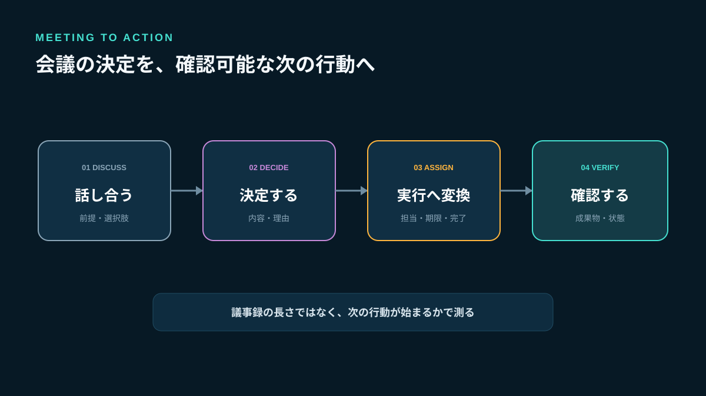
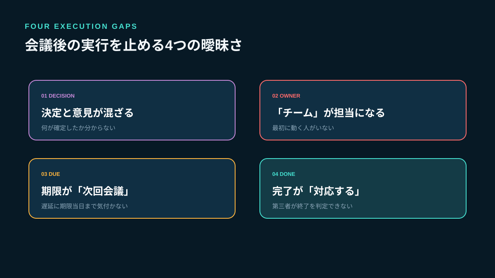
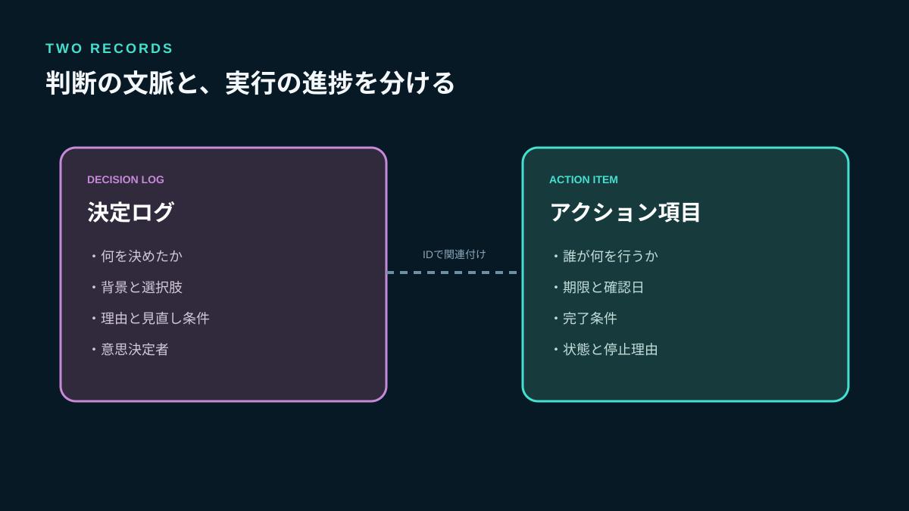
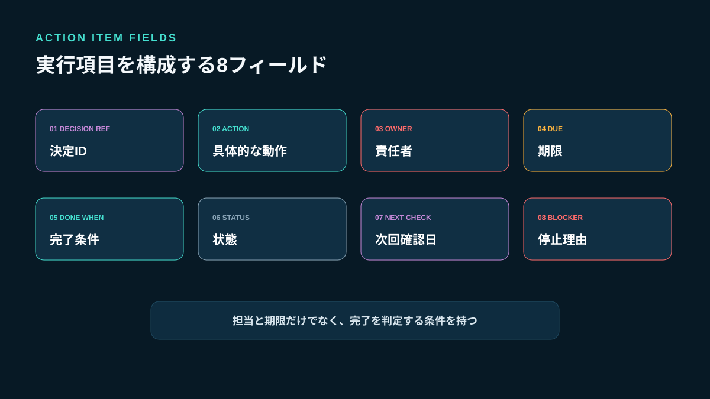
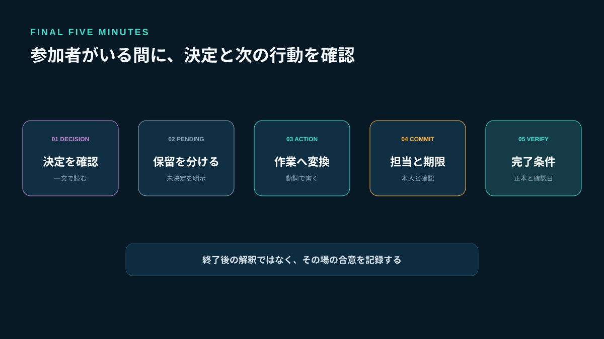
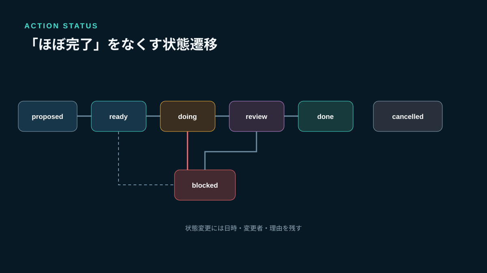

# 会議の決定事項を実行につなげる方法｜担当・期限・完了条件の管理テンプレート

会議で「進めましょう」と合意したのに、次の会議で同じ話を繰り返すことがあります。原因は議事録の不足だけではありません。決定した内容と、決定を実行する作業が混ざり、担当者・期限・完了条件が曖昧なまま会話が終わるからです。

必要なのは会議全文を細かく残すことではなく、**なぜその判断をしたかを示す決定ログと、誰が何をいつまでに終えるかを示すアクション項目を分けること**です。小規模チームでも、この二つを分けるだけで、確認のための再会議を減らせます。

[Stult Partyの公式公開面](https://stult-party.com/)では、コミュニティ内のテキスト・ボイスチャンネル、直接通話、画面共有などが案内されています。継続的に相談するチームの会話場所として活用できますが、本記事では自動議事録、自動タスク登録、監査ログなどの未確認機能を前提にしません。決定と実行項目は、チームが承認した共有文書やタスク台帳で管理します。



*会話をそのまま保存せず、決定ログと実行項目へ分けて次の確認につなげます。*

## 議事録だけでは仕事が進まない4つの理由

### 1. 決定と意見が同じ階層にある

発言順の議事録では、検討中の案、反対意見、最終決定が同じ見た目で並びます。欠席者はどれが確定した内容か判断できません。

### 2. 「チームで対応」が担当者になっている

複数人を担当にすると、誰が最初に動くか分かりません。協力者が複数いても、状態を更新する責任者は一人にします。

### 3. 期限が次回会議になっている

次回会議の日付だけでは、作業の提出時刻も、遅れると誰が困るかも分かりません。期限は日時で記録し、確認日は別に持ちます。

### 4. 完了条件が「対応する」で終わる

資料を作る、顧客へ送る、承認を得るでは完了状態が異なります。「何が確認できれば閉じるか」を書かなければ、担当者と依頼者の認識がずれます。



*決定、責任、期限、完了条件の曖昧さを別々に解消します。*

## 公式資料から確認できる基本原則

Microsoftの公式サポートでは、TeamsやOutlookの会議メモにフォローアップタスクを追加し、タスク名、担当者、期限を設定できると案内しています（[会議メモにタスクリストを追加する](https://support.microsoft.com/en-us/planner/add-a-task-list-to-meeting-notes)）。製品機能の説明ではありますが、会議後の実行項目に最低限必要な情報が示されています。

英国政府のGDSは、サービス設計上の判断について、判断が必要になった背景、検討した選択肢、決定とその理由を記録し、後から文脈を確認できるようにする考え方を示しています（[Documenting architecture decisions](https://gds-way.digital.cabinet-office.gov.uk/standards/architecture-decisions.html)）。これは技術判断向けの指針ですが、営業方針、制作レビュー、運用変更などにも応用できます。

MicrosoftはAI生成の会議メモについて、結果が誤っている可能性があるため確認するよう注意しています（[Generate meeting notes](https://support.microsoft.com/en-gb/teams/meetings-events/generate-meeting-notes)）。自動要約を使う場合も、最終決定、担当、期限は人が確認してから正本へ反映します。

## 決定ログとアクション項目を分ける

二つの台帳は役割が異なります。

| 項目 | 決定ログ | アクション項目 |
|---|---|---|
| 答える質問 | 何を、なぜ決めたか | 誰が、何を、いつまでに行うか |
| 更新頻度 | 判断変更時 | 作業進行時 |
| 主な所有者 | 会議責任者・意思決定者 | 実行担当者 |
| 終了条件 | 決定が有効または廃止 | 成果物が完了条件を満たす |
| 残す期間 | 判断根拠が必要な期間 | 完了確認と振り返りまで |

決定ログに作業の細かな進捗を書き続けると、判断理由が埋もれます。アクション項目に長い議論を貼ると、担当者が次の一手を探せません。相互にIDで関連付け、本文は複製しない設計にします。



*判断の文脈と実行の進捗を分離し、IDで結び付けます。*

## 決定ログに残す7項目

### 1. 決定ID

後からアクション項目や変更履歴から参照できる短いIDを付けます。例は`DEC-2026-014`です。

### 2. 決定した内容

一文で書きます。「問い合わせ受付を一本化する」のように、採用した状態を明確にします。

### 3. 背景と解決する問題

なぜ判断が必要だったかを2〜3行で記録します。議事録全文へのリンクだけでは、後から読む人が重要箇所を特定できません。

### 4. 検討した選択肢

採用案だけでなく、主要な代替案と見送った理由を短く残します。将来条件が変わったとき、再検討の出発点になります。

### 5. 意思決定者と参加者

誰が最終判断を持ち、誰の情報を基に決めたかを区別します。出席者全員を意思決定者と扱いません。

### 6. 適用日と見直し日

決定日と実際に運用を始める日は異なることがあります。試行の場合は見直し日も設定します。

### 7. 変更・廃止条件

どの前提が変われば再検討するかを書きます。「問い合わせ件数が週50件を超えたら再評価」のように観測可能な条件にします。

```text
decision_id: DEC-2026-014
decision: 問い合わせ受付を共有窓口へ一本化する
problem: 個人宛て連絡が分散し、担当不在時に返信が止まる
options: 個人窓口を継続 / 共有窓口 / 外部フォーム
reason: 現行人数では共有窓口が最小の運用変更で実施できる
decision_owner: 業務責任者
decided_at: 2026-11-10
effective_at: 2026-11-17
review_at: 2026-12-15
reconsider_when: 週50件を超える、または機密情報を扱う
```

## アクション項目に必要な8項目

決定後の作業は、次の形へ変換します。

```text
action_id: ACT-2026-031
decision_ref: DEC-2026-014
action: 共有窓口の案内文を作成し、責任者の承認を得る
owner: 佐藤
supporters: 高橋
due_at: 2026-11-14 17:00 JST
done_when: 承認済み文面のURLが登録され、公開日が決まっている
status: ready / doing / blocked / review / done / cancelled
next_check_at: 2026-11-12 10:00 JST
blocker: なし
```

### 担当者は「状態を更新する一人」

実作業を複数人で行っても、`owner`は一人にします。責任を押し付けるためではなく、進捗を確認する窓口を明確にするためです。

### 期限と確認日を分ける

期限まで待ってから遅延に気付くのでは遅すぎます。依存関係がある作業には、途中確認日を設定します。確認日は会議開催日である必要はありません。

### 完了条件は第三者が判定できる言葉で書く

「資料をいい感じにする」ではなく、「責任者の承認コメントがあり、共有URLを閲覧できる」とします。完了条件に品質、承認、配置場所のどれが必要かを明記します。



*担当・期限だけでなく、決定参照、完了条件、確認日、停止理由を持たせます。*

## 会議中に行う5分の締め作業

会議終了後に記憶を頼りに整理すると、参加者の認識がずれます。最後の5分で次の順に読み上げます。

1. 今日決まったことを一文ずつ確認する
2. 未決定事項を「保留」として分ける
3. 各決定から必要な作業を抽出する
4. 作業ごとに担当者・期限・完了条件を確認する
5. 次回確認日と正本の場所を共有する

担当者がその場にいない場合、勝手に割り当てて確定しません。候補者への確認を別のアクション項目にし、回答期限を設定します。実行を始められる`ready`と、担当確認前の`proposed`を分けても構いません。



*決定・保留・担当・期限・完了条件を、参加者がいる間に確認します。*

## 実装者の視点：状態遷移で「ほぼ完了」をなくす

アクション項目の状態を自由記述にすると、「対応中」「確認待ち」「ほぼ完了」が人によって異なります。最小状態を固定します。

- `proposed`：担当者の合意前
- `ready`：着手条件が揃った
- `doing`：担当者が作業中
- `blocked`：外部条件により進められない
- `review`：成果物があり確認待ち
- `done`：完了条件を確認した
- `cancelled`：理由を記録して中止した

`done`へ変更できるのは「作業した人」ではなく「完了条件を確認できる人」とする設計も有効です。ただし小規模チームで過剰な承認工程を作らず、顧客送付や公開など影響の大きい作業だけに適用します。

状態変更には、変更日時、変更者、短い理由を残します。会話の投稿時刻だけを履歴にすると、どの発言で状態が変わったか追えません。



*提案、着手可能、作業中、停止、確認、完了を区別します。*

## Stult Partyを業務の相談場所として使う場合

公式公開面で確認できるテキスト・ボイスチャンネル、直接通話、画面共有は、少人数チームの継続相談や資料確認に使える構成です。たとえば、案件別のテキストチャンネルで事前情報を共有し、必要なときだけボイス通話と画面共有で判断し、決定IDとアクションIDを会話へ戻します。

ただし、チャットの固定投稿を決定台帳そのものにすると、更新履歴や期限管理が会話へ埋もれます。次の役割分担にしてください。

| 場所 | 役割 |
|---|---|
| Stult Partyのテキスト・ボイス | 相談、確認、画面共有、変更通知 |
| 決定ログ | 判断内容、背景、選択肢、理由、見直し条件 |
| アクション台帳 | 担当、期限、完了条件、状態、停止理由 |
| 成果物の保管先 | 承認済みファイルや公開物の正本 |

Stult Partyに自動文字起こし、自動要約、タスク管理、外部カレンダー同期、SSO、監査ログ、SLAが提供中とは本記事では扱いません。機密情報や個人情報を扱う場合は、所属組織の規則、公開範囲、契約条件を別途確認してください。

## 会議を開かずに確認できる条件

すべての状態更新を会議へ戻す必要はありません。次の条件が揃えば、テキストで確認できます。

- 選択肢が明確で追加議論が不要
- 意思決定者が一人または事前に決まっている
- 期限と影響範囲が共有されている
- 資料を非同期で確認できる
- 反対や懸念を出す期限がある

一方、利害が衝突する、前提が共有されていない、機密情報を扱う、短時間で相互質問が必要な場合は、音声や対面の会議が向きます。非同期連絡は会議をゼロにする方法ではなく、会議でしか解けない問題を選別する方法です。

## よくある失敗と修正方法

### 議事録を全員へ送り、担当確認をしない

閲覧できることと引き受けたことは別です。担当者が`ready`への変更を確認する工程を置きます。

### 一つの作業へ複数の担当者を書く

協力者と責任者を分けます。状態更新の責任者は一人にします。

### 期限だけを厳しくする

着手条件や依存作業が揃っていなければ進みません。`blocked`の理由と解除担当を記録します。

### 完了報告をチャットの「終わりました」で済ませる

成果物のURLと完了条件の確認者を記録します。チャットには台帳の更新通知だけを載せます。

### 決定を上書きして理由を消す

新しい決定IDを作り、以前の決定を置き換えた理由を関連付けます。古い判断を無効と示しつつ、当時の前提は残します。

### AI要約をそのまま確定記録にする

人名、否定表現、期限、保留事項を誤る可能性があります。意思決定者と担当者が確認してから正本へ反映します。

## 週次15分の確認方法

長い進捗会議を作らず、台帳から次だけを確認します。

1. 期限を過ぎた`ready`または`doing`
2. 24時間以上変化がない`blocked`
3. 確認者が決まっていない`review`
4. 見直し日を過ぎた決定
5. 所有者が不在の項目

確認の目的は担当者を責めることではありません。停止理由を除く、期限を調整する、作業を分割する、決定自体を見直すのいずれかを選びます。更新がない項目を読み上げる必要はありません。

## 導入を7日で進める

### 1日目：直近の会議を一つ選ぶ

全会議を一度に変えず、毎週繰り返している会議から始めます。

### 2日目：決定と意見を分ける

過去の議事録から、確定した判断だけを一文で抜き出します。

### 3日目：アクション項目へ変換する

担当、期限、完了条件、確認日を追加します。

### 4日目：所有者へ確認する

一方的な割り当てを避け、着手可能か、依存関係があるかを確認します。

### 5日目：状態を統一する

`proposed`から`cancelled`までの定義をチームで共有します。

### 6日目：会議の最後に読み上げる

新しい決定と実行項目をその場で確認します。

### 7日目：15分だけ振り返る

抜けた項目、不要だった項目、更新されなかった理由を確認し、テンプレートを一度だけ修正します。

## FAQ

### 議事録は不要になりますか？

不要にはなりません。説明責任や詳しい文脈が必要な会議では残します。ただし日々の実行確認では、決定ログとアクション項目を入口にします。

### 担当者を一人にすると負担が集中しませんか？

一人で作業するという意味ではありません。協力者は複数にできます。状態を更新し、相談を始める責任者だけを一人にします。

### 期限を決められない作業はどうしますか？

完了期限の代わりに「見積もりを出す期限」や「次に条件を確認する日」を設定します。無期限の`doing`にしません。

### Stult Partyだけでタスク管理できますか？

本記事では専用のタスク管理機能を提供中とは扱っていません。Stult Partyは確認できたチャット、ボイス通話、画面共有による相談場所として使い、決定・担当・期限・完了条件は承認済みの台帳で管理します。

## まとめ：会議の成果物は議事録ではなく、確認可能な次の行動

会議を実行につなげるには、発言を詳しく残すだけでは足りません。決定ログには判断内容、背景、選択肢、理由、見直し条件を残し、アクション項目には担当者、期限、完了条件、確認日、状態を持たせます。会議終了前の5分で参加者と読み合わせ、週次15分では停止項目だけを確認してください。

Stult Partyは、公式公開面で確認できるテキスト・ボイスチャンネル、直接通話、画面共有を使い、少人数チームが継続的に相談する選択肢になります。自動議事録やタスク管理を前提にせず、会話の場所と仕事の正本を分けてください。まず次の会議で、決定を一つ、担当者・期限・完了条件のある実行項目を一つだけ作るところから始めましょう。
